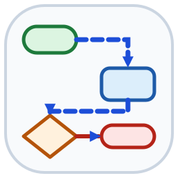
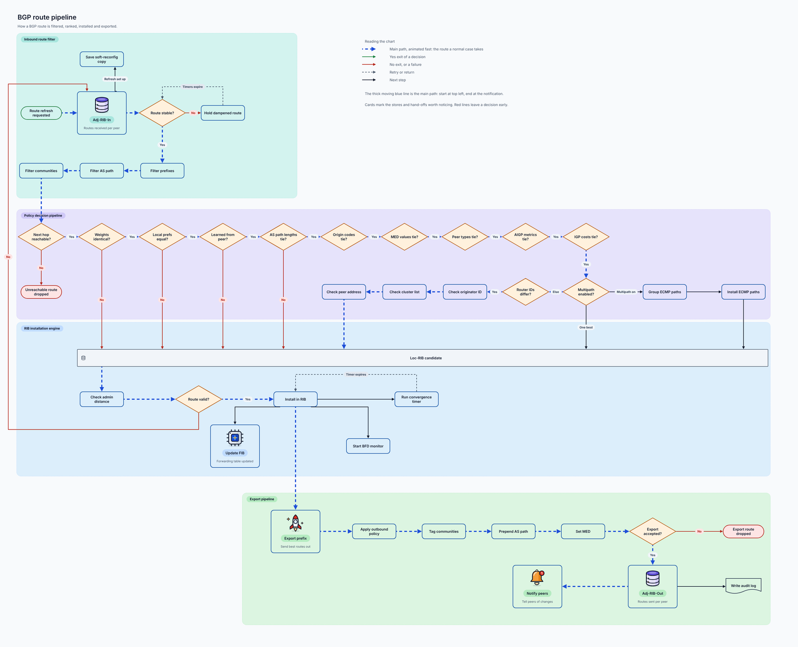
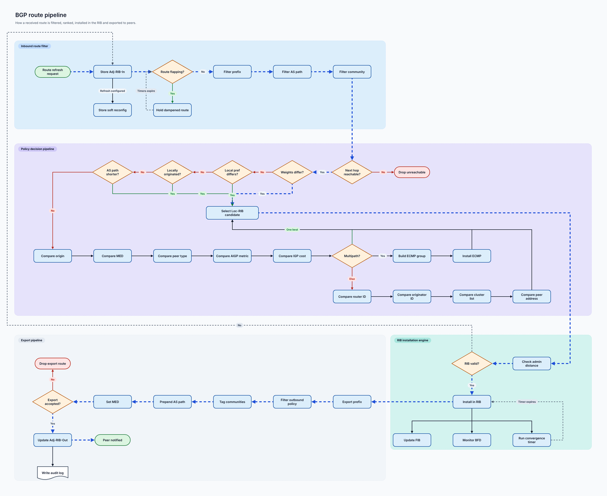
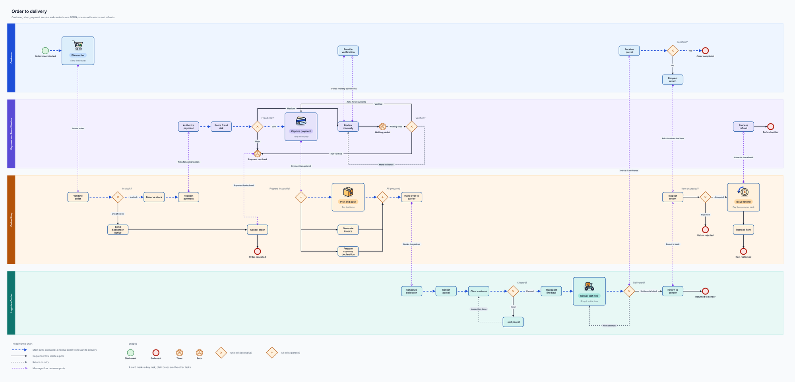
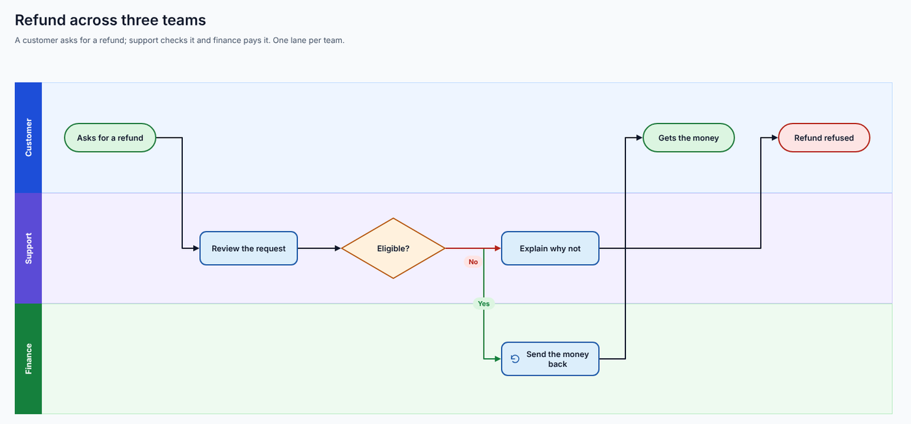

<p align="center">
  <a href="docs/assets/logo.svg"></a>
</p>

<h1 align="center">Flow</h1>

<p align="center"><b>AI plugins that draw diagrams as animated HTML/SVG or as editable <a href="https://www.drawio.com/">draw.io</a> files.</b><br>
Describe a diagram in plain language. Get a web page you can view and share, and a <code>.drawio</code> file you can keep editing.</p>

<p align="center">
  
  
  
  
  
  <a href="LICENSE"></a>
</p>

> **Status: first release (0.1.x).** It works end to end in Claude Code, but it is young: nothing has been tried in the draw.io editor, claude.ai, Cowork, Windows or Antigravity, and the layout of very large diagrams is still the weak point. See [what is not verified](#not-verified).

---

## Features

- **Text to diagram.** Say what you want ("how a customer pays and gets an order delivered") and Claude draws it.
- **Two outputs.** An HTML page with animated lines (the main path moves, data streams move slowly) and a native `.drawio` file, both from the same positions so they do not drift apart.
- **24 skills for 20+ diagram types.** Flowchart, sequence, ER, architecture, C4, cloud, state, BPMN, use case, class, DFD, screen flow, org chart, mind map, Gantt, roadmap, Kanban, layers, wireframe, concept, and editing of existing `.drawio` files.
- **Two ways to lay a diagram out.** Small diagrams: a short spec and an automatic layout, in seconds. Large or dense diagrams: `/flow:author`, where Claude lays the diagram out itself, looks at its own picture and improves it.
- **One design.** A shared palette, type, icons (40 flat, 97 detailed) and line roles for every type, in a plain and an illustrated style (cards with a name pill and a large icon).
- **Checks.** Overlaps, lines through boxes, covered labels and captions, lines on top of each other, crossings, text that does not fit.
- **Edit what you have.** Import a `.drawio` file, or change it in place with a checked list of operations (rename, move, resize, recolour, add, delete).
- **No dependencies.** Python 3.11+ and its standard library; nothing to `pip install`.

## What is inside

- **`plugins/flow/`**: the plugin. `skills/` (the 24 skills), `scripts/` (`flow.py`, `doctor.py`), `flowlib/` (layout, routing, renderers, checks, the author kit).
- **`docs/design/`**: the design of every diagram type, with 100+ pictures. **`docs/plugin/design.md`**: how the plugin is built and the decisions taken.
- **`examples/`**: a spec for every type. **`benchmarks/`**: 25 hard test briefs, a checker, and the first agent runs.

## Screenshots

Made by Claude with the plugin, from the benchmark briefs (one run each, not hand-tuned by a person).

### Flowchart, 43 steps, 4 groups (`/flow:author`, illustrated)

[](docs/screenshots/flowchart-illustrated.png)

### The same flowchart, plain

[](docs/screenshots/flowchart-plain.png)

### BPMN, 4 pools, 46 elements, 55 flows (`/flow:author`, illustrated)

[](docs/screenshots/bpmn-illustrated.png)

### Swimlane flowchart (automatic layout, `/flow:flowchart`)

[](docs/screenshots/swimlane.png)

## Quick start

```
/plugin marketplace add iamcaominhtien/flow
/plugin install flow@flow
/flow:doctor
```

Then ask:

```
/flow:flowchart how a customer pays and gets an order delivered
/flow:bpmn an order across customer, shop, payment service and carrier
/flow:author draw this process as a large illustrated flowchart: <your description>
```

Claude writes the files next to your spec: `<name>.html` (open it in any browser), `<name>.drawio` (open it in draw.io) and `<name>.scene.json`. Full steps, requirements and the Antigravity notes are in [INSTALL.md](INSTALL.md). To export PNG, SVG or PDF, also install the optional draw.io plugin: `/plugin marketplace add jgraph/drawio-mcp` and `/plugin install drawio@drawio`.

## Skills

| Skill | Draws |
| --- | --- |
| `/flow:flowchart` | Flowcharts, top to bottom or left to right, with swimlanes and an overrides file for fixes |
| `/flow:author` | Large or dense diagrams of any type: Claude lays the diagram out by hand in a script of its own, using a small kit that keeps the design, and looks at the result and improves it |
| `/flow:sequence` | Sequence diagrams: activation bars, fragments, notes, create and destroy |
| `/flow:er` | ER diagrams: tables, keys, crow's-foot cardinality |
| `/flow:architecture`, `/flow:cloud`, `/flow:c4` | Components in nested zones; cloud resources; C4 elements |
| `/flow:state`, `/flow:bpmn`, `/flow:usecase`, `/flow:class`, `/flow:dfd`, `/flow:screen-flow` | State, BPMN-style, use case, class, data flow and screen flow diagrams |
| `/flow:org-chart`, `/flow:mind-map` | Trees with a tidy layout (top down; left to right) |
| `/flow:gantt`, `/flow:roadmap` | Time axis in named periods; lanes of items |
| `/flow:kanban`, `/flow:layers`, `/flow:wireframe`, `/flow:concept` | Columns of cards (also a comparison); stacked bands; low-fidelity screens; a hub with parts around it |
| `/flow:explainer` | One idea taught to a newcomer: a journey through bands, a tree, a comparison or a concept with an analogy, or several on one page |
| `/flow:import-drawio` | Reads an existing `.drawio` file into a scene (best effort) |
| `/flow:edit-drawio` | Changes an existing `.drawio` file in place; the rest of the file stays as it was |
| `/flow:doctor` | Checks the install |

## Two ways to get a diagram

1. **Spec and `build`** (the type skills). Claude writes a short JSON spec; one automatic layout places the boxes, routes the lines, checks the result and writes both files. Quick, and good for small diagrams.
2. **`/flow:author`**. Claude writes a layout script for that diagram, using `flowlib/author.py` (`Canvas`), which keeps the design (shape sizes, ports, line roles and animation, lanes, legend, label placement, the check). Claude decides every position and route, looks at the picture, and changes the script. Better for large or dense diagrams.

Why both: on level C briefs the automatic layout gave pages up to about 10000 px wide and bundles of lines that the agent could not change, and the author path gave about 2500 x 2100 px for a 43-step flowchart. One run per row, not averages; see [the results](benchmarks/results/2026-10-26-author-path.md).

## Design system

The visual language is designed first, on a canvas of sample artboards, before any plugin code is written. The canvas currently lives outside this repository; the decisions it holds are written up in full, with pictures, in the **[design document](docs/design/README.md)**, and summarised here.

- **Foundation**: a flat pastel palette with ink outlines, Inter and JetBrains Mono, 12 px node radius, 2 px strokes.
- **Icons**: a flat set of 98 icons and a detailed set that has a twin for every one of them (shaded, with highlights and accents).
- **Line roles**: next step, yes / success, no / failure, return (dashed), one animated main path, and a slower animated data stream.
- **Two styles**: *plain* (shapes with text, optional small icon; the default) and *illustrated* (cards with a name pill, one line of explanation and a large icon, tinted by swimlane). Styles can be mixed in one diagram.
- **Per-type notation**: each diagram type gets its own rules page, patterns and complete examples, so a plugin can rely on written conventions instead of guessing.

| Diagram type | Design status |
| --- | --- |
| Screen flow | Done: rules, fidelity levels, conditions, tabs, overlays, devices, full examples |
| Flowchart | Done: rules, patterns, plain and illustrated examples, swimlane, complete delivery flow |
| Sequence | Done: rules, message kinds, fragments, basic example, complete delivery flow (plain and illustrated) |
| ER | Done: rules, notation, relationship patterns, blog example, complete delivery schema (plain and illustrated), splitting by domain |
| Architecture | Done: rules, notation, building-block patterns, web app example, complete delivery system, large streaming platform (plain and illustrated) |
| Explainer | Done: rules, four shapes (layers, tree, comparison, concept) and a complete card-payment explainer |
| Planning (Gantt, org chart, mind map, Kanban, roadmap) | Done: rules and an example of each; org chart and mind map also in an illustrated style, plus a large four-level mind map |
| UML (state machine, use case, class) | Done: rules and an example of each; use case also in an illustrated style |
| Wireframe | Done: rules, annotated phone flow, annotated desktop screen, responsive set, state set |
| BPMN | Done: rules, notation, basic example, advanced features, three-pool delivery, complex order-to-delivery case |
| C4 | Done: rules, level 1 context, level 2 containers, level 3 components (one delivery platform at three zooms) |
| Cloud | Done: rules, basic one-VPC app, delivery platform on two zones, network joining offices to the cloud |
| DFD | Done: rules, notation with forbidden connections, levels 0, 1 and 2 of the delivery system, plain and illustrated |
| Editing existing .drawio files | Not designed; built from the plugin design: import and edit (see the [plugin design](docs/plugin/design.md)) |

Cross-type review (done): the automatic overlap check covers every board; the lint tool now also knows the Gantt and swimlane frames; the same thing now has the same icon and tint everywhere (Payment provider, Orders database).

Animation in draw.io (checked in the draw.io viewer code, and by rendering a file with two edges): each edge has its own `flowAnimation=1`, `flowAnimationDuration` (default 500), `flowAnimationTimingFunction` and `flowAnimationDirection`. So the two tiers of the design work: main route `strokeWidth=3;flowAnimation=1;flowAnimationDuration=500`, event stream `strokeWidth=1;flowAnimation=1;flowAnimationDuration=1500`. The viewer adds the keyframes at render time and its SVG export writes them into the file. Still not tested: opening an exported SVG file on its own, and the PNG/PDF export (which cannot animate).

## Supported diagram types

Flow aims to cover **nearly every common diagram type**, grouped into 8 categories. Each category is delivered as a plugin (or a set of plugins).

| Category | Diagram types | Status |
| --- | --- | --- |
| Process & business | Flowchart, Swimlane / cross-functional, BPMN, User flow | Built (BPMN as a look, not the full standard) |
| UML behavior | Sequence, Use case, Activity, State machine | Built; activity is drawn with the flowchart skill |
| Structure & data | ER diagram, Class diagram, Data flow diagram (DFD) | Built |
| Architecture & infrastructure | Architecture, C4 model, Cloud (AWS / GCP / Azure), Network, Deployment | Built (network and deployment use the architecture or cloud skill; no provider icons) |
| Planning & management | Gantt, Org chart, Mind map, Roadmap / Kanban | Built |
| UI design | Wireframe / mockup | Built (a simple stack of boxes) |
| Explainer / infographic | Layered flow (icon-based tiers/lanes), Tree / hierarchy, Side-by-side comparison, Concept illustration | Built: layers, tree, comparison (through Kanban) and concept (hub and spokes) |
| Editing | Update or restyle existing `.drawio` files | Built: import (best effort) and an edit command with a fixed list of operations |

## Icons

The icon library is 40 flat line icons plus 97 detailed icons (23 of them are the detailed form of a flat one). You can also add your own flat icons: Claude writes `icons.local.json` next to the spec, and the build checks it before use. The illustrated style is partial: add `"style": "illustrated"` and boxes with an icon become cards (large icon on a disc, name pill, detail line) in the flowchart, architecture, cloud, C4, BPMN, use case, DFD, screen flow, Kanban and layers skills, in both outputs. Cards use the 97 detailed 64 px icons from the design when the icon has one; the per-type illustrated notation of the design pages is not built. BPMN has pools as swimlanes, timer, message and error events, exclusive and parallel gateways and message flows, but no boundary events, data objects or checks that a message crosses pools. Not built: the illustrated notation specific to ER, DFD, Kanban and the roadmap, and restyling a whole existing diagram. The types above are simpler than the design pages describe (for example no device frames, no provider icons). Nothing has been tested in the draw.io editor, in claude.ai or in Cowork, or on Windows.

## Roadmap

- [x] Design foundation, icon sets, Screen flow, Flowchart, Sequence, ER, Architecture, Explainer, Planning, UML, Wireframe, BPMN, C4, Cloud and DFD notation
- [x] Cross-type review and a first test of draw.io animated edges
- [x] Write the [design document](docs/design/README.md) (18 pages, 104 pictures)
- [ ] Design how plugins edit existing `.drawio` files
- [ ] Test an exported SVG with animated edges on its own
- [x] Plugin skeleton: marketplace, `flow` plugin, `doctor` skill, installs locally; the draw.io plugin is optional
- [x] Write the [plugin design](docs/plugin/design.md) (pipeline, spec, layout, renderers, checks)
- [x] Shared library: diagram description (JSON), one layout step, HTML/SVG renderer, checks, and the first skill (flowchart, top to bottom)
- [x] draw.io renderer from the same description (checked in the draw.io viewer; not yet in the editor)
- [x] Generate valid draw.io XML from a text prompt (flowchart, sequence, ER, architecture, state)
- [x] First plugins: flowchart, sequence, ER, architecture, state
- [x] Expand to the remaining categories above (simplified; see the table)
- [x] Support editing existing `.drawio` files (`flow.py edit` with a fixed list of operations; no layout)
- [x] Author kit and `/flow:author` for large or dense diagrams; swimlanes as in the design; folding of long charts
- [x] Documentation: [INSTALL.md](INSTALL.md), [plugin design](docs/plugin/design.md), first benchmark runs
- [ ] Author-path runs for the other diagram types and levels
- [ ] Try the plugin in the draw.io editor, claude.ai, Cowork, Windows and Antigravity
- [ ] Publish to a plugin directory

## Benchmarks

`benchmarks/` holds 25 test briefs (8 diagram types, 3 sizes each, and a second level C BPMN brief) taken from public subjects, and a checker for them. See [benchmarks/README.md](benchmarks/README.md). A few level C briefs have been run by blind agents; the results, including what is still weak, are in `benchmarks/results/2026-10-26-author-path.md`.

### Not verified

- Nothing has been opened in the draw.io editor or desktop app; PNG, SVG and PDF export is untested.
- claude.ai, Cowork, Windows (the command may need `python`) and Google Antigravity: not tested.
- Text width is estimated, not measured.
- The author path needs a way to look at the picture (a headless browser); one agent run per row; other models and types not run.
- The type pages are simpler than the design pages (no device frames, no provider icons).

## Contributing

The project is just getting started. Ideas and issues are welcome; contribution guidelines will follow.

Python code is checked with [ruff](https://docs.astral.sh/ruff/) and tested with pytest (`pip install ruff pytest`; run `python3 -m pytest`; settings in `pyproject.toml`; the `docs/` folder is skipped):

```
ruff format .
ruff check .
```

A Claude Code hook in `.claude/settings.json` runs both on every Python file Claude edits, and reports any error ruff cannot fix.

## License

Released under the [MIT License](LICENSE).
