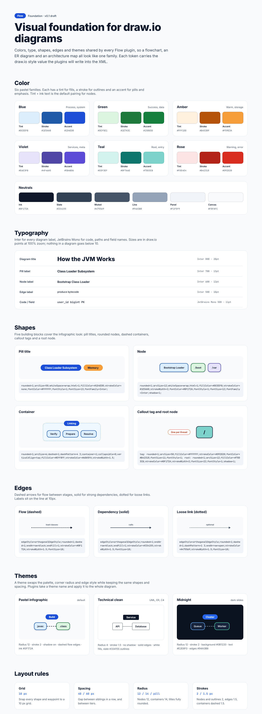
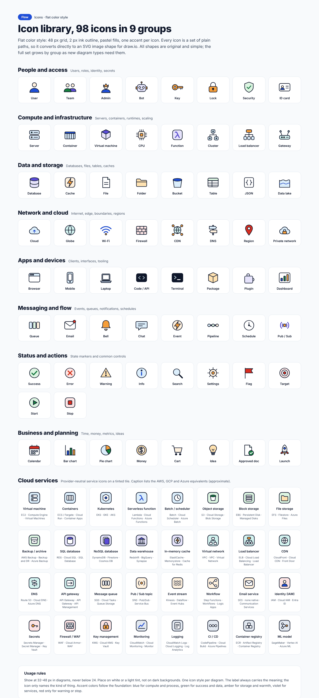
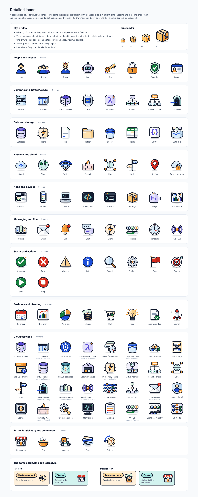
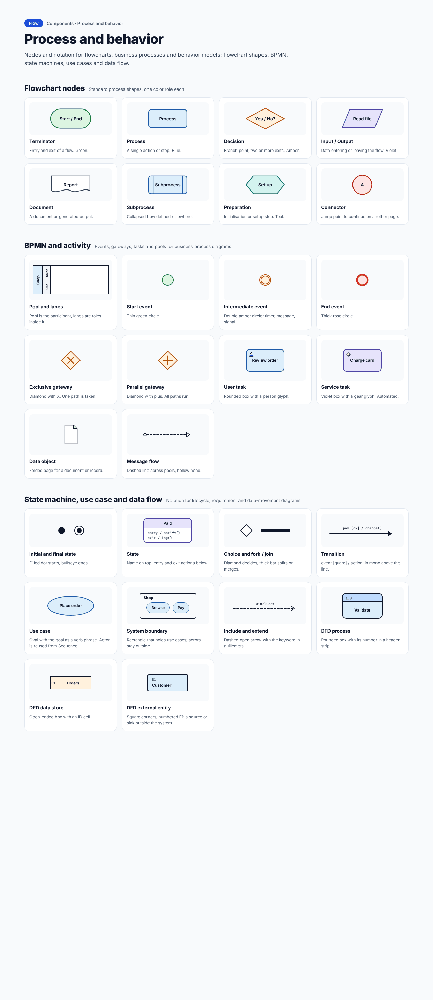
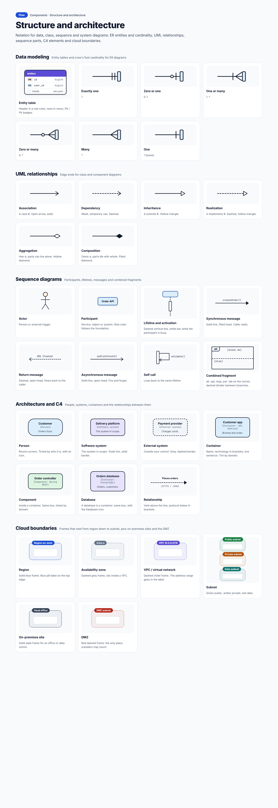
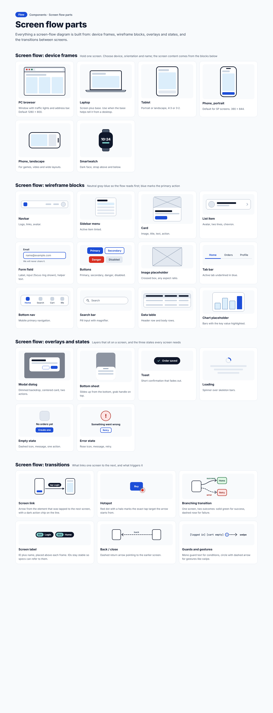
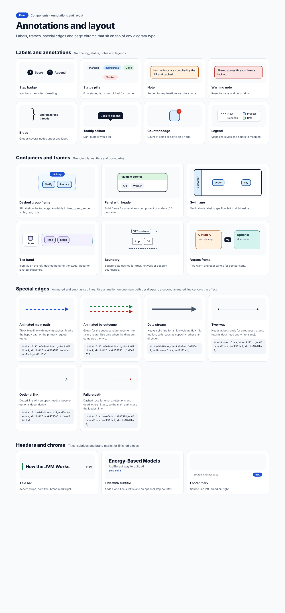
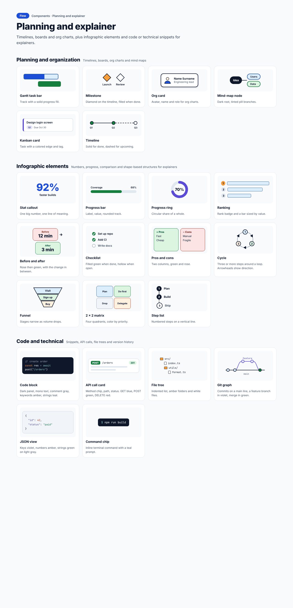
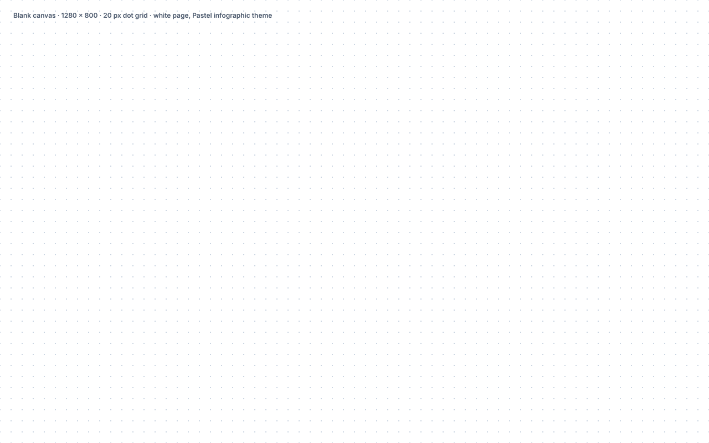

# Foundations

Everything in this page is shared by all diagram types. A type page only describes what is *different* about that type; if a rule is not repeated there, it is the rule given here.

The visual foundation was drawn first, before any type: the palette, the type scale, the basic shapes, edges and themes, and the two icon sets.

*The foundation board: colour families, neutrals, type scale, shapes, edges, themes and layout rules. [Full size](images/Main.png) · [HTML source](source/html/Main.html)*

## 1. Colour

### 1.1 Six families and the neutrals

Colour in Flow is deliberately quiet. There are six pastel families. Each family has a **tint** (used to fill a shape), a **stroke** (outline) and an **accent** (pills and emphasis). Ink text on a tint is the default pairing for a node.

| Family | Tint | Stroke | Accent | Typical meaning |
| --- | --- | --- | --- | --- |
| Blue | `#DCEEFB` | `#1E5AA8` | `#1D4ED8` | Process, system, the customer |
| Green | `#DCF5E1` | `#1E7A3C` | `#15803D` | Success, data, start, the restaurant |
| Amber | `#FFF1DD` | `#B45309` | `#F59E3A` | Decision, storage, money, warmth |
| Violet | `#E6E3FB` | `#4F46A5` | `#5B4BD6` | Services, meta, orders and documents |
| Teal | `#D3F3EF` | `#0F766E` | `#7DD3CB` | Root, entry, the courier |
| Rose | `#FDE4E4` | `#B42318` | `#D92D20` | Warning, error, failure |

Neutrals: ink `#0F172A`, slate `#334155`, muted `#475569`, line `#94A3B8`, panel `#F1F5F9`, canvas `#F8FAFC`.

### 1.2 Tones: colour groups, never meaning

Beyond the six families, the diagrams use a smaller set of **tones**, each a pair of a box tint and a darker pill tint:

| Tone | Box tint | Pill tint |
| --- | --- | --- |
| blue | `#DCEEFB` | `#BFDBFE` |
| violet | `#E6E3FB` | `#CFC8F7` |
| amber | `#FFF1DD` | `#FFD9A3` |
| green | `#DCF5E1` | `#B5EBC1` |
| teal | `#D3F3EF` | `#A8E6DE` |
| gray | `#F1F5F9` | `#E2E8F0` |

**The rule that matters most:** a tone groups things by *domain or owner*, and it never carries a meaning by itself. In the delivery examples:

| Tone | Used for |
| --- | --- |
| blue | The customer and everything the customer touches |
| green | The restaurant and its catalogue |
| teal | The courier and delivery |
| violet | The order domain: the order service, the orders database, the gateway |
| amber | Payment, money, and the event bus |
| gray | Third parties and outside systems |

So "Courier is teal everywhere" is a rule, not a coincidence. A reader who has learned that teal means the courier on one page can use it on every page.

Rose, green and blue are also used for *roles of lines* (failure, success, main path). That is deliberate and does not clash: line colours appear only on lines, tones only on boxes.

## 2. Typography

Inter for every label, JetBrains Mono for code, paths, field names, guards and ids. Nothing in a diagram is smaller than 10 points at 100 % zoom.

| Use | Sample | Specification |
| --- | --- | --- |
| Diagram title | How the JVM Works | Inter 800, 20 pt |
| Pill label | Class Loader Subsystem | Inter 700, 13 pt |
| Node label | Bootstrap Class Loader | Inter 600, 12 pt |
| Edge label | produce bytecode | Inter 500, 10 pt |
| Code or field | `user_id  bigint  PK` | JetBrains Mono 500, 11 pt |

## 3. Building blocks and their draw.io styles

Five blocks cover the whole infographic look. Each carries the draw.io style a plugin will write, so the canvas and the real diagram stay in step.

| Block | Purpose | draw.io style |
| --- | --- | --- |
| Pill title | A heading or label on a frame | `rounded=1;arcSize=50;whiteSpace=wrap;html=1;fillColor=#1D4ED8;strokeColor=none;fontColor=#FFFFFF;fontStyle=1;fontSize=13;fontFamily=Inter;` |
| Node | A rounded box with a tint | `rounded=1;arcSize=12;whiteSpace=wrap;html=1;fillColor=#DCEEFB;strokeColor=#1E5AA8;strokeWidth=2;fontColor=#0F172A;fontStyle=1;fontSize=12;fontFamily=Inter;shadow=1;` |
| Container | A dashed frame that holds nodes | `rounded=1;arcSize=6;dashed=1;dashPattern=4 3;container=1;collapsible=0;verticalAlign=top;fillColor=#EFF8FF;strokeColor=#60A5FA;strokeWidth=1.5;` |
| Callout tag | A small outlined remark | `rounded=1;arcSize=50;fillColor=#FFFFFF;strokeColor=#D92D20;fontColor=#B42318;fontSize=11;fontStyle=1;` |
| Root node | The one important node of a diagram | `rounded=1;arcSize=12;fillColor=#7DD3CB;strokeColor=#0F172A;strokeWidth=2;fontSize=22;fontStyle=1;shadow=1;` |

Three base **edge styles** sit under the line roles of §6. Labels sit on the line at 10 pt.

| Edge | Use | draw.io style |
| --- | --- | --- |
| **Flow** (dashed) | Flow between stages | `edgeStyle=orthogonalEdgeStyle;rounded=1;dashed=1;endArrow=block;endFill=1;strokeColor=#0F172A;strokeWidth=1.5;fontSize=10;` |
| **Dependency** (solid) | A strong dependency | `edgeStyle=orthogonalEdgeStyle;rounded=1;endArrow=block;endFill=1;strokeColor=#334155;strokeWidth=1.5;fontSize=10;` |
| **Loose link** (dotted) | An optional or weak link | `edgeStyle=orthogonalEdgeStyle;rounded=1;dashed=1;dashPattern=1 3;endArrow=open;strokeColor=#475569;strokeWidth=1.5;fontSize=10;` |

Layout rules shared by all types:

| Rule | Value | Meaning |
| --- | --- | --- |
| Grid | 10 px | Snap every shape and waypoint to a 10 px grid. |
| Spacing | 40 / 60 px | Gap between siblings in a row, and between tiers. |
| Radius | 12 / 14 / pill | Nodes 12, containers 14, titles fully rounded. |
| Strokes | 2 / 1.5 px | Nodes and outlines 2, edges 1.5, containers dashed 1.5. |

The type pages use larger gaps where lines carry labels (see §6).

## 4. The two icon sets

Icons name the *kind* of a thing. The label always carries the meaning; an icon never replaces text.

### 4.1 Flat icons

A 48 px grid, a 2 px ink outline, pastel fills and one accent per icon. Every icon is a set of plain paths, so it converts directly to an SVG image shape in draw.io. Shown at 32 to 48 px in diagrams, never below 24 px, on white or a light tint.

*The flat icon library, nine groups. [Full size](images/Icons.png) · [HTML source](source/html/Icons.html)*

The nine groups: people and access, compute and infrastructure, data and storage, network and cloud, apps and devices, messaging and flow, status and actions, business and planning, and cloud services (32 icons that mirror the managed services of the big clouds: Kubernetes, SQL database, Message queue, Firewall / WAF, Identity (IAM) and so on).

### 4.2 Detailed icons (illustrated style)

A second style for the illustrated mode. The same subjects as the flat set, with a shaded side, a highlight, small accents and a soft ground shadow, in the same palette. Every flat icon has a detailed twin with the same name (88 drawings; cloud service icons that match a generic icon reuse it).

*The detailed icon library. [Full size](images/Icons_Detailed.png) · [HTML source](source/html/Icons_Detailed.html)*

Style rules for the detailed set: a 64 px grid, a 2.5 px ink outline with round joins, three tones per object (base, a darker shade on the side away from the light, a white highlight stroke), one or two small accents in palette colours, and a ground shadow under each object. Readable at 56 px.

### 4.3 Choosing an icon

Choose by the noun: *Card* for a payment, *Cart* for an order, *Database* for a database. One icon per node, and the same icon for the same thing everywhere. When an icon exists in both sets, use the detailed one in illustrated mode and the flat one in plain mode; the name is the same.

## 5. Components library

The **Components** pages are the building-block kit the type pages were assembled from: flowchart nodes, BPMN and activity shapes, state-machine and use-case shapes, ER tables and cardinality ends, UML edge ends, sequence parts, C4 elements, cloud frames, screen-flow device frames and wireframe blocks, annotations and special edges, planning and infographic elements.

*Components: process and behavior. [Full size](images/Components_Process.png) · [HTML source](source/html/Components_Process.html)*

*Components: structure and architecture. [Full size](images/Components_Structure.png) · [HTML source](source/html/Components_Structure.html)*

*Components: screen flow parts. [Full size](images/Components_ScreenFlow.png) · [HTML source](source/html/Components_ScreenFlow.html)*

*Components: annotations and layout. [Full size](images/Components_Annotations.png) · [HTML source](source/html/Components_Annotations.html)*

*Components: planning and explainer. [Full size](images/Components_Planning.png) · [HTML source](source/html/Components_Planning.html)*

The Components pages were drawn first, as a general kit. Where a later type page made a decision that differs, **the type page is the authority**. The DFD, C4 and cloud-frame entries on the Components pages were realigned with their type pages during the final review; the remaining pages may still differ in small details (see [Open items](15-open-items.md)).

## 6. Line roles and animation

### 6.1 The roles

Every line in every diagram has one of a small set of roles. The role decides colour, weight and dash.

| Role | Colour | Weight | Dash | Meaning |
| --- | --- | --- | --- | --- |
| Next | ink `#0F172A` | 2 | solid | The ordinary next step, call or link |
| Yes / success | green `#15803D` | 2 | solid | The success branch |
| No / failure | rose `#B42318` | 2 | solid | The failure branch |
| Back / return | slate `#475569` | 2 | dashed | A return, retry, loop or dismiss |
| Main path | blue `#1D4ED8` | 4 | animated | The one route the diagram is about |
| Data / event stream | violet `#7C3AED` | 2 | animated slowly | Messages, events and live data |

The weights in this table are the weights on the canvas, in pixels. The base edge styles above use a stroke width of 1.5, and the animation recipe in §6.3 uses 3 and 1, so **the mapping from canvas weight to draw.io `strokeWidth` is not yet fixed** (see [Open items](15-open-items.md)).

Arrowheads are always filled (an open head is used only where a notation demands it, such as an asynchronous message). A line leaves the middle of an edge and enters the middle of the next. A label sits on a pill beside or on the line, never across a shape.

### 6.2 One main path

The animated blue line marks **the one route that matters**: the happy path, the primary request, an order from the phone to the card network. There is exactly one per diagram. A second animated blue line cancels the effect, because the eye no longer knows where to look.

The violet line is a **second tier**, thin and slow, for something that flows alongside the main story: an event stream, a stream of live positions, a status that is only reported. It never competes with the main path.

Everything else is static. Animation is off when the viewer prefers reduced motion.

Some types do not animate at all: a mind map has no order to follow, a use case or class diagram has no path, and a wireframe is a still.

### 6.3 Animation in draw.io

This was an open question and has been checked. In draw.io, each edge has its own animation settings, so the two tiers can run at different speeds on one page:

| Style key | Meaning | Default |
| --- | --- | --- |
| `flowAnimation=1` | Turn the moving dashes on for this edge | off |
| `flowAnimationDuration` | Duration in milliseconds. Larger is slower. | 500 |
| `flowAnimationTimingFunction` | `linear`, `ease`, `ease-in`, `ease-out`, `ease-in-out` | `linear` |
| `flowAnimationDirection` | `normal`, `reverse`, `alternate`, `alternate-reverse` | `normal` |

The recipe the plugins will use:

| Tier | Style |
| --- | --- |
| Main route | `strokeWidth=3;strokeColor=#1D4ED8;flowAnimation=1;flowAnimationDuration=500;` |
| Event stream | `strokeWidth=1;strokeColor=#7C3AED;flowAnimation=1;flowAnimationDuration=1500;` |

How it was checked: the draw.io viewer's source reads these keys per edge and writes a CSS animation onto the edge's SVG path, with the keyframes added to the page; its SVG export writes the same keyframes into the file. A test file with two edges (duration 500 and 1500) was rendered in the real viewer in a headless browser, and the two edges ran at the two speeds at the same time.

**Not tested yet:** opening an *exported* SVG file on its own, and PNG or PDF export, which cannot move.

## 7. The two styles

| | Plain | Illustrated |
| --- | --- | --- |
| Look | Shapes with text and, optionally, a small flat icon | Cards with a name pill, one line of explanation and a large detailed icon |
| Use for | Drafts, technical documents, anything that will change often | Readers outside the team, a title slide, steps people must notice |
| Default | Yes | No |
| What changes | Size of boxes and spacing | The same: lines, labels, frames, tints and rules are identical |

A diagram changes style by changing the box size and the spacing, never the rules. Styles can be mixed inside one diagram when the author asks, as fidelity levels are mixed in a screen flow.

Types that are **plain only**: Gantt and Kanban (large icons would add noise to dense charts), wireframes (an illustrated wireframe would defeat the purpose), BPMN (the shapes are the standard), and the explainer, which is **always illustrated**.

## 8. Spacing, in one place

The numbers differ by type, but the principles are the same everywhere:

- **Room for a label.** Where a line carries a label, leave at least 240 px between the edges of the two boxes it joins (90 px of free line for the label itself). Where it carries none, 96 to 120 px is enough.
- **A label never touches a border.** If it does, widen the gap; do not shrink the label.
- **Boxes in a row share a centre line.** Boxes in a column share a centre line too.
- **Frames nest with 30 px** between an outer and an inner edge, and a part sits in the smallest frame that holds it.
- **A part keeps its size** in every diagram of a type. Never shrink one to make room.
- **About a dozen parts per diagram** for most types. Past fifteen or so, split.

## 9. Naming and consistency

- Name things by **role in the team's words** (*Order service*, *Orders database*), not by product. The product goes in the detail line (*PostgreSQL*).
- The same thing keeps the same name, tone and icon across all diagram types.
- A node's text is a verb and a noun for an action (*Check stock*), a noun for a thing (*Orders*), a question for a decision (*In stock?*).
- Numbers and ids follow one scheme per type (S12 for screens, E1 / 1.0 / D1 for DFD) and are never reused.

## 10. Quality checks

Three automatic checks run before a board is published. They exist because a person scanning a canvas does not see every overlap.

1. **Board overlap.** No two boards on a page overlap, and no section title sits on top of a board.
2. **Clipping.** The content of a board never runs past the board's own frame (a board whose last card was cut off was found and fixed this way).
3. **Lint for borders.** A label, an icon or a small shape never straddles a frame border or sits on a divider (a pool border, a lane divider, a fragment frame). Frames and dividers mark themselves for the check. This found nine real defects in the BPMN and sequence examples.

A fourth check is by eye: every board is looked at in a rendered screenshot before it is published.

## 11. The canvas

The design canvas has 16 pages (foundation, components, icons and the thirteen types) and 104 boards. Each type page has the same shape: section titles, a **Rules** board first, then notation, then examples ordered from small to complete.

*The blank canvas: 1280 × 800, 20 px dot grid, white page, pastel infographic theme. [Full size](images/Canvas.png) · [HTML source](source/html/Canvas.html)*

A blank canvas is 1280 × 800 on a 20 px dot grid with a white page in the Pastel infographic theme. Themes swap the palette, corner radius and edge style while keeping the same shapes and spacing: *Pastel infographic* (the default: radius 12, stroke 2, shadow on, dashed flow edges), *Technical clean* (for UML, ER and C4: radius 4, stroke 1.5, no shadow, solid edges) and *Midnight* (dark slides: radius 12, stroke 2, background `#0B1220`).
