# Screen flow

## At a glance

| | |
| --- | --- |
| **Question it answers** | How does a person move between the screens of an app or site? |
| **Use it when** | Planning or documenting navigation: what screens exist, what the user does to get from one to the next, what happens on failure, and where the app can be entered |
| **Do not use it when** | You need what is *inside* a screen (use a [wireframe](10-wireframe.md)) or the steps of a business process (use a [flowchart](03-flowchart.md) or [BPMN](11-bpmn.md)) |
| **Styles** | One style, drawn at four **fidelity levels** (L0 to L3) that can be mixed in one diagram |
| **Boards** | 18, in five groups: reference, fidelity levels, examples and variants, navigation patterns, complete flows |

A screen flow is the first diagram type that was designed, and it set several habits that the later types inherited: ids on everything, one animated main path, a green and rose pair for success and failure, and the idea of raising and lowering the amount of detail without redrawing.

## 1. How to read one

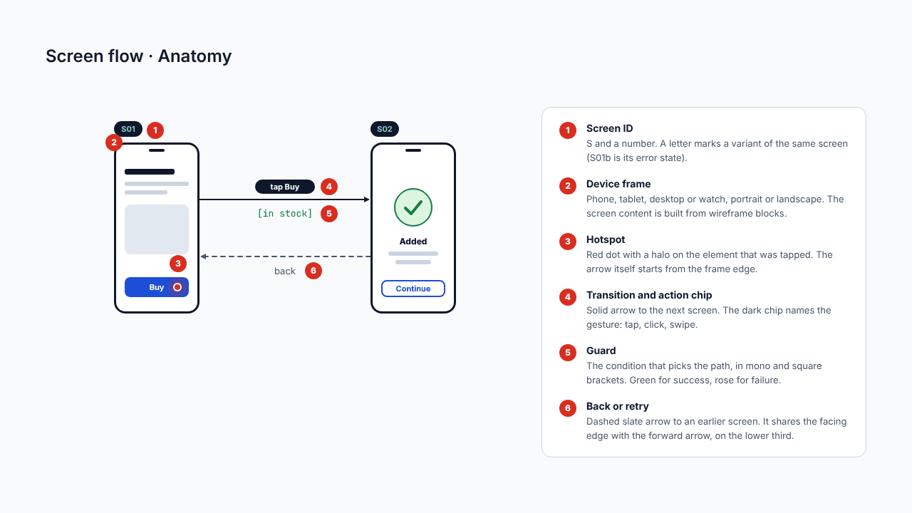

*Anatomy of a screen flow: id, device frame, hotspot, transition chip, guard and back arrow. [Full size](images/ScreenFlow_Anatomy.png) · [HTML source](source/html/ScreenFlow_Anatomy.html)*

1. **Screen id.** `S` and a number (S01). A letter marks a variant of the same screen: `S01b` is its error state.
2. **Device frame.** The screen is drawn inside the frame of the device it exists on: phone, tablet, desktop, watch, portrait or landscape. The frame *is* the platform statement, so there are no "SP" or "PC" badges.
3. **Hotspot.** A red dot with a halo marks the element that was tapped. The arrow itself starts from the frame edge, not from the dot.
4. **Transition.** A solid arrow to the next screen. A dark chip names what the user did (tap, click, swipe).
5. **Guard.** The condition that decides the path, in mono and square brackets. Green on the success path, rose on failure.
6. **Back or retry.** A dashed slate arrow to an earlier screen, on the lower third of the facing edges so it does not overlap the forward arrow.

## 2. The ideas behind the conventions

### 2.1 Every arrow carries up to three things: trigger, guard, effect

An arrow is written `trigger [guard] / effect`, for example `tap Login [valid] / save token`.

- The **trigger** is a chip. It is *dark* for something the user does (a verb plus a target: tap Login, click product, swipe left) and *slate with an icon* for something the system does: a clock for time, a bolt for an event, a shield for permission, a cloud for an API result, a phone for a device action.
- The **guard** says which exit is taken, so a decision never needs its own box unless several arrows share it.
- The **effect** is optional and tells what happens on the way (save, request, clear).

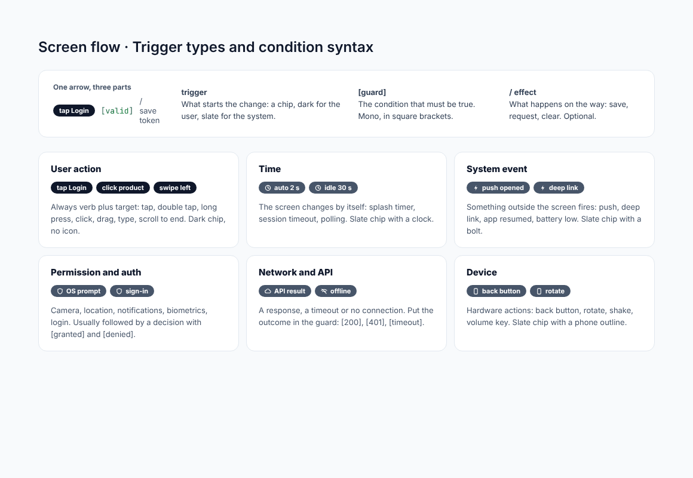

*Trigger types and condition syntax. [Full size](images/ScreenFlow_Triggers.png) · [HTML source](source/html/ScreenFlow_Triggers.html)*

Why: dark and slate chips let a reader see at a glance whether the person or the system moves the flow forward. A long flow of slate chips is a flow the user cannot control, which is itself a design smell.

### 2.2 Short conditions go on the arrow, long ones go in a table

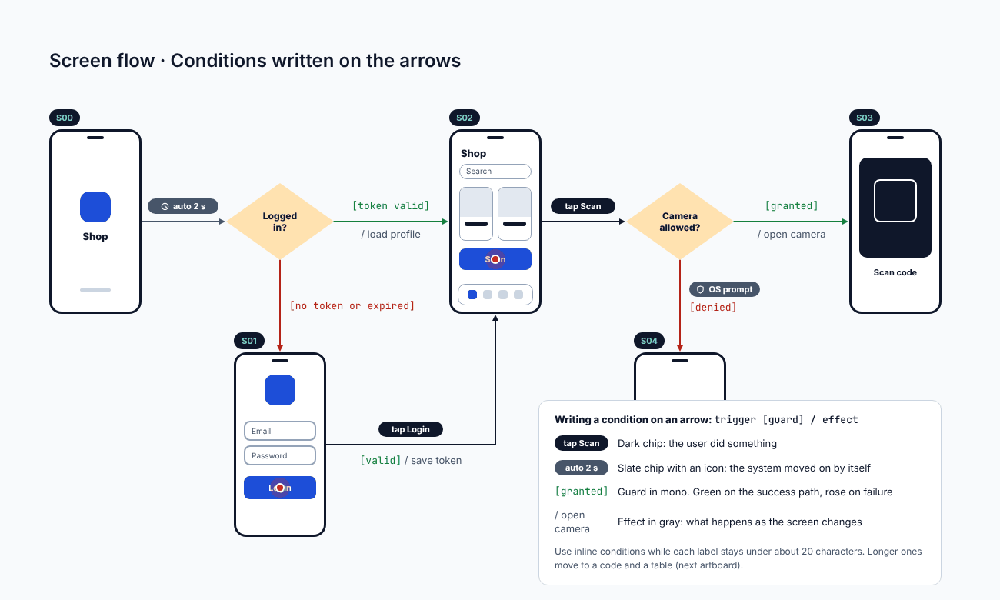

*Conditions written on the arrows. [Full size](images/ScreenFlow_Cond_Inline.png) · [HTML source](source/html/ScreenFlow_Cond_Inline.html)*

While a label stays under about 20 characters it is written on the arrow. Longer conditions, or conditions shared by several arrows, get a short code (C1, C2) on the arrow and the full text in a table next to the diagram.

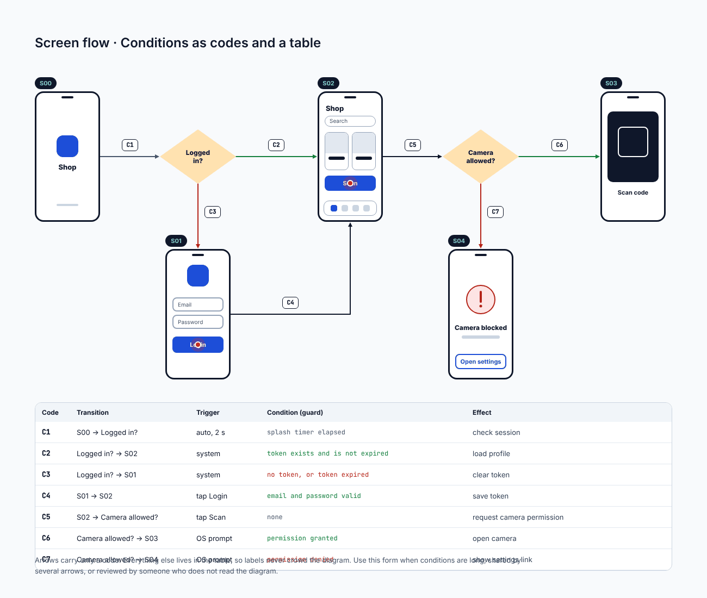

*Conditions as codes and a table. [Full size](images/ScreenFlow_Cond_Coded.png) · [HTML source](source/html/ScreenFlow_Cond_Coded.html)*

Why: the diagram stays readable, and a reviewer who does not read diagrams can read the table.

### 2.3 Fidelity levels: more detail without moving an arrow

A designer rarely knows every screen at the same level at the same time. The four levels let each screen be drawn as far as it has been decided:

| Level | What is drawn | Meaning |
| --- | --- | --- |
| **L0** | A rounded card with id and name | Nothing on the screen is decided |
| **L1** | A real device frame with identical generic content and "content TBD" | The screen exists as a screen; nothing on it is promised |
| **L2** | Only the elements that cause a transition are drawn and named; everything else is hatched | The navigation is decided, the layout is not |
| **L3** | A full [wireframe](10-wireframe.md) from the wireframe blocks | Everything is decided |

Every level has the **same width and the same centre line**, so raising a screen from L1 to L2 never moves an arrow. Something still undecided is a dashed card with a TBD tag and a dashed arrow into it.

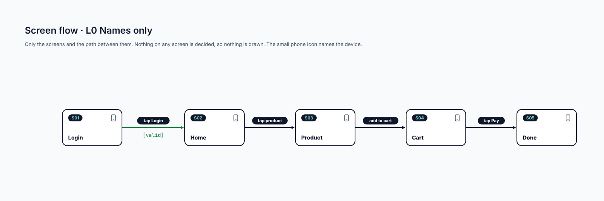

*Fidelity L0: names only. [Full size](images/ScreenFlow_L0_Names.png) · [HTML source](source/html/ScreenFlow_L0_Names.html)*

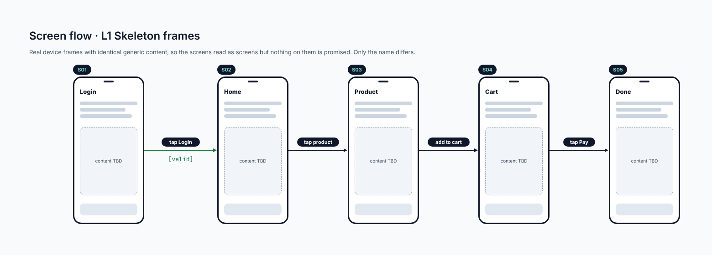

*Fidelity L1: skeleton frames. [Full size](images/ScreenFlow_L1_Skeleton.png) · [HTML source](source/html/ScreenFlow_L1_Skeleton.html)*

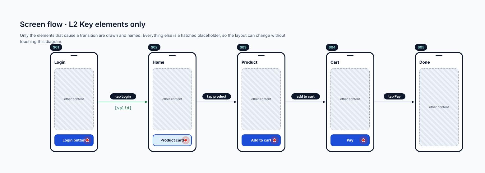

*Fidelity L2: key elements. [Full size](images/ScreenFlow_L2_KeyElements.png) · [HTML source](source/html/ScreenFlow_L2_KeyElements.html)*

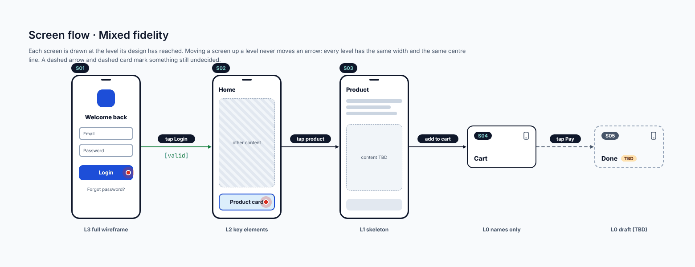

*Mixed fidelity: each screen at the level its design has reached. [Full size](images/ScreenFlow_Mixed.png) · [HTML source](source/html/ScreenFlow_Mixed.html)*

No default level has been chosen; the plugin should ask, or pick the level that matches the stage of the design.

### 2.4 Platforms are shown by drawing the frame

A screen that exists on a phone is drawn in a phone frame; one that exists on the web is drawn in a browser frame. A web flow is its own zone below the app flow and shows its own path, so differences (a one-page checkout, a header menu instead of a tab bar) are visible as *structure*. The same action uses the matching verb: tap on touch, click on desktop. Ids follow the same scheme with a `W` prefix for web (W01, W02).

The phone version walks one task end to end: S01 Welcome back (login), S02 the shop home, S03 a product (a linen shirt, with Add to cart), S04 the cart with its total and Pay, S05 order complete, plus S01b, the login screen in its error state, reached by a failed login and left by retry. The red dot marks each tapped element.

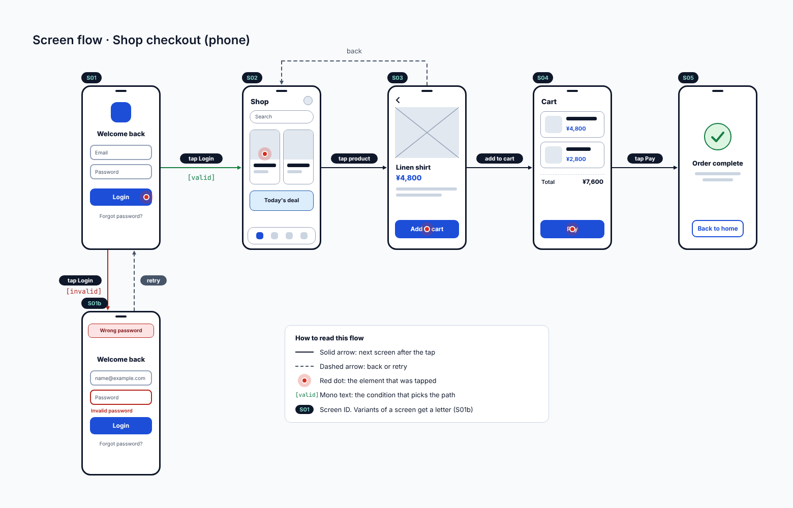

*The shop checkout on a phone. [Full size](images/ScreenFlow_Shop_SP.png) · [HTML source](source/html/ScreenFlow_Shop_SP.html)*

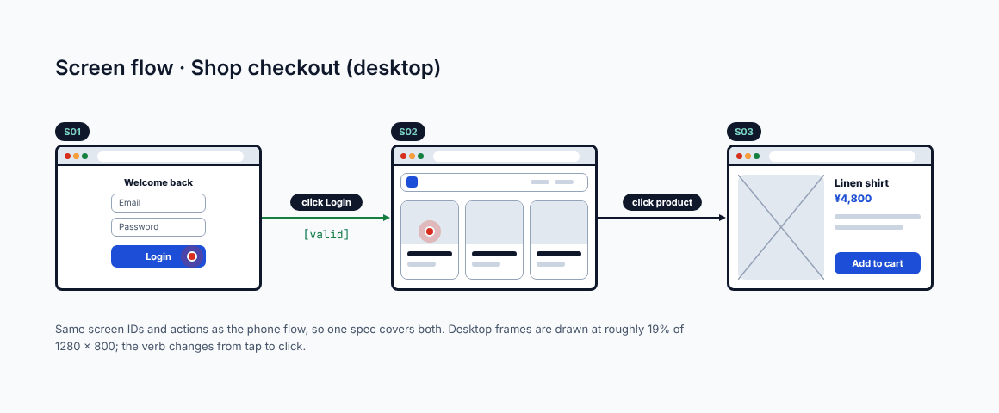

*The same checkout on desktop, with the same ids and actions. [Full size](images/ScreenFlow_Shop_PC.png) · [HTML source](source/html/ScreenFlow_Shop_PC.html)*

### 2.5 Devices and orientation

Rotating a phone changes the screen but not the place in the app, so it is a transition between two frames *of the same id*. A tablet in landscape often shows two panes where portrait needs two screens for the same action; there, the structure differs per orientation and the second form gets its own id.

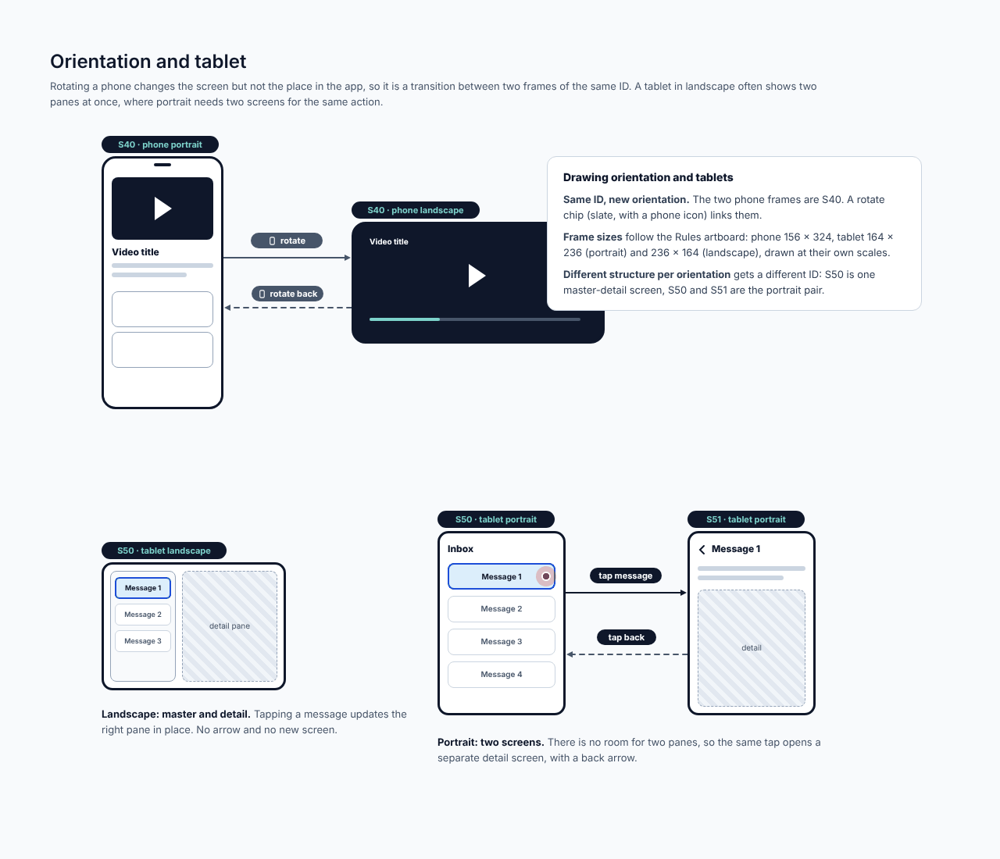

*Orientation and tablet. [Full size](images/ScreenFlow_Devices.png) · [HTML source](source/html/ScreenFlow_Devices.html)*

Frame sizes (drawn at roughly the scale shown):

| Device | Real size | Drawn at |
| --- | --- | --- |
| Phone, portrait | 390 × 844 | 156 × 324 |
| Phone, landscape | 844 × 390 | 324 × 156 |
| Tablet, portrait | 820 × 1180 | 164 × 236 |
| Tablet, landscape | 1180 × 820 | 236 × 164 |
| Desktop browser | 1280 × 800 | 240 × 170 |
| Smartwatch face | about 200 × 240 | 80 × 96 |

## 3. Navigation and structure patterns

These boards show the patterns that recur in almost every app. A plugin should pick one rather than invent a layout.

### 3.1 States of one screen

Loading, data, empty and error are not four screens; they are four states of one screen and share its id (written `S31 · loading`). Loading is the hub: every state is reached from it, and refresh or retry returns to it.

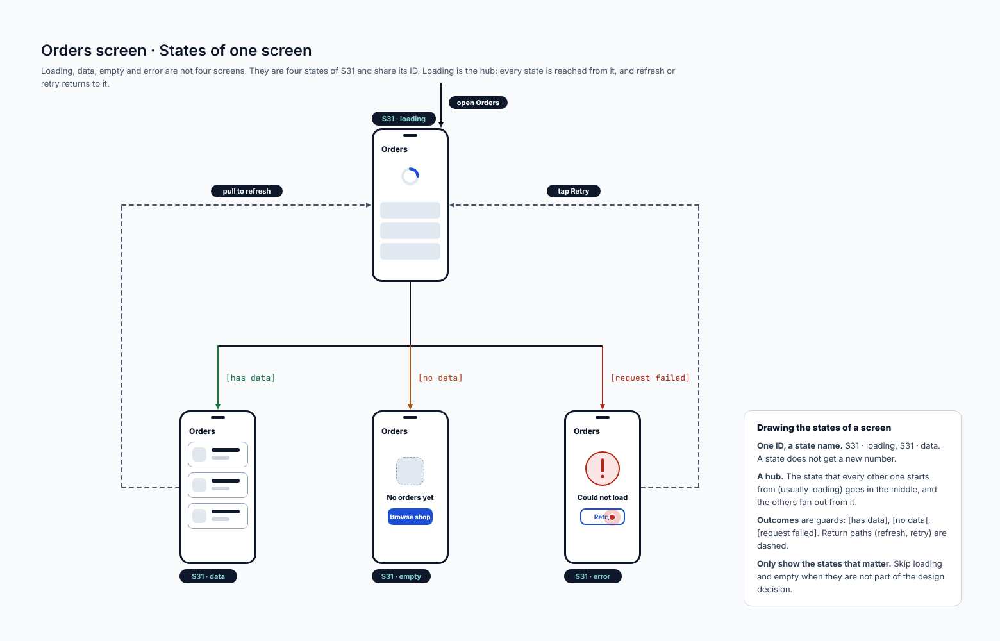

*States of one screen. [Full size](images/ScreenFlow_States.png) · [HTML source](source/html/ScreenFlow_States.html)*

### 3.2 Tab navigation

A tab bar lets the user jump between any two tabs. Drawing every pair of arrows would need a dozen lines, so the bar is drawn **once as a bus**: one line into all four tabs. Each tab then has its own stack of screens, and screens that hide the bar sit outside the tab zone.

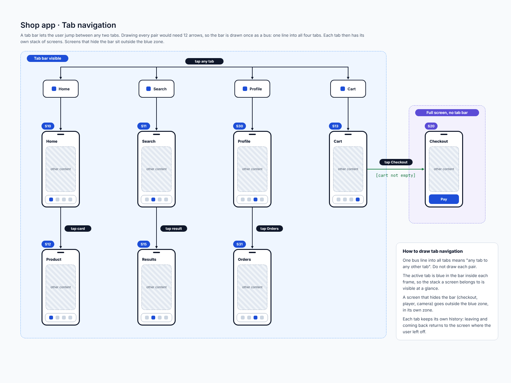

*Tab navigation. [Full size](images/ScreenFlow_Tabs.png) · [HTML source](source/html/ScreenFlow_Tabs.html)*

### 3.3 Overlays

Modals, bottom sheets and toasts are drawn on the screen they cover, not as screens of their own. Closing one returns to the same screen, so every path ends back where it started (S12 in the example). An overlay gets its own number only when it has onward transitions of its own.

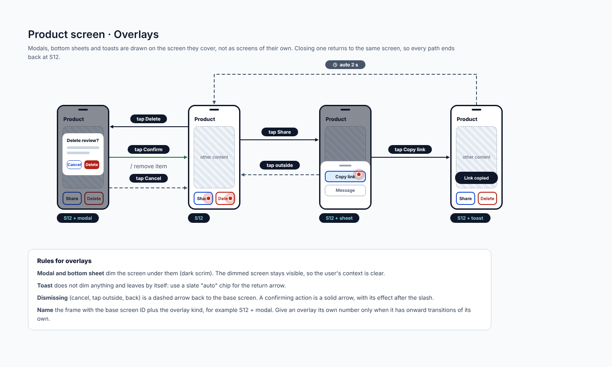

*Overlays. [Full size](images/ScreenFlow_Overlays.png) · [HTML source](source/html/ScreenFlow_Overlays.html)*

### 3.4 Entry points and links

An app is rarely entered from one place. Each way in is a **green pill in a left column** and runs into the flow at the screen it opens, which may skip the screens a cold start passes through. In the example the app icon (cold start) opens the splash screen S00, a push about a shipped order opens the order detail S31, and a deep link opens a product S12; each checks "has session?" before it goes on. **Flags** at the edge ("From Auth flow", "To Checkout flow") point to another diagram by name and number instead of repeating it.

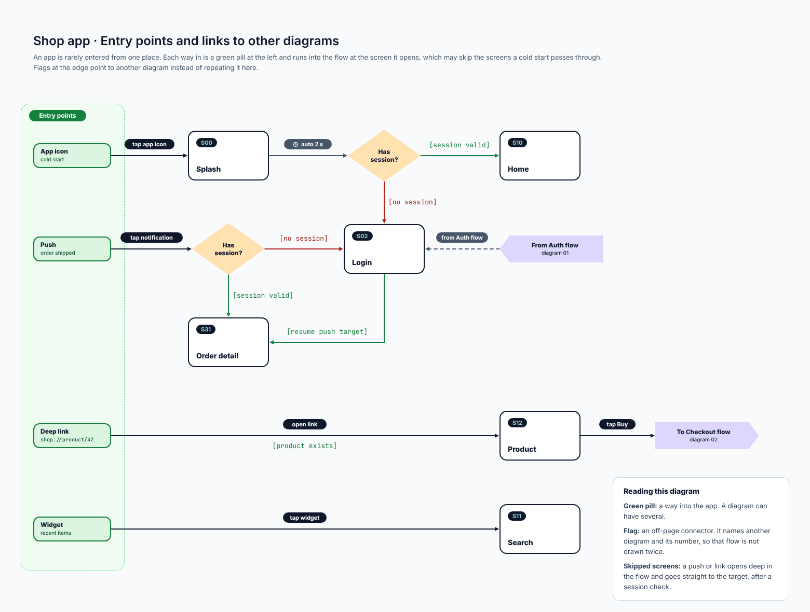

*Entry points and links. [Full size](images/ScreenFlow_Entry.png) · [HTML source](source/html/ScreenFlow_Entry.html)*

## 4. Complete flows

### 4.1 The shop app

The complete example is a shop app drawn at mixed fidelity: **14 screens and 2 decisions** for the phone, and below it **8 screens and 1 decision** for the web, which has its own flow. Dark chips are things the user does, slate chips are things the system does, green and rose are success and failure, dashed is back or retry.

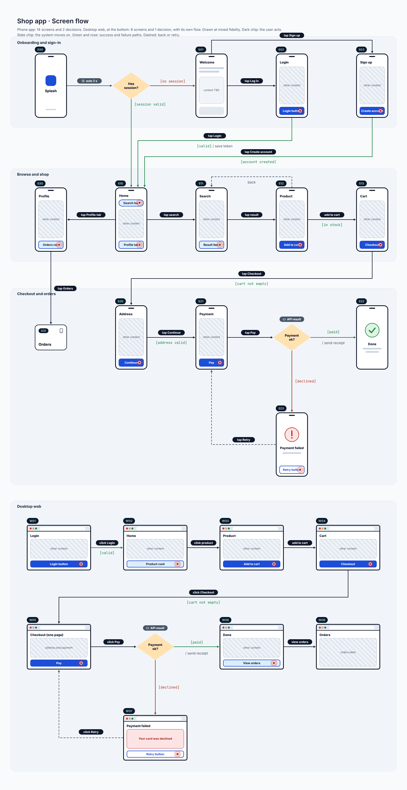

*Shop app: the full flow, phone above and desktop web below. [Full size](images/ScreenFlow_Real_ShopApp.png) · [HTML source](source/html/ScreenFlow_Real_ShopApp.html)*

### 4.2 The same flow with the main path highlighted

Only one route is animated: the happy path from launch to a paid order. Zones are colour-coded; branches and failures stay as plain thin arrows so the main route reads first. This is the rule used everywhere else: **if everything is highlighted, nothing is**.

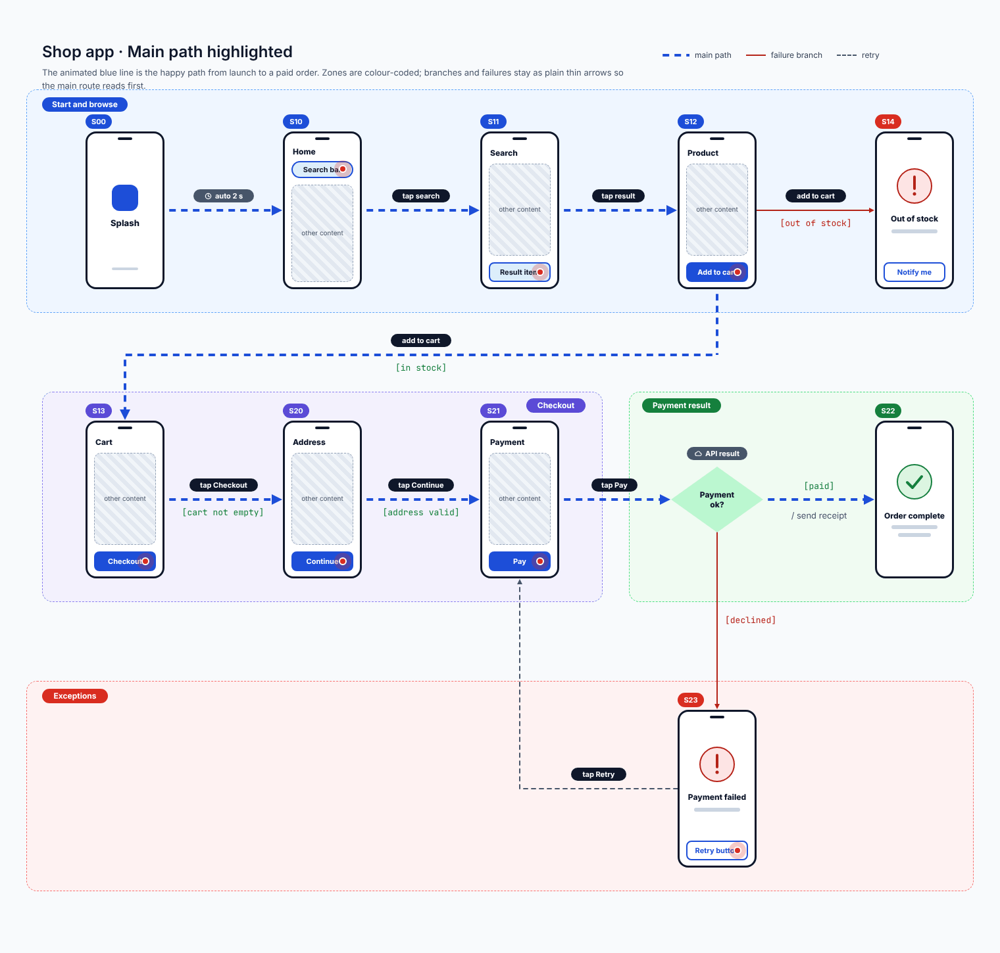

*The shop app with the main path highlighted. [Full size](images/ScreenFlow_Highlight.png) · [HTML source](source/html/ScreenFlow_Highlight.html)*

## 5. Ids and names in detail

| Thing | Rule |
| --- | --- |
| Phone screens | `S` plus two digits. The first digit is the group (0 onboarding, 1 browse, 2 checkout, 3 account), the second the order within the group. Codes need not be consecutive. |
| Desktop web screens | The same scheme with `W` (W01, W02), drawn in their own zone. |
| States of one screen | The same id plus a state name: `S31 · loading`. A state never gets a new number. |
| Overlays | Base id plus the kind: `S12 + modal`. Own number only if it has onward transitions. |
| Orientation | The same id; a different structure per orientation gets a different id. |
| Decisions and flags | No id. |
| Entry points | Named by their source: App icon, Push, Deep link. |

## 6. Connections to other types

- **Wireframe.** A screen at fidelity L3 *is* a wireframe, with the same blocks and the same id and name (`S12 · Cart`). A screen can move between the two types without being redrawn.
- **Flowchart and BPMN.** A screen flow describes what the *user* sees. The process behind it (stock check, payment, dispatch) belongs in a flowchart or BPMN diagram. Use a flag to point from one to the other.
- **Sequence.** An arrow with an API result as its trigger is often one message of a sequence diagram.

## 7. What a plugin can rely on

- A node is: id, name, device, orientation, fidelity level, optional state or overlay.
- A transition is: from, to, trigger, optional guard, optional effect, kind (forward, back, retry, failure, main).
- Layout comes from rows, columns and zones, not free coordinates. The plugin picks the column and row; the arrow routes follow the gap rules.
- Anything not covered is left to the diagram author.

## Reference: the rules board

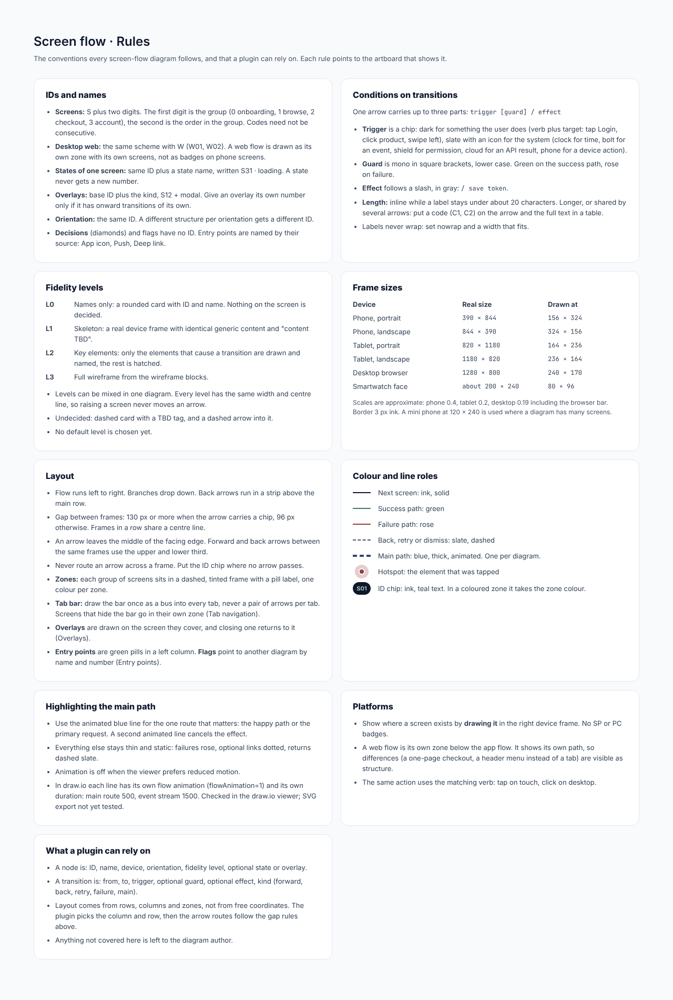

*Screen flow: rules board. [Full size](images/ScreenFlow_Rules.png) · [HTML source](source/html/ScreenFlow_Rules.html)*

#### IDs and names

- **Screens:** S plus two digits. The first digit is the group (0 onboarding, 1 browse, 2 checkout, 3 account), the second is the order in the group. Codes need not be consecutive.
- **Desktop web:** the same scheme with W (W01, W02). A web flow is drawn as its own zone with its own screens, not as badges on phone screens.
- **States of one screen:** same ID plus a state name, written S31 · loading. A state never gets a new number.
- **Overlays:** base ID plus the kind, S12 + modal. Give an overlay its own number only if it has onward transitions of its own.
- **Orientation:** the same ID. A different structure per orientation gets a different ID.
- **Decisions** (diamonds) and flags have no ID. Entry points are named by their source: App icon, Push, Deep link.

#### Conditions on transitions

One arrow carries up to three parts: `trigger [guard] / effect`
- **Trigger** is a chip: dark for something the user does (verb plus target: tap Login, click product, swipe left), slate with an icon for the system (clock for time, bolt for an event, shield for permission, cloud for an API result, phone for a device action).
- **Guard** is mono in square brackets, lower case. Green on the success path, rose on failure.
- **Effect** follows a slash, in gray: `/ save token`.
- **Length:** inline while a label stays under about 20 characters. Longer, or shared by several arrows: put a code (C1, C2) on the arrow and the full text in a table.
- Labels never wrap: set nowrap and a width that fits.

#### Fidelity levels

|  |  |
|---|---|
| L0 | Names only: a rounded card with ID and name. Nothing on the screen is decided. |
| L1 | Skeleton: a real device frame with identical generic content and "content TBD". |
| L2 | Key elements: only the elements that cause a transition are drawn and named, the rest is hatched. |
| L3 | Full wireframe from the wireframe blocks. |

- Levels can be mixed in one diagram. Every level has the same width and centre line, so raising a screen never moves an arrow.
- Undecided: dashed card with a TBD tag, and a dashed arrow into it.
- No default level is chosen yet.

#### Frame sizes

|  |  |  |
|---|---|---|
| Device | Real size | Drawn at |
| Phone, portrait | 390 × 844 | 156 × 324 |
| Phone, landscape | 844 × 390 | 324 × 156 |
| Tablet, portrait | 820 × 1180 | 164 × 236 |
| Tablet, landscape | 1180 × 820 | 236 × 164 |
| Desktop browser | 1280 × 800 | 240 × 170 |
| Smartwatch face | about 200 × 240 | 80 × 96 |

Scales are approximate: phone 0.4, tablet 0.2, desktop 0.19 including the browser bar. Border 3 px ink. A mini phone at 120 × 240 is used where a diagram has many screens.

#### Layout

- Flow runs left to right. Branches drop down. Back arrows run in a strip above the main row.
- Gap between frames: 130 px or more when the arrow carries a chip, 96 px otherwise. Frames in a row share a centre line.
- An arrow leaves the middle of the facing edge. Forward and back arrows between the same frames use the upper and lower third.
- Never route an arrow across a frame. Put the ID chip where no arrow passes.
- **Zones:** each group of screens sits in a dashed, tinted frame with a pill label, one colour per zone.
- **Tab bar:** draw the bar once as a bus into every tab, never a pair of arrows per tab. Screens that hide the bar go in their own zone (Tab navigation).
- **Overlays** are drawn on the screen they cover, and closing one returns to it (Overlays).
- **Entry points** are green pills in a left column. **Flags** point to another diagram by name and number (Entry points).

#### Colour and line roles

|  |  |
|---|---|
|  | Next screen: ink, solid |
|  | Success path: green |
|  | Failure path: rose |
|  | Back, retry or dismiss: slate, dashed |
|  | Main path: blue, thick, animated. One per diagram. |
|  | Hotspot: the element that was tapped |
| S01 | ID chip: ink, teal text. In a coloured zone it takes the zone colour. |

#### Highlighting the main path

- Use the animated blue line for the one route that matters: the happy path or the primary request. A second animated line cancels the effect.
- Everything else stays thin and static: failures rose, optional links dotted, returns dashed slate.
- Animation is off when the viewer prefers reduced motion.
- In draw.io each line has its own flow animation (flowAnimation=1) and its own duration: main route 500, event stream 1500. Checked in the draw.io viewer; SVG export not yet tested.

#### Platforms

- Show where a screen exists by **drawing it** in the right device frame. No SP or PC badges.
- A web flow is its own zone below the app flow. It shows its own path, so differences (a one-page checkout, a header menu instead of a tab) are visible as structure.
- The same action uses the matching verb: tap on touch, click on desktop.

#### What a plugin can rely on

- A node is: ID, name, device, orientation, fidelity level, optional state or overlay.
- A transition is: from, to, trigger, optional guard, optional effect, kind (forward, back, retry, failure, main).
- Layout comes from rows, columns and zones, not from free coordinates. The plugin picks the column and row, then the arrow routes follow the gap rules above.
- Anything not covered here is left to the diagram author.

