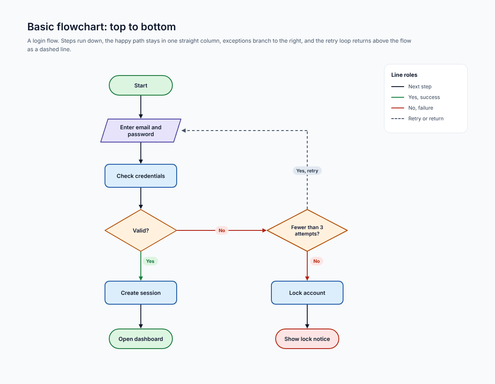
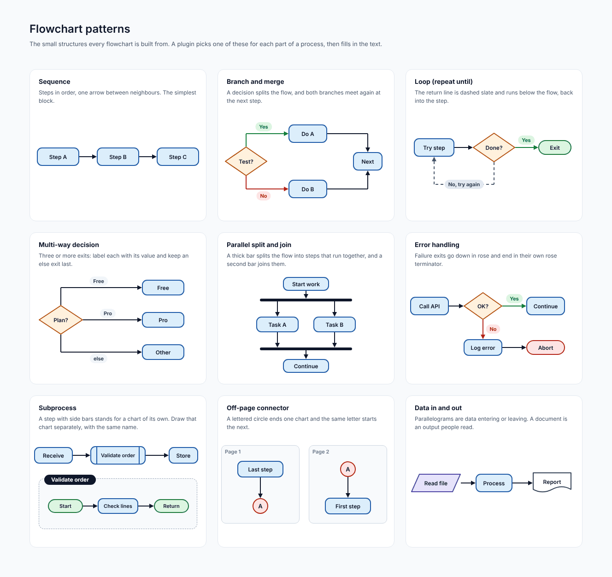
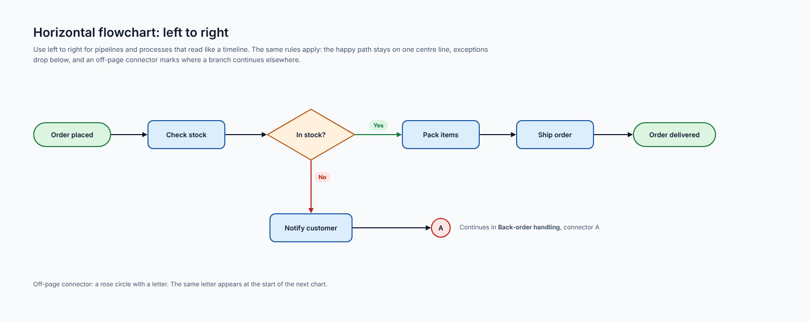
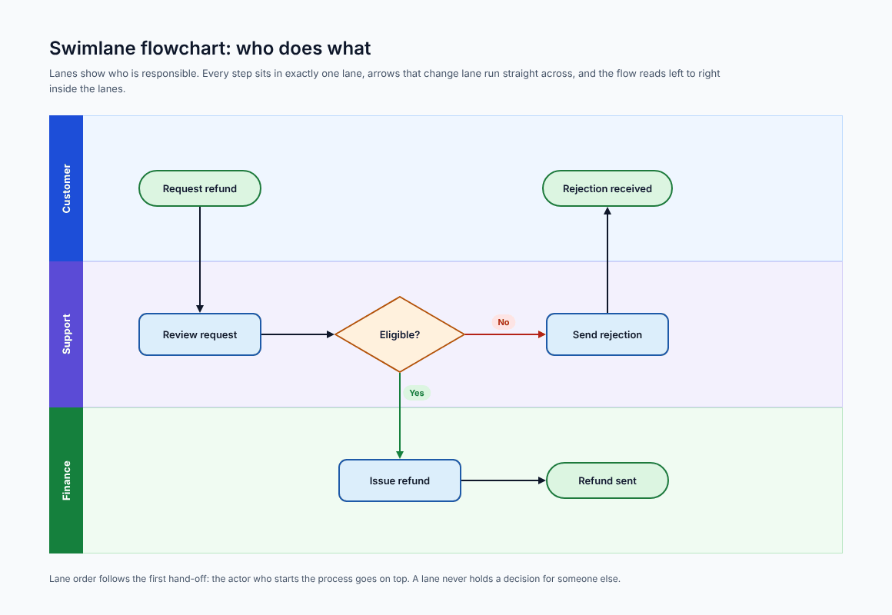
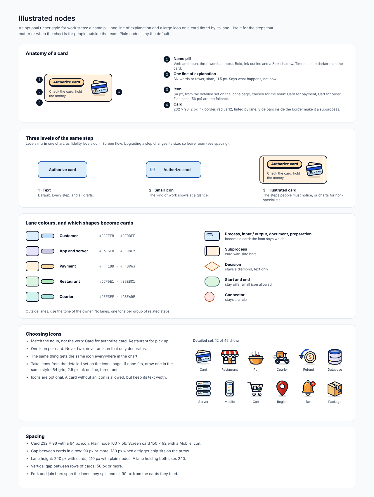
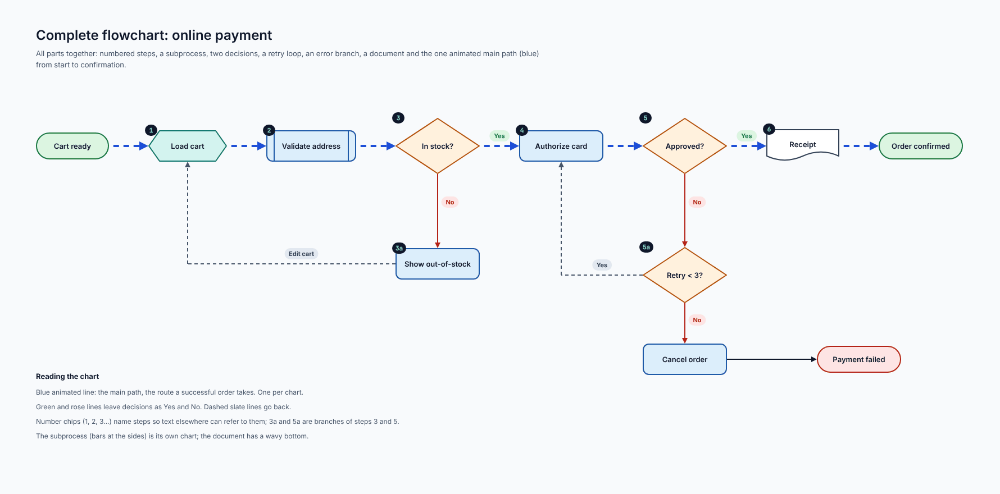
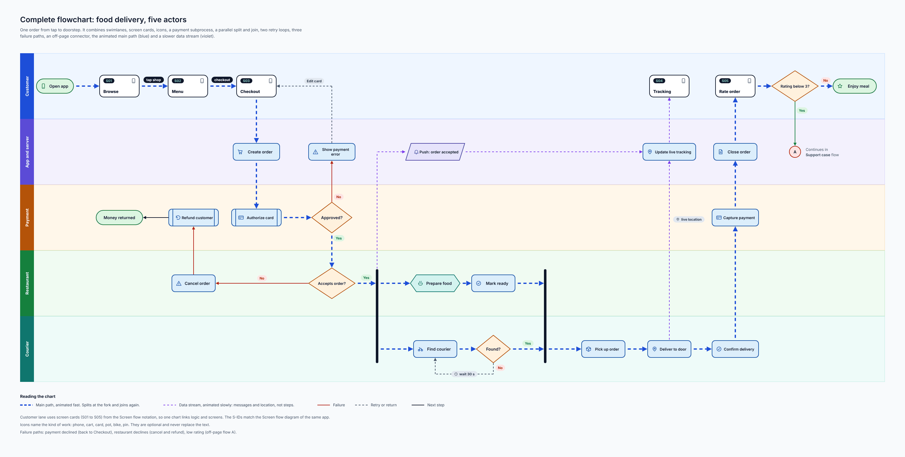
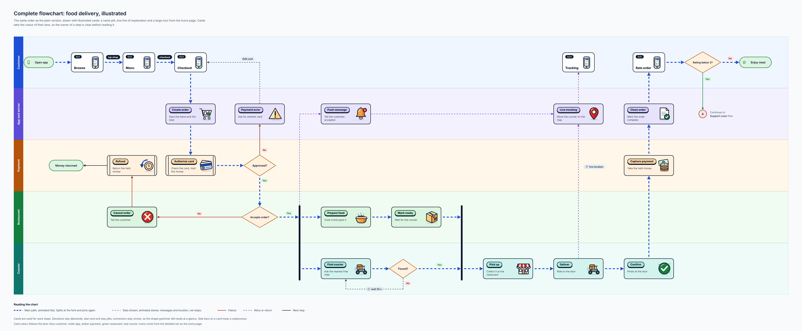
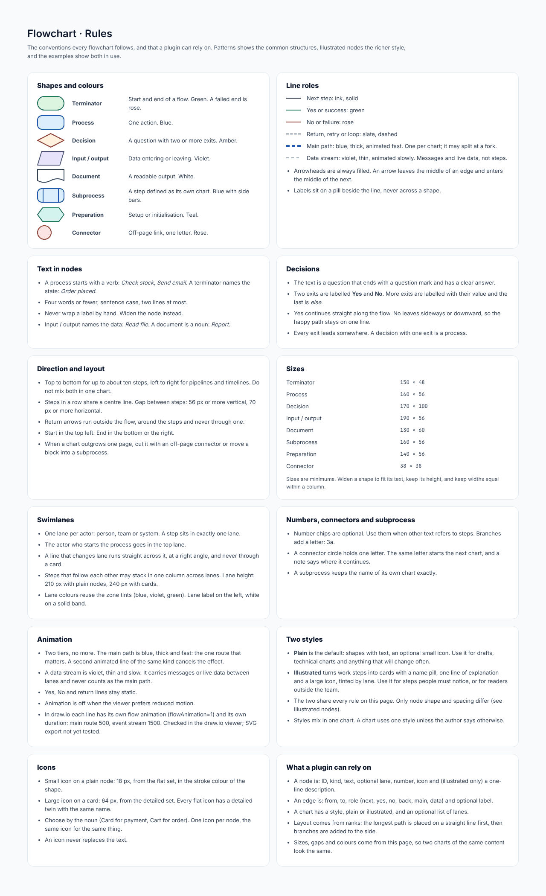

# Flowchart

## At a glance

| | |
| --- | --- |
| **Question it answers** | What are the steps of a process, and what decides between them? |
| **Use it when** | One actor or team follows a process: a login, a refund, an order from tap to doorstep. It is the most general diagram and the right default when nothing more specific fits |
| **Do not use it when** | The process crosses several organisations with messages, deadlines or work in parallel (use [BPMN](11-bpmn.md)), or the interest is in *data* rather than control (use a [DFD](14-dfd.md)) |
| **Styles** | Plain (default) and illustrated; the two mix in one chart |
| **Boards** | 9: rules, patterns, illustrated nodes, three small examples, two complete flows |

## 1. How to read one

A flowchart reads from the top left. A **terminator** (rounded, green) starts it; each **process** (blue box) is one action; a **decision** (amber diamond) asks a question with two or more exits; the flow ends at another terminator. Colour follows shape: the shape says what kind of step it is.

*Basic flowchart: a login flow, top to bottom. [Full size](images/Flowchart_Basic.png)*

What to notice in the basic example:

- The **happy path stays in one straight column** (Start, Enter email and password, Check credentials, Valid?, Create session, Open dashboard). A reader can follow it without reading a word.
- **Exceptions branch to the right.** "No" leaves the first diamond sideways to a second decision (fewer than three attempts?) and ends at a rose terminator, *Show lock notice*.
- The **retry loop** returns above the flow as a dashed slate line into the input step, so it never crosses the happy path.
- The legend at the right lists the line roles used here.

## 2. Shapes

|  |  |
|---|---|
| Terminator | Start and end of a flow. Green. A failed end is rose. |
| Process | One action. Blue. |
| Decision | A question with two or more exits. Amber. |
| Input / output | Data entering or leaving. Violet. |
| Document | A readable output. White. |
| Subprocess | A step defined as its own chart. Blue with side bars. |
| Preparation | Setup or initialisation. Teal. |
| Connector | Off-page link, one letter. Rose. |

Sizes are minimums: widen a shape to fit its text, keep its height, and keep widths equal within a column. Terminator 150 × 48, process 160 × 56, decision 170 × 100, input / output 190 × 56, document 130 × 60, subprocess 160 × 56, preparation 140 × 56, connector 38 × 38.

### Text in nodes

A process starts with a **verb** (*Check stock*, *Send email*). A terminator names the **state** (*Order placed*). Four words or fewer, sentence case, two lines at most. Never wrap a label by hand; widen the node instead. Input / output names the data (*Read file*), a document is a noun (*Report*).

### Decisions

The text is a **question** that ends with a question mark and has a clear answer. Two exits are labelled **Yes** and **No**; more exits are labelled with their value and the last is *else*. Yes continues straight along the flow and No leaves sideways or downward, so the happy path stays on one line. Every exit leads somewhere: a decision with one exit is a process.

## 3. Patterns

A plugin picks one of these for each part of a process, then fills in the text.

*Flowchart patterns. [Full size](images/Flowchart_Patterns.png)*

| Pattern | When to use it |
| --- | --- |
| **Sequence** | Steps in order, one arrow between neighbours |
| **Branch and merge** | A decision splits the flow and both branches meet again |
| **Loop (repeat until)** | Retry; the return line is dashed slate and runs below the flow, back into the step |
| **Multi-way decision** | Three or more exits, each labelled with its value, an *else* exit last |
| **Parallel split and join** | A thick bar splits the flow into steps that run together, a second bar joins them |
| **Error handling** | Failure exits go down in rose and end in their own rose terminator |
| **Subprocess** | A step with side bars stands for a chart of its own; draw that chart separately with the same name |
| **Off-page connector** | A lettered circle ends one chart and the same letter starts the next |
| **Data in and out** | Parallelograms are data entering or leaving; a document is an output people read |

## 4. Direction, layout and lanes

- **Top to bottom** for up to about ten steps; **left to right** for pipelines and timelines. Never mix both in one chart.
- Steps in a row share a centre line. Gaps: 56 px or more vertical, 70 px or more horizontal.
- Return arrows run *outside* the flow, around the steps and never through one.

*Horizontal flowchart: left to right. [Full size](images/Flowchart_Horizontal.png)*

### Swimlanes

When several actors share a process, one **lane** per actor shows who is responsible. A step sits in exactly one lane, the actor who starts is in the top lane, and a line that changes lane runs straight across at a right angle. Lane colours reuse the zone tints, with the lane name on a solid band on the left.

*Swimlane flowchart: a refund across customer, support and finance. [Full size](images/Flowchart_Swimlane.png)*

## 5. The illustrated style

Work steps can become **cards**: a name pill, one line of explanation (six words or fewer) and a large icon, on a card tinted by its lane. They are for the steps people must notice or for charts read outside the team. Plain nodes stay the default, and the three levels of the same step (text, small icon, illustrated card) can mix in one chart. Upgrading a step changes its size, so leave room.

*Illustrated nodes: anatomy of a card, three levels of one step and lane colours. [Full size](images/Flowchart_Illustrated.png)*

Lane tints for cards: customer blue, app and server violet, payment amber, restaurant green, courier teal.

## 6. Complete examples

### 6.1 Online payment

All the parts together: numbered steps, a subprocess, two decisions, a retry loop, an error branch, a document, and the one animated main path (blue) from start to confirmation.

*Complete flow: online payment. [Full size](images/Flowchart_Complex.png)*

### 6.2 Food delivery, plain

One order from tap to doorstep. It combines swimlanes, screen cards, icons, a payment subprocess, a parallel split and join, two retry loops, three failure paths, an off-page connector, the animated main path (blue) and a slower data stream (violet).

*Complete flow: food delivery, plain. [Full size](images/Flowchart_Delivery.png)*

### 6.3 Food delivery, illustrated

The same order drawn with illustrated cards. Cards take the colour of their lane, so the owner of a step is clear before reading it.

*Complete flow: food delivery, illustrated. [Full size](images/Flowchart_Delivery_Illustrated.png)*

## 7. Numbers, connectors and subprocesses

Number chips are optional; use them when other text refers to steps. Branches add a letter (3a). A connector circle holds one letter; the same letter starts the next chart, and a note says where it continues. A subprocess keeps the exact name of its own chart.

## 8. Connections to other types

- **Sequence.** A flowchart lane is an actor; the same actor is a participant in a sequence diagram, with the same name, icon and tint.
- **Screen flow.** A step may be a screen; use the screen id and point to the screen-flow diagram.
- **BPMN.** When the process outgrows one actor, move to BPMN; the step names carry over.

## 9. What a plugin can rely on

- A node is: id, kind, text, optional lane, number, icon and (illustrated only) a one-line description.
- An edge is: from, to, role (next, yes, no, back, main, data) and optional label.
- A chart has a style, plain or illustrated, and an optional list of lanes.
- Layout comes from **ranks**: the longest path is placed on a straight line first, then branches are added to the side.
- Sizes, gaps and colours come from the rules, so two charts of the same content look the same.

## Reference: the rules board

*Flowchart: rules board. [Full size](images/Flowchart_Rules.png)*

#### Shapes and colours

|  |  |
|---|---|
| Terminator | Start and end of a flow. Green. A failed end is rose. |
| Process | One action. Blue. |
| Decision | A question with two or more exits. Amber. |
| Input / output | Data entering or leaving. Violet. |
| Document | A readable output. White. |
| Subprocess | A step defined as its own chart. Blue with side bars. |
| Preparation | Setup or initialisation. Teal. |
| Connector | Off-page link, one letter. Rose. |

#### Line roles

|  |
|---|
| Next step: ink, solid |
| Yes or success: green |
| No or failure: rose |
| Return, retry or loop: slate, dashed |
| Main path: blue, thick, animated fast. One per chart; it may split at a fork. |
| Data stream: violet, thin, animated slowly. Messages and live data, not steps. |

- Arrowheads are always filled. An arrow leaves the middle of an edge and enters the middle of the next.
- Labels sit on a pill beside the line, never across a shape.

#### Text in nodes

- A process starts with a verb: *Check stock*, *Send email*. A terminator names the state: *Order placed*.
- Four words or fewer, sentence case, two lines at most.
- Never wrap a label by hand. Widen the node instead.
- Input / output names the data: *Read file*. A document is a noun: *Report*.

#### Decisions

- The text is a question that ends with a question mark and has a clear answer.
- Two exits are labelled **Yes** and **No**. More exits are labelled with their value and the last is *else*.
- Yes continues straight along the flow. No leaves sideways or downward, so the happy path stays on one line.
- Every exit leads somewhere. A decision with one exit is a process.

#### Direction and layout

- Top to bottom for up to about ten steps, left to right for pipelines and timelines. Do not mix both in one chart.
- Steps in a row share a centre line. Gap between steps: 56 px or more vertical, 70 px or more horizontal.
- Return arrows run outside the flow, around the steps and never through one.
- Start in the top left. End in the bottom or the right.
- When a chart outgrows one page, cut it with an off-page connector or move a block into a subprocess.

#### Sizes

|  |  |
|---|---|
| Terminator | 150 × 48 |
| Process | 160 × 56 |
| Decision | 170 × 100 |
| Input / output | 190 × 56 |
| Document | 130 × 60 |
| Subprocess | 160 × 56 |
| Preparation | 140 × 56 |
| Connector | 38 × 38 |

Sizes are minimums. Widen a shape to fit its text, keep its height, and keep widths equal within a column.

#### Swimlanes

- One lane per actor: person, team or system. A step sits in exactly one lane.
- The actor who starts the process goes in the top lane.
- A line that changes lane runs straight across it, at a right angle, and never through a card.
- Steps that follow each other may stack in one column across lanes. Lane height: 210 px with plain nodes, 240 px with cards.
- Lane colours reuse the zone tints (blue, violet, green). Lane label on the left, white on a solid band.

#### Numbers, connectors and subprocess

- Number chips are optional. Use them when other text refers to steps. Branches add a letter: 3a.
- A connector circle holds one letter. The same letter starts the next chart, and a note says where it continues.
- A subprocess keeps the name of its own chart exactly.

#### Animation

- Two tiers, no more. The main path is blue, thick and fast: the one route that matters. A second animated line of the same kind cancels the effect.
- A data stream is violet, thin and slow. It carries messages or live data between lanes and never counts as the main path.
- Yes, No and return lines stay static.
- Animation is off when the viewer prefers reduced motion.
- In draw.io each line has its own flow animation (flowAnimation=1) and its own duration: main route 500, event stream 1500. Checked in the draw.io viewer; SVG export not yet tested.

#### Two styles

- **Plain** is the default: shapes with text, an optional small icon. Use it for drafts, technical charts and anything that will change often.
- **Illustrated** turns work steps into cards with a name pill, one line of explanation and a large icon, tinted by lane. Use it for steps people must notice, or for readers outside the team.
- The two share every rule on this page. Only node shape and spacing differ (see Illustrated nodes).
- Styles mix in one chart. A chart uses one style unless the author says otherwise.

#### Icons

- Small icon on a plain node: 18 px, from the flat set, in the stroke colour of the shape.
- Large icon on a card: 64 px, from the detailed set. Every flat icon has a detailed twin with the same name.
- Choose by the noun (Card for payment, Cart for order). One icon per node, the same icon for the same thing.
- An icon never replaces the text.

#### What a plugin can rely on

- A node is: ID, kind, text, optional lane, number, icon and (illustrated only) a one-line description.
- An edge is: from, to, role (next, yes, no, back, main, data) and optional label.
- A chart has a style, plain or illustrated, and an optional list of lanes.
- Layout comes from ranks: the longest path is placed on a straight line first, then branches are added to the side.
- Sizes, gaps and colours come from this page, so two charts of the same content look the same.

