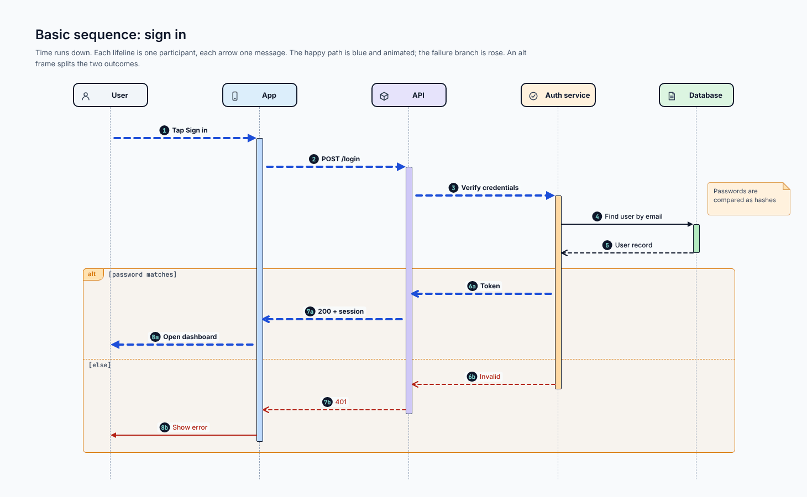
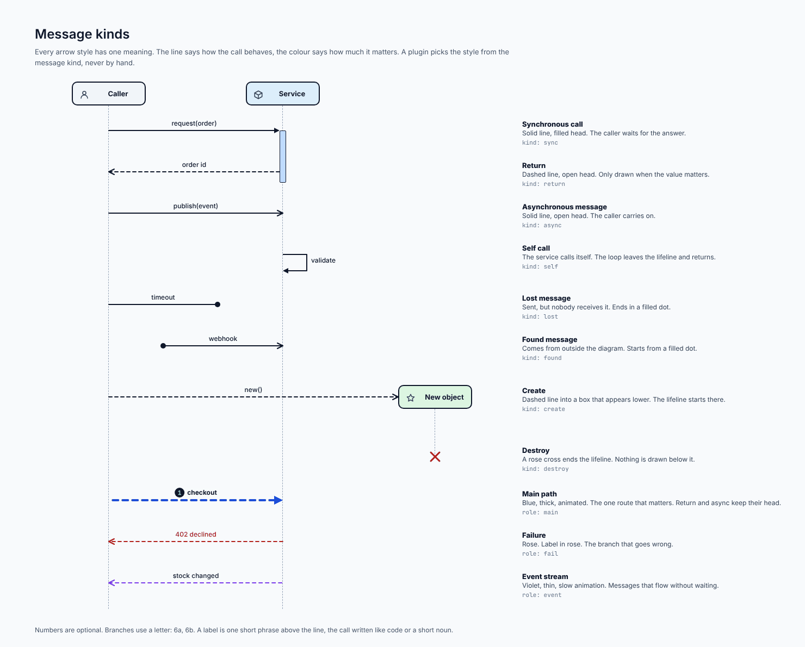
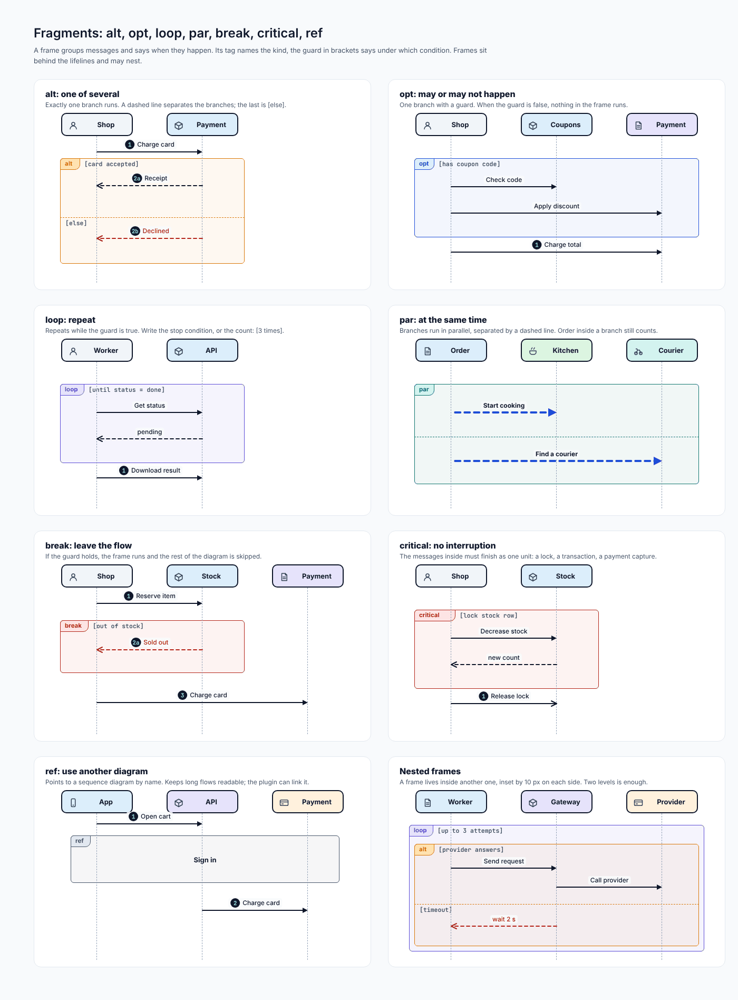
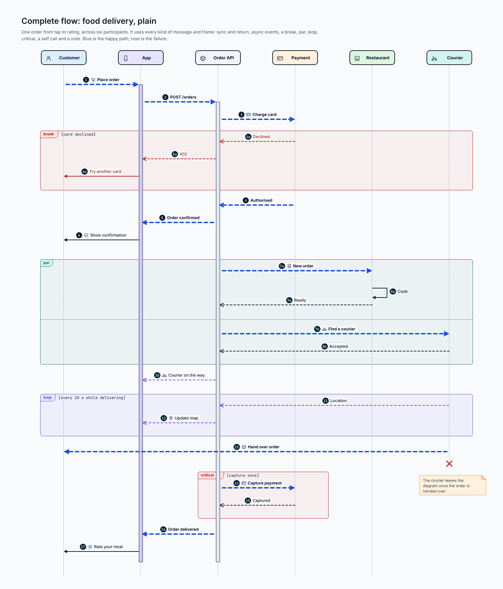
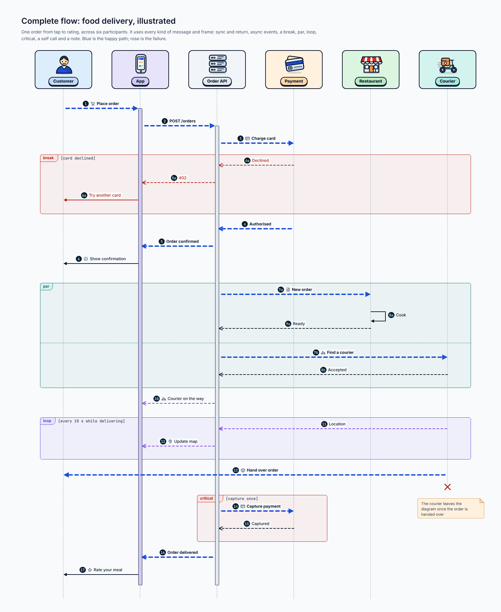
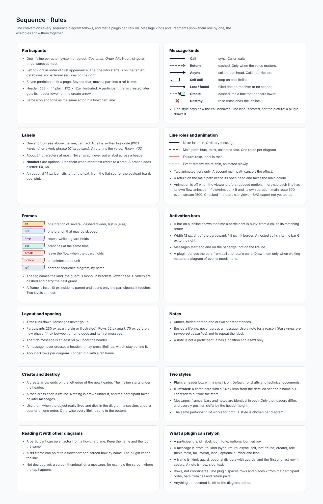

# Sequence

## At a glance

| | |
| --- | --- |
| **Question it answers** | Who says what to whom, and in what order? |
| **Use it when** | The *order of messages* between people, apps or services is the point: a sign-in, a payment capture, a checkout across several services |
| **Do not use it when** | The point is structure (use [architecture](06-architecture.md)) or a process with decisions and loops for one actor (use a [flowchart](03-flowchart.md)) |
| **Styles** | Plain (default) and illustrated (only the participant headers differ) |
| **Boards** | 6: rules, message kinds, fragments, a basic example, a complete flow in two styles |

## 1. How to read one

**Time runs down.** Each vertical dashed line is a **lifeline**, one for each participant (a person, an app, a service, a database). Each horizontal arrow is one **message**. A thin bar on a lifeline, the **activation bar**, shows the time that participant is busy: from a call to its matching return.

*Basic sequence: sign in. [Full size](images/Sequence_Basic.png) · [HTML source](source/html/Sequence_Basic.html)*

In the basic example, a user signs in:

1. The happy path is **blue and animated**: *Tap Sign in*, *POST /login*, *Verify credentials*, then the token returns the same way, ending in *Open dashboard*.
2. A **database lookup** (*Find user by email*, *User record*) is ordinary ink: it matters, but it is not the route the diagram is about.
3. An **alt frame** splits the two outcomes: `[password matches]` continues blue, `[else]` goes **rose**, ending in *Show error*.
4. An amber **note** beside the database gives a reason (*Passwords are compared as hashes*) that no arrow could carry.
5. Numbers (1, 2, 3 ... 6a, 6b) are optional; they exist so that text elsewhere can say "see step 4". A branch adds a letter.

## 2. Message kinds

The line says *how the call behaves*; the colour says *how much it matters*. A plugin chooses the style from the message kind and never by hand.

*Message kinds. [Full size](images/Sequence_Messages.png) · [HTML source](source/html/Sequence_Messages.html)*

| Kind | Drawn as | Meaning |
| --- | --- | --- |
| **Call (sync)** | Solid line, filled head | The caller waits for the answer |
| **Return** | Dashed line, open head | Drawn only when the value matters (*Token*, *402*) |
| **Async** | Solid line, open head | The caller carries on |
| **Self call** | A loop leaving and returning to one lifeline | The service calls itself (*validate*) |
| **Lost** | Ends in a filled dot | Sent, but nobody receives it (*timeout*) |
| **Found** | Starts from a filled dot | Comes from outside the diagram (*webhook*) |
| **Create** | Dashed line into a box that appears lower | The lifeline starts there (*new()*) |
| **Destroy** | A rose cross ends the lifeline | Nothing is drawn below it |

Colour roles on top of the kind: **main path** is blue, thick and animated; **failure** is rose with a rose label; an **event stream** is violet, thin and slowly animated. A return or async message on the main path keeps its own head and takes the main colour.

### Writing a label

One short phrase above the line, centred: a call is written like code (`POST /orders`) or as a verb phrase (*Charge card*); a return is the value (*Token*, *402*). About 24 characters at most, never wrapped, never across a header. An optional 14 px flat icon may sit to the left for the payload (a card, a document, a pin).

## 3. Fragments

A frame groups messages and says *when* they happen. Its tag names the kind, and the guard in brackets says under which condition. Frames sit **behind** the lifelines, span only the participants they touch, and may nest two levels deep.

*Fragments: alt, opt, loop, par, break, critical, ref. [Full size](images/Sequence_Fragments.png) · [HTML source](source/html/Sequence_Fragments.html)*

| Frame | Meaning | Example guard |
| --- | --- | --- |
| **alt** | Exactly one branch runs; a dashed line separates branches, the last is `[else]` | `[card accepted]` / `[else]` |
| **opt** | One branch that may be skipped | `[has coupon code]` |
| **loop** | Repeats while the guard is true; write the stop condition or the count | `[until status = done]`, `[3 times]` |
| **par** | Branches run at the same time, separated by a dashed line | (none) |
| **break** | If the guard holds, the frame runs and the rest of the diagram is skipped | `[out of stock]` |
| **critical** | The messages inside finish as one unit (a lock, a transaction, a payment capture) | `[lock stock row]` |
| **ref** | Points to another sequence diagram by name; keeps long flows readable | *Sign in* |

The guard is mono, in square brackets, lower case. Dividers are dashed and carry the next guard.

## 4. The complete example: one order from tap to rating

Six participants (Customer, App, Order API, Payment, Restaurant, Courier) and **every kind of message and frame**: sync and return, async events, a break, a par, a loop, a critical frame, a self call and a note.

*Complete flow: food delivery, plain. [Full size](images/Sequence_Delivery.png) · [HTML source](source/html/Sequence_Delivery.html)*

How to read it:

- **Blue is the happy path:** *Place order*, *POST /orders*, *Charge card*, *Authorised*, *Order confirmed*, *Show confirmation*.
- **`break [card declined]`** is the failure: *Declined* (4a), *402* (5a), *Try another card* (6a) in rose. When it fires, the rest of the diagram is skipped.
- **`par`** shows two things at once after the order is confirmed: the restaurant cooks (*New order*, *Cook*, *Ready*) while a courier is found (*Find a courier*, *Accepted*).
- **Violet** is the event stream. *Courier on the way* (10) announces it, and **`loop [every 10 s while delivering]`** repeats *Location* (courier to Order API) and *Update map* (Order API to App), thin and slow, as live data does.
- **Step 13, *Hand over order*,** is the long blue arrow from the Courier straight to the Customer: the main path ends where the person receives the food. A rose cross then ends the Courier's lifeline (a *destroy*).
- **`critical [capture once]`** wraps *Capture payment* and *Captured*, so the payment is taken exactly once.
- The note **"The courier leaves the diagram once the order is handed over"** explains why the Courier lifeline ends before the order is delivered.
- Steps 16 and 17, *Order delivered* and *Rate your meal*, close the loop for the customer.

### The illustrated version

*Complete flow: food delivery, illustrated. [Full size](images/Sequence_Delivery_Illustrated.png) · [HTML source](source/html/Sequence_Delivery_Illustrated.html)*

Only the headers change: a tinted card with a 64 px icon from the detailed set and a name pill, instead of a small header box. Messages, frames, bars and notes are identical, and every y position shifts by the extra header height.

## 5. Conventions in detail

### Participants

One lifeline per actor, system or object, named with a singular noun of three words at most. Left to right in order of first appearance: the one who starts is on the far left; databases and outside services are on the right. Seven participants fit a page; beyond that, move a part into a `ref` frame. Headers are 136 × 44 (plain) and 172 × 116 (illustrated). A participant created later has its header lower, on the create arrow.

### Spacing

Participants are 230 px apart (both styles). Rows are 52 px apart, with 70 px before a new phase and 14 px between a frame edge and its first message. The first message is at least 58 px under the header. A message never crosses a header; it may cross lifelines, which stay behind it. About 40 rows per diagram; longer, cut with a `ref` frame. After a frame closes, leave 34 px before the next message (this was added after the automatic check found messages sitting on frame borders).

### Activation bars

12 px wide, in the tint of the participant, with a 1.5 px ink border. A nested call shifts the bar 6 px to the right. Messages start and end on the bar edge, not on the lifeline. A plugin derives the bars from call-and-return pairs; draw them only when waiting matters.

### Notes

Amber with a folded corner, one or two short sentences, beside a lifeline and never across a message. Use a note for a *reason*, not to repeat the label. A note is not a participant: it has a position and a text only.

## 6. Connections to other types

- A participant can be an actor from a [flowchart](03-flowchart.md) lane: keep the same name and icon.
- A `ref` frame can point to a flowchart or [screen flow](02-screen-flow.md) by name; the plugin keeps the link.
- The blue path of an [architecture](06-architecture.md) diagram is often exactly one sequence diagram. Name it in a note so a reader can find it.
- A message between pools in [BPMN](11-bpmn.md) is usually one arrow here.

## 7. What a plugin can rely on

- A participant is: name, icon, tone. A message is: from, to, kind, label, role and optional number. A frame is: kind, guard and the messages it holds.
- The message kind is stored, and the plugin draws the right line from it.
- Bars are derived from call and return pairs.
- Layout comes from rows and participant slots; frames wrap the rows they hold.

## Reference: the rules board

*Sequence: rules board. [Full size](images/Sequence_Rules.png) · [HTML source](source/html/Sequence_Rules.html)*

#### Participants

- One lifeline per actor, system or object: *Customer*, *Order API*. Noun, singular, three words at most.
- Left to right in order of first appearance. The one who starts is on the far left, databases and external services on the right.
- Seven participants fit a page. Beyond that, move a part into a ref frame.
- Header: `136 × 44` plain, `172 × 116` illustrated. A participant that is created later gets its header lower, on the create arrow.
- Same icon and tone as the same actor in a flowchart lane.

#### Message kinds

|  |  |
|---|---|
| Call | sync. Caller waits. |
| Return | dashed. Only when the value matters. |
| Async | solid, open head. Caller carries on. |
| Self call | loop on one lifeline. |
| Lost / found | filled dot: no receiver or no sender. |
| Create | dashed into a box that appears lower. |
| Destroy | rose cross ends the lifeline. |

- Line style says how the call behaves. The kind is stored, not the picture: a plugin draws it.

#### Labels

- One short phrase above the line, centred. A call is written like code (`POST /orders`) or a verb phrase (*Charge card*). A return is the value: *Token*, *402*.
- About 24 characters at most. Never wrap, never put a label across a header.
- **Numbers** are optional. Use them when other text refers to a step. A branch adds a letter: 6a, 6b.
- An optional 14 px icon sits left of the text, from the flat set, for the payload (card, doc, pin).

#### Line roles and animation

|  |
|---|
| Next: ink, thin. Ordinary message. |
| Main path: blue, thick, animated fast. One route per diagram. |
| Failure: rose, label in rose. |
| Event stream: violet, thin, animated slowly. |

- Two animated tiers only. A second main path cancels the effect.
- A return on the main path keeps its open head and takes the main colour.
- Animation is off when the viewer prefers reduced motion. In draw.io each line has its own flow animation (flowAnimation=1) and its own duration: main route 500, event stream 1500. Checked in the draw.io viewer; SVG export not yet tested.

#### Frames

|  |  |
|---|---|
| alt | one branch of several, dashed divider, last is [else] |
| opt | one branch that may be skipped |
| loop | repeat while a guard holds |
| par | branches at the same time |
| break | leave the flow when the guard holds |
| critical | an uninterrupted unit |
| ref | another sequence diagram, by name |

- The tag names the kind, the guard is mono, in brackets, lower case. Dividers are dashed and carry the next guard.
- A frame is inset 10 px inside its parent and spans only the participants it touches. Two levels at most.

#### Activation bars

- A bar on a lifeline shows the time a participant is busy: from a call to its matching return.
- Width 12 px, tint of the participant, 1.5 px ink border. A nested call shifts the bar 6 px to the right.
- Messages start and end on the bar edge, not on the lifeline.
- A plugin derives the bars from call and return pairs. Draw them only when waiting matters; a diagram of events needs none.

#### Layout and spacing

- Time runs down. Messages never go up.
- Participants 230 px apart (plain or illustrated). Rows 52 px apart, 70 px before a new phase, 14 px between a frame edge and its first message.
- The first message is at least 58 px under the header.
- A message never crosses a header. It may cross lifelines, which stay behind it.
- About 40 rows per diagram. Longer: cut with a ref frame.

#### Notes

- Amber, folded corner, one or two short sentences.
- Beside a lifeline, never across a message. Use a note for a reason (*Passwords are compared as hashes*), not to repeat the label.
- A note is not a participant. It has a position and a text only.

#### Create and destroy

- A create arrow ends on the left edge of the new header. The lifeline starts under the header.
- A rose cross ends a lifeline. Nothing is drawn under it, and the participant takes no later messages.
- Use them when the object really lives and dies in the diagram: a session, a job, a courier on one order. Otherwise every lifeline runs to the bottom.

#### Two styles

- **Plain:** a header box with a small icon. Default; for drafts and technical documents.
- **Illustrated:** a tinted card with a 64 px icon from the detailed set and a name pill. For readers outside the team.
- Messages, frames, bars and notes are identical in both. Only the headers differ, and every y position shifts by the header height.
- The same participant list works for both. A style is chosen per diagram.

#### Reading it with other diagrams

- A participant can be an actor from a flowchart lane. Keep the name and the icon the same.
- A **ref** frame can point to a flowchart or a screen flow by name. The plugin keeps the link.
- Not decided yet: a screen thumbnail on a message, for example the screen where the tap happens.

#### What a plugin can rely on

- A participant is: id, label, icon, tone, optional born-at row.
- A message is: from, to, kind (sync, return, async, self, lost, found, create), role (next, main, fail, event), label, optional number and icon.
- A frame is: kind, guard, optional dividers with guards, and the first and last row it covers. A note is: row, side, text.
- Rows, not coordinates. The plugin spaces rows and places x from the participant order, bars from call and return pairs.
- Anything not covered is left to the diagram author.

