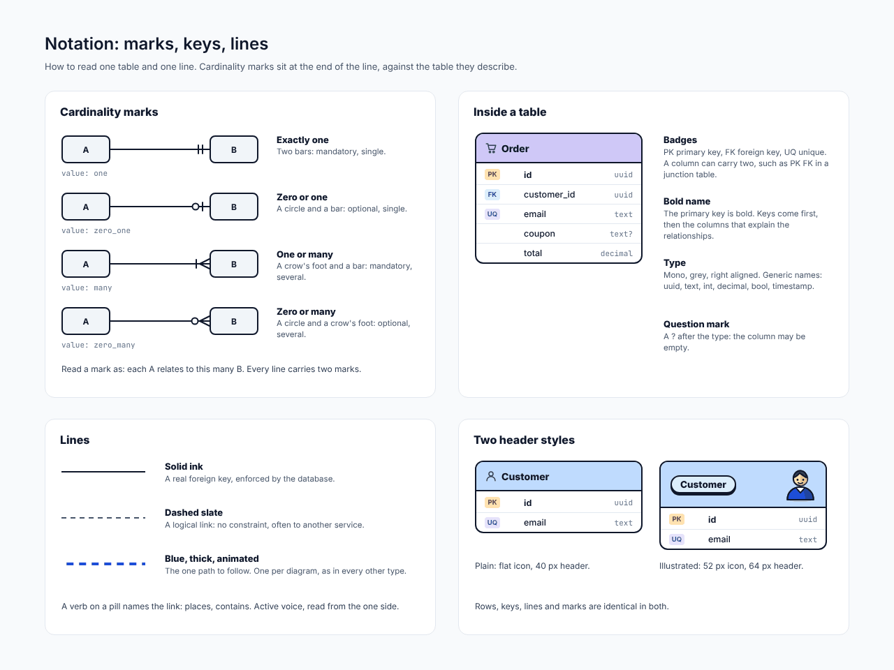
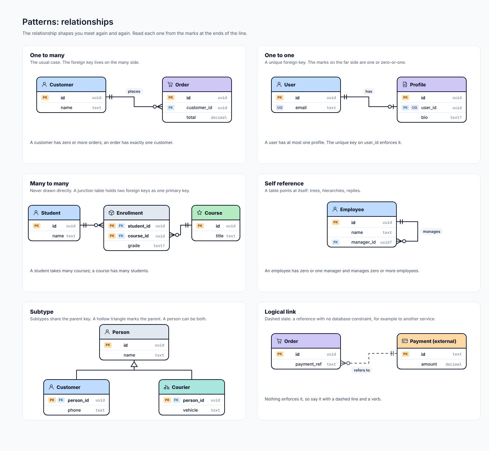
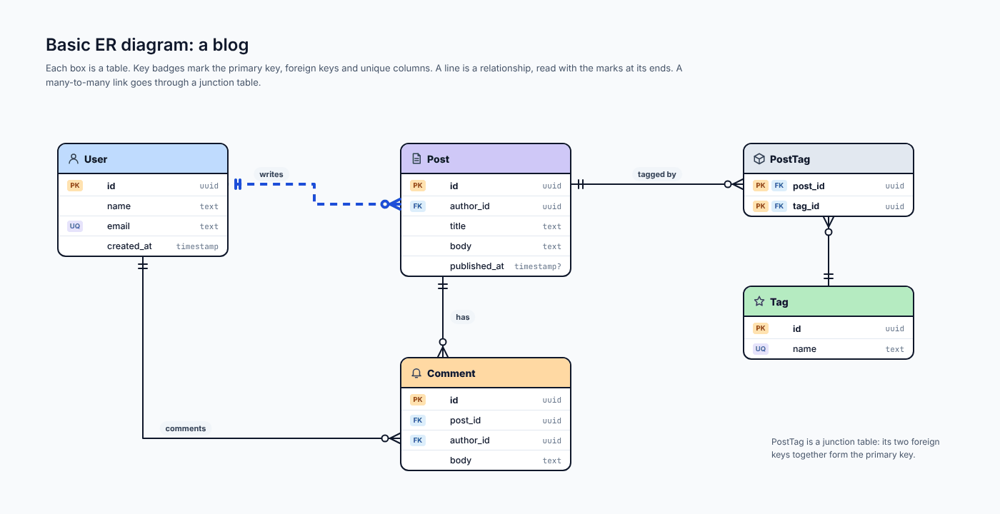
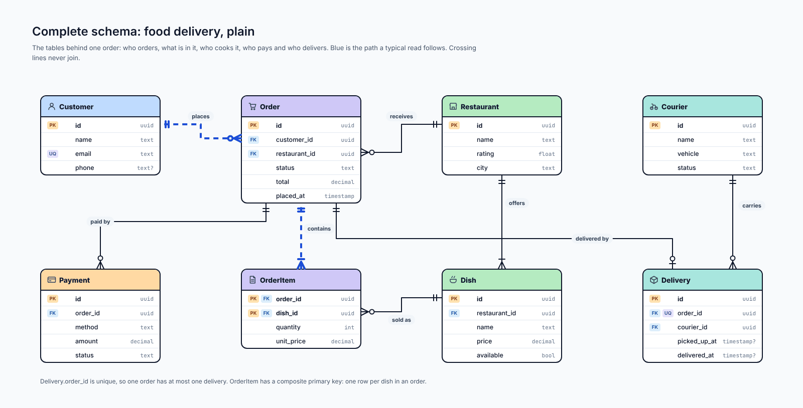
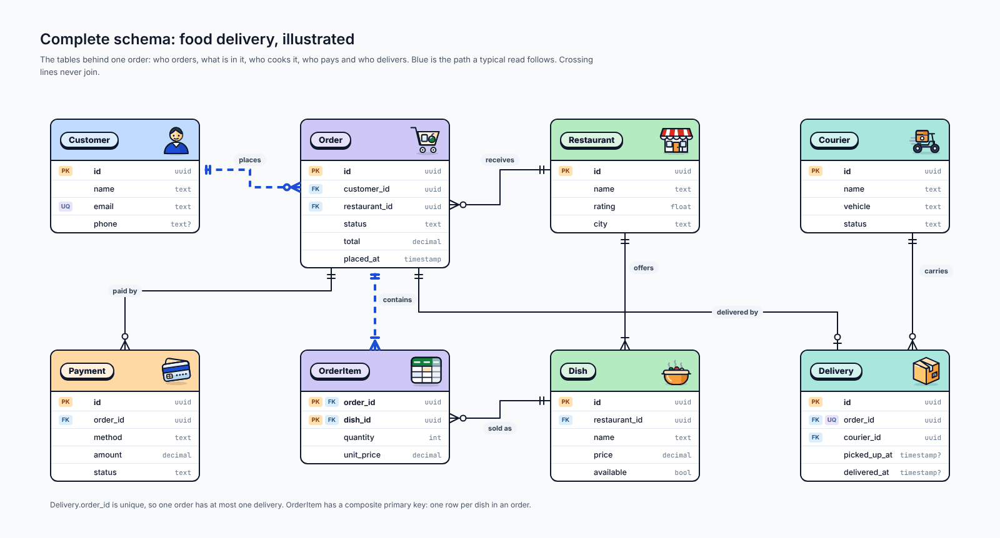
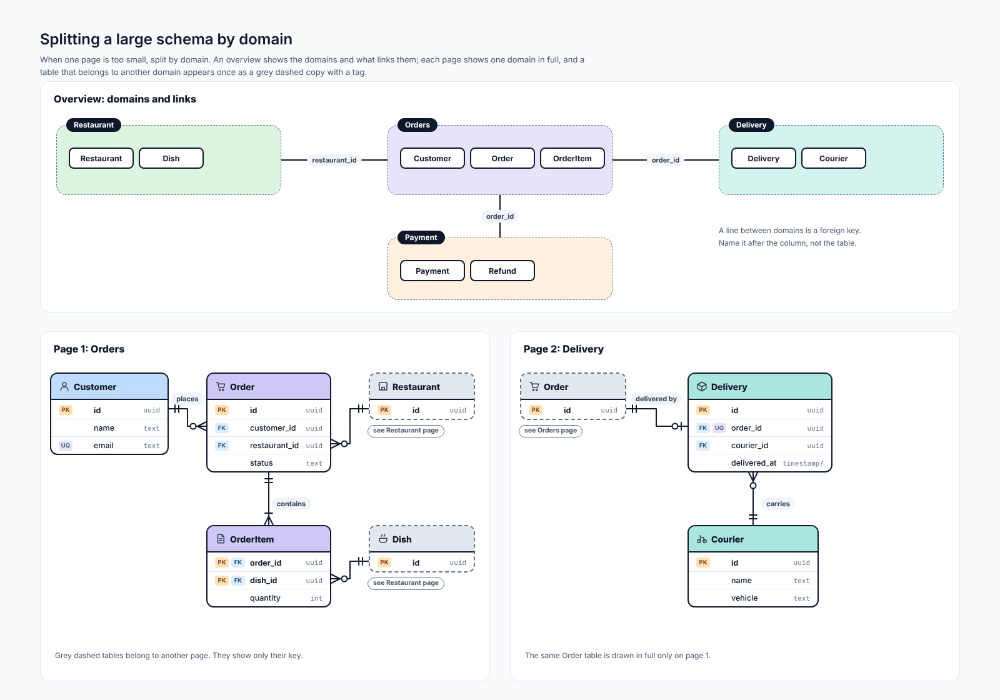
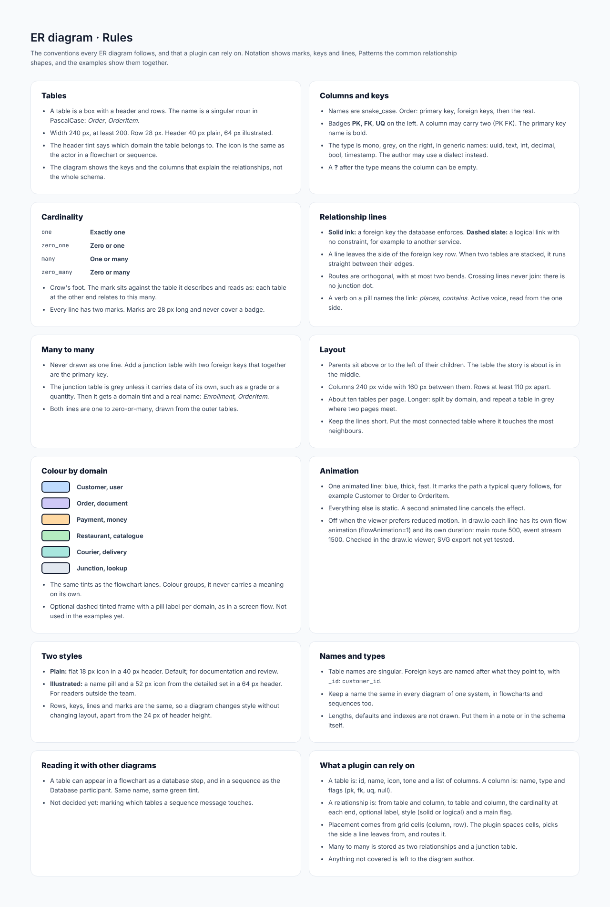

# ER diagram

## At a glance

| | |
| --- | --- |
| **Question it answers** | What data is stored, and how are the tables related? |
| **Use it when** | Designing or documenting a database: tables, keys, and the relationships between them |
| **Do not use it when** | You need how data *moves* (use a [DFD](14-dfd.md)) or how code is organised (use a UML class diagram, see [UML](09-uml.md)) |
| **Styles** | Plain (40 px header with a flat icon) and illustrated (64 px header with a name pill and a 52 px icon) |
| **Boards** | 7: rules, notation, patterns, a basic example, a complete delivery schema in two styles, and splitting a large schema by domain |

## 1. What an ER diagram is

An **entity-relationship diagram** draws a database as boxes and lines. Each box is a **table** (an *entity*): a header with its name and rows for its columns. Each line is a **relationship** between two tables, almost always a *foreign key*: a column in one table that holds the key of a row in another.

The notation is *crow's foot*: the marks at the ends of a line say how many rows of one table can relate to one row of the other. You do not need to know the whole schema to read the diagram, only the keys and the columns that explain the relationships.

Does a whole system have only one ER diagram? Not necessarily. A small system fits on one page. A large one is split by domain, with an overview (see §6).

## 2. How to read one table and one line

*ER notation: cardinality marks, table anatomy and line styles. [Full size](images/ER_Notation.png) · [HTML source](source/html/ER_Notation.html)*

### Inside a table

| Part | Meaning |
| --- | --- |
| **Header** | The table name, a singular noun in PascalCase (*Order*, *OrderItem*), tinted by domain |
| **Badges** | **PK** primary key, **FK** foreign key, **UQ** unique. A column may carry two (**PK FK** in a junction table) |
| **Bold name** | The primary key is bold; keys come first, then the columns that explain the relationships |
| **Type** | Mono, grey, right aligned, in generic names: uuid, text, int, decimal, bool, timestamp |
| **`?`** | A question mark after the type means the column may be empty |

Column names are snake_case, and a foreign key is named after what it points to with `_id` (`customer_id`).

### Cardinality marks

Marks sit at the end of the line, **against the table they describe**, and read as "each table at the other end relates to *this many* of this one".

| Mark | Meaning | Value stored |
| --- | --- | --- |
| Two bars | Exactly one | `one` |
| Circle and bar | Zero or one | `zero_one` |
| Crow's foot and bar | One or many | `many` |
| Circle and crow's foot | Zero or many | `zero_many` |

Every line carries two marks. Marks are 28 px long and never cover a badge.

### Lines

| Line | Meaning |
| --- | --- |
| **Solid ink** | A real foreign key, enforced by the database |
| **Dashed slate** | A logical link with no constraint, for example to another service |
| **Blue, thick, animated** | The one path to follow, such as the path a typical read takes. One per diagram |

A verb on a pill names the link (*places*, *contains*), in the active voice, read from the "one" side. Routes are orthogonal with at most two bends. Crossing lines never join: there is no junction dot.

## 3. Patterns

The relationship shapes that you meet again and again.

*Relationship patterns. [Full size](images/ER_Patterns.png) · [HTML source](source/html/ER_Patterns.html)*

| Pattern | Reading |
| --- | --- |
| **One to many** | The usual case. A customer has zero or more orders; an order has exactly one customer. The foreign key lives on the "many" side |
| **One to one** | A unique foreign key. A user has at most one profile; the unique key on `user_id` enforces it |
| **Many to many** | Never drawn as one line. A junction table holds two foreign keys that together are its primary key (Student, Enrollment, Course) |
| **Self reference** | A table points at itself: trees, hierarchies, replies. An employee has zero or one manager and manages zero or more |
| **Subtype** | Subtypes share the parent key; a hollow triangle marks the parent. A person can be both a customer and a courier |
| **Logical link** | Dashed slate: a reference with no database constraint, for example to a payment held by another service |

A junction table is grey unless it carries data of its own (a grade, a quantity); then it gets a domain tint and a real name (*Enrollment*, *OrderItem*).

## 4. A basic example: a blog

*Basic ER diagram: a blog. [Full size](images/ER_Basic.png) · [HTML source](source/html/ER_Basic.html)*

Five tables: **User**, **Post**, **Comment**, **PostTag** and **Tag**. A user *writes* posts and comments; a post *has* comments; posts and tags are linked by the **PostTag junction table**, whose two foreign keys together form its primary key. A post's `published_at` is optional (`timestamp?`): a draft has none.

## 5. The complete example: food delivery

*Complete schema: food delivery, plain. [Full size](images/ER_Delivery.png) · [HTML source](source/html/ER_Delivery.html)*

The tables behind one order: who orders (**Customer**), what is in it (**Order**, **OrderItem**, **Dish**), who cooks it (**Restaurant**), who pays (**Payment**) and who delivers (**Delivery**, **Courier**). Blue is the path a typical read follows.

Two details worth reading closely:

- `Delivery.order_id` is **unique**, so one order has at most one delivery.
- `OrderItem` has a **composite primary key** (`order_id`, `dish_id`): one row per dish in an order. It is the junction between Order and Dish and carries its own data (`quantity`, `unit_price`), so it has a real name and a tint.

### The illustrated version

*Complete schema: food delivery, illustrated. [Full size](images/ER_Delivery_Illustrated.png) · [HTML source](source/html/ER_Delivery_Illustrated.html)*

Same rows, keys, lines and marks; only the headers differ, so the diagram changes style without changing layout, apart from 24 px of header height.

## 6. Large schemas: splitting by domain

About ten tables fit on one page. A larger schema is split by **domain**, with an **overview** that shows the domains and what links them, and **one page per domain**.

*Splitting a large schema by domain: an overview and two pages. [Full size](images/ER_Split.png) · [HTML source](source/html/ER_Split.html)*

- The **overview** has one box per domain (Restaurant, Orders, Delivery, Payment) and one line per foreign key that crosses a domain border. A line is named after the *column* (`restaurant_id`, `order_id`), not after the table.
- On each **domain page**, the tables of that domain are drawn in full. A table that belongs to another domain appears **once as a grey dashed copy with a tag** ("see Restaurant page") and shows only its key.
- A table is drawn in full on one page only (the Order table is in full on the Orders page, and a grey copy on the Delivery page).

## 7. Colour and layout

| Domain | Tint |
| --- | --- |
| Customer, user | blue |
| Order, document | violet |
| Payment, money | amber |
| Restaurant, catalogue | green |
| Courier, delivery | teal |
| Junction, lookup | gray |

Colour groups, it never carries a meaning on its own. Parents sit above or to the left of their children; the table the story is about is in the middle. Columns are 240 px wide with 160 px between them; rows are at least 110 px apart. Keep lines short.

## 8. Connections to other types

- A table can appear in a [flowchart](03-flowchart.md) as a database step and in a [sequence](04-sequence.md) as the Database participant; same name, same green tint.
- The same names appear in the [architecture](06-architecture.md) diagram as the "Orders database".
- Not decided yet: marking which tables a sequence message touches.

## 9. What a plugin can rely on

- A table is: id, name, icon, tone and a list of columns. A column is: name, type and flags (pk, fk, uq, null).
- A relationship is: from table and column, to table and column, the cardinality at each end, an optional label, a style (solid or logical) and a main flag.
- Placement comes from grid cells (column, row). The plugin spaces cells, picks the side a line leaves from, and routes it.
- Many to many is stored as two relationships and a junction table.

## Reference: the rules board

*ER: rules board. [Full size](images/ER_Rules.png) · [HTML source](source/html/ER_Rules.html)*

#### Tables

- A table is a box with a header and rows. The name is a singular noun in PascalCase: *Order*, *OrderItem*.
- Width 240 px, at least 200. Row 28 px. Header 40 px plain, 64 px illustrated.
- The header tint says which domain the table belongs to. The icon is the same as the actor in a flowchart or sequence.
- The diagram shows the keys and the columns that explain the relationships, not the whole schema.

#### Columns and keys

- Names are snake_case. Order: primary key, foreign keys, then the rest.
- Badges **PK**, **FK**, **UQ** on the left. A column may carry two (PK FK). The primary key name is bold.
- The type is mono, grey, on the right, in generic names: uuid, text, int, decimal, bool, timestamp. The author may use a dialect instead.
- A **?** after the type means the column can be empty.

#### Cardinality

|  |  |
|---|---|
| one | Exactly one |
| zero_one | Zero or one |
| many | One or many |
| zero_many | Zero or many |

- Crow's foot. The mark sits against the table it describes and reads as: each table at the other end relates to this many.
- Every line has two marks. Marks are 28 px long and never cover a badge.

#### Relationship lines

- **Solid ink:** a foreign key the database enforces. **Dashed slate:** a logical link with no constraint, for example to another service.
- A line leaves the side of the foreign key row. When two tables are stacked, it runs straight between their edges.
- Routes are orthogonal, with at most two bends. Crossing lines never join: there is no junction dot.
- A verb on a pill names the link: *places*, *contains*. Active voice, read from the one side.

#### Many to many

- Never drawn as one line. Add a junction table with two foreign keys that together are the primary key.
- The junction table is grey unless it carries data of its own, such as a grade or a quantity. Then it gets a domain tint and a real name: *Enrollment*, *OrderItem*.
- Both lines are one to zero-or-many, drawn from the outer tables.

#### Layout

- Parents sit above or to the left of their children. The table the story is about is in the middle.
- Columns 240 px wide with 160 px between them. Rows at least 110 px apart.
- About ten tables per page. Longer: split by domain, and repeat a table in grey where two pages meet.
- Keep the lines short. Put the most connected table where it touches the most neighbours.

#### Colour by domain

|  |
|---|
| Customer, user |
| Order, document |
| Payment, money |
| Restaurant, catalogue |
| Courier, delivery |
| Junction, lookup |

- The same tints as the flowchart lanes. Colour groups, it never carries a meaning on its own.
- Optional dashed tinted frame with a pill label per domain, as in a screen flow. Not used in the examples yet.

#### Animation

- One animated line: blue, thick, fast. It marks the path a typical query follows, for example Customer to Order to OrderItem.
- Everything else is static. A second animated line cancels the effect.
- Off when the viewer prefers reduced motion. In draw.io each line has its own flow animation (flowAnimation=1) and its own duration: main route 500, event stream 1500. Checked in the draw.io viewer; SVG export not yet tested.

#### Two styles

- **Plain:** flat 18 px icon in a 40 px header. Default; for documentation and review.
- **Illustrated:** a name pill and a 52 px icon from the detailed set in a 64 px header. For readers outside the team.
- Rows, keys, lines and marks are the same, so a diagram changes style without changing layout, apart from the 24 px of header height.

#### Names and types

- Table names are singular. Foreign keys are named after what they point to, with `_id`: `customer_id`.
- Keep a name the same in every diagram of one system, in flowcharts and sequences too.
- Lengths, defaults and indexes are not drawn. Put them in a note or in the schema itself.

#### Reading it with other diagrams

- A table can appear in a flowchart as a database step, and in a sequence as the Database participant. Same name, same green tint.
- Not decided yet: marking which tables a sequence message touches.

#### What a plugin can rely on

- A table is: id, name, icon, tone and a list of columns. A column is: name, type and flags (pk, fk, uq, null).
- A relationship is: from table and column, to table and column, the cardinality at each end, optional label, style (solid or logical) and a main flag.
- Placement comes from grid cells (column, row). The plugin spaces cells, picks the side a line leaves from, and routes it.
- Many to many is stored as two relationships and a junction table.
- Anything not covered is left to the diagram author.

