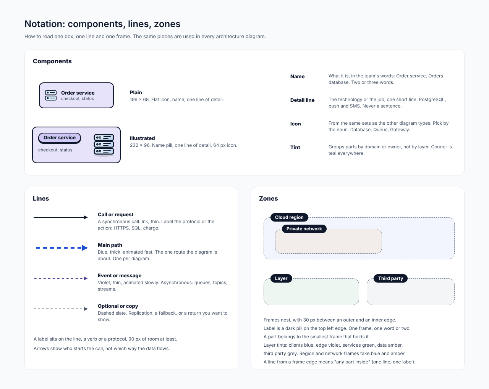
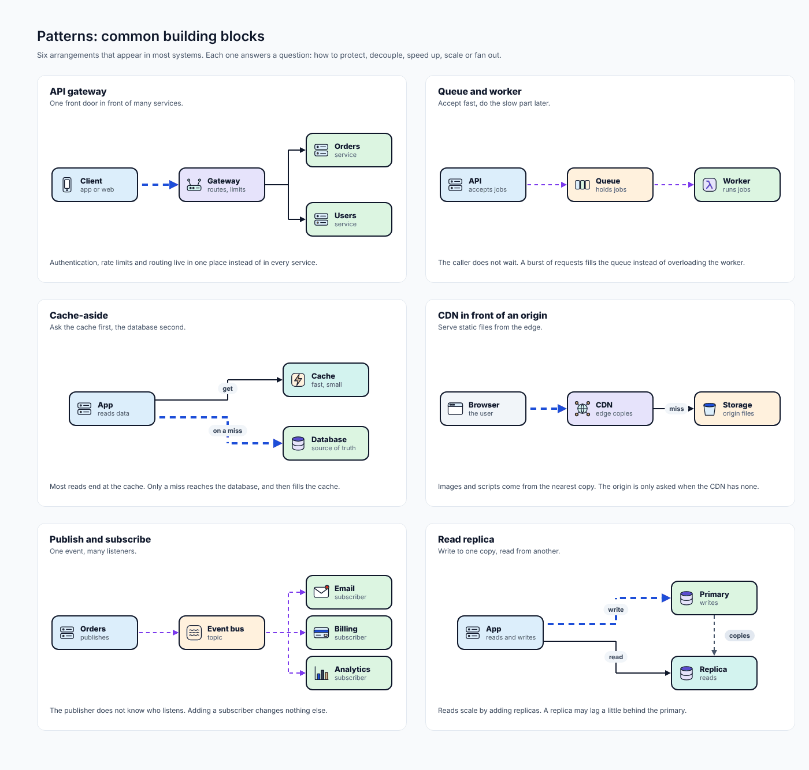
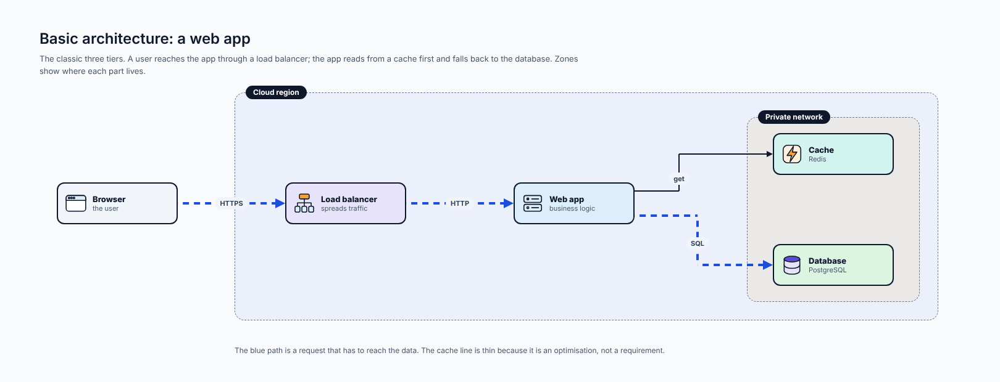
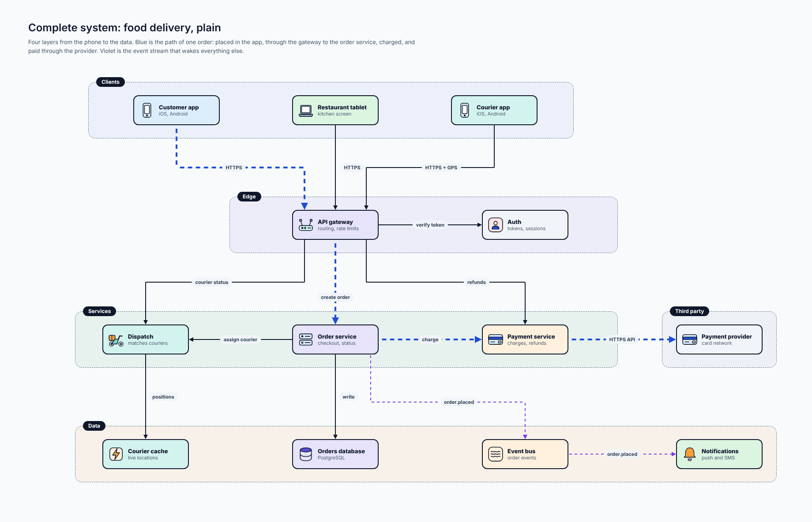
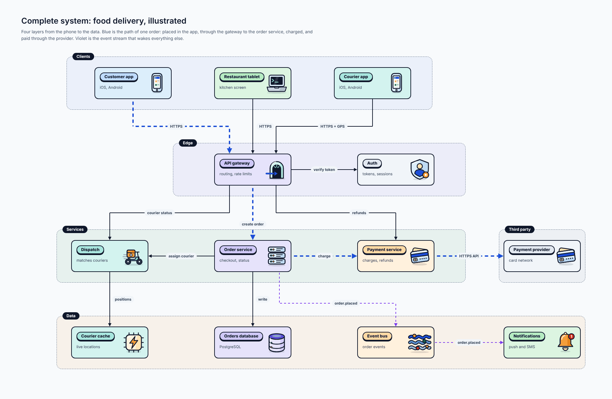
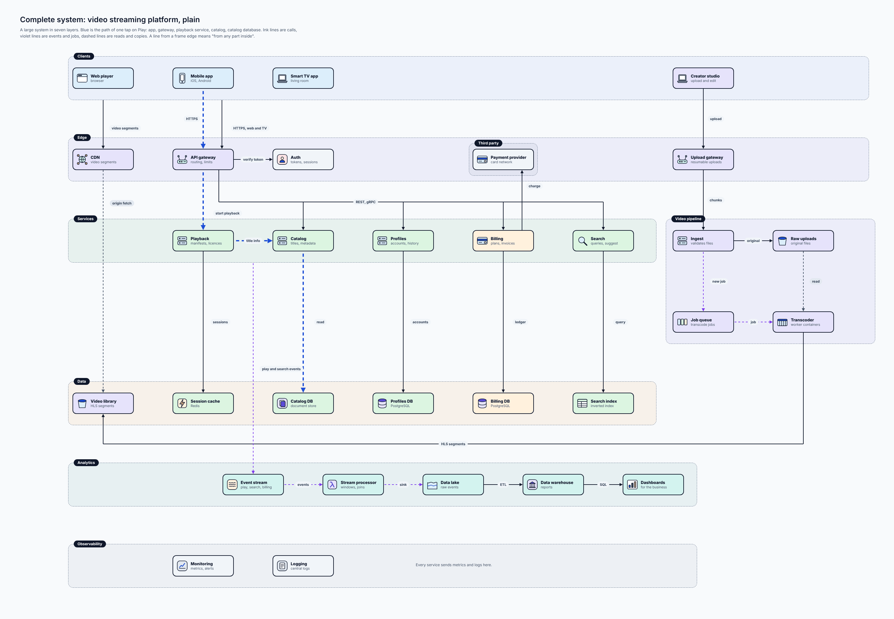
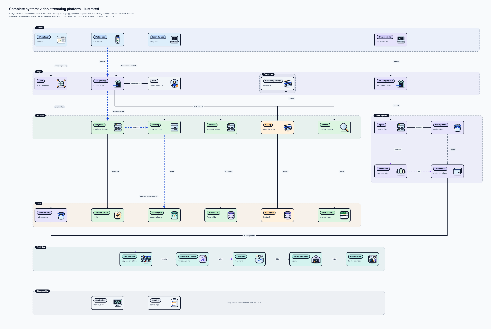
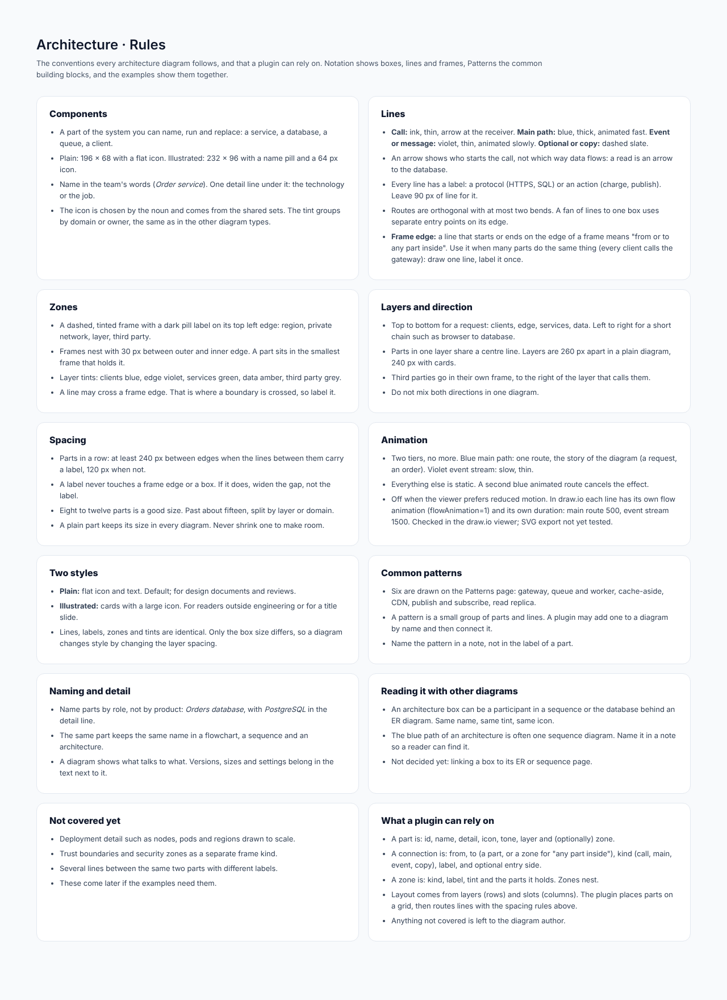

# Architecture diagram

## At a glance

| | |
| --- | --- |
| **Question it answers** | What parts make up the system, and what talks to what? |
| **Use it when** | Showing a system's structure: its services, databases, queues and clients, and which part calls which |
| **Do not use it when** | The order of messages is the point ([sequence](04-sequence.md)), you need regions, subnets and trust levels ([cloud](13-cloud.md)), or you want a fixed four-level vocabulary ([C4](12-c4.md)) |
| **Styles** | Plain (196 × 68 parts) and illustrated (232 × 96 cards with a 64 px icon) |
| **Boards** | 8: rules, notation, patterns, a web-app example, the delivery system in two styles, a large streaming platform in two styles |

## 1. What an architecture diagram is

An **architecture diagram** shows the *parts* of a system and the *connections* between them. A part is anything you can name, run and replace: a service, a database, a queue, a client app. A connection is a call, an event or a copy. Frames group parts into layers, networks or owners.

If you have never drawn one, think of a map of a city's roads, not a timetable: it tells you what is connected to what, not in which order things happen. For that, draw a [sequence diagram](04-sequence.md) of one route through it.

## 2. How to read one box, one line and one frame

*Components, lines and zones. [Full size](images/Architecture_Notation.png) · [HTML source](source/html/Architecture_Notation.html)*

### Components

A box has a **name** (in the team's words: *Order service*, *Orders database*, two or three words), a **detail line** (the technology or the job: *PostgreSQL*, *push and SMS*; never a sentence), an **icon** (chosen by the noun) and a **tint** (by domain or owner, not by layer: *Courier is teal everywhere*).

### Lines

| Line | Meaning |
| --- | --- |
| **Call or request** | Synchronous. Ink, thin. Label the protocol or the action: HTTPS, SQL, charge |
| **Main path** | Blue, thick, animated fast. The one route the diagram is about. One per diagram |
| **Event or message** | Violet, thin, animated slowly. Asynchronous: queues, topics, streams |
| **Optional or copy** | Dashed slate. Replication, a fallback, or a return you want to show |

**An arrow shows who starts the call, not which way the data flows.** A read is an arrow *to* the database. Every line has a label (a protocol or an action) and 90 px of room for it.

### Frames (zones)

A dashed, tinted frame with a dark pill label on its top left edge: a cloud region, a private network, a layer, a third party. Frames nest with 30 px between outer and inner edge, and a part belongs to the smallest frame that holds it. Layer tints: clients blue, edge violet, services green, data amber, third parties grey.

**A line from a frame edge** means "from or to any part inside". Use it when many parts do the same thing (every client calls the gateway): draw one line and label it once.

## 3. Common patterns

Six arrangements appear in most systems. Each answers a question.

*Six common building blocks. [Full size](images/Architecture_Patterns.png) · [HTML source](source/html/Architecture_Patterns.html)*

| Pattern | Question it answers | In one line |
| --- | --- | --- |
| **API gateway** | How do I protect many services? | One front door; authentication, rate limits and routing live in one place |
| **Queue and worker** | How do I do the slow part later? | The API accepts a job, the queue holds it, a worker runs it; the caller does not wait |
| **Cache-aside** | How do I speed up reads? | Ask the cache first, the database second; only a miss reaches the database, and fills the cache |
| **CDN in front of an origin** | How do I serve static files fast? | Files come from the nearest copy; the origin is asked only when the CDN has none |
| **Publish and subscribe** | How do I fan out one event? | The publisher does not know who listens; adding a subscriber changes nothing else |
| **Read replica** | How do I scale reads? | Write to the primary, read from replicas, which may lag a little |

A pattern is a small group of parts and lines. A plugin may add one to a diagram by name and then connect it. Name the pattern in a note, never in the label of a part.

## 4. A basic example: a web app

*Basic architecture: a web app. [Full size](images/Architecture_Basic.png) · [HTML source](source/html/Architecture_Basic.html)*

The classic three tiers. A **Browser** reaches the **Web app** through a **Load balancer** (blue, the path to the data); the app reads from the **Cache** first (a thin line, because the cache is an optimisation, not a requirement) and falls back to the **Database** with SQL. Two zones show where each part lives: a cloud region, and a private network that holds the cache and the database.

## 5. The complete example: food delivery

*Complete system: food delivery, plain. [Full size](images/Architecture_Delivery.png) · [HTML source](source/html/Architecture_Delivery.html)*

Four layers from the phone to the data: **Clients** (Customer app, Restaurant tablet, Courier app), **Edge** (API gateway, Auth), **Services** (Dispatch, Order service, Payment service) and **Data** (Courier cache, Orders database, Event bus, Notifications), with a **Third party** frame to the right holding the Payment provider.

- **Blue** is one order: placed in the app, through the gateway (*create order*) to the Order service, *charge* to the Payment service, and *HTTPS API* to the provider.
- **Violet** is the event stream: the Order service publishes `order.placed` to the Event bus, and Notifications consume it (push and SMS). Nothing waits on that stream.
- The Courier app sends *HTTPS + GPS*; Dispatch keeps *positions* in the Courier cache.

### The illustrated version

*Complete system: food delivery, illustrated. [Full size](images/Architecture_Delivery_Illustrated.png) · [HTML source](source/html/Architecture_Delivery_Illustrated.html)*

Lines, labels, zones and tints are identical. Only the box size differs: cards are 232 × 96 and layers sit 240 px apart, against 196 × 68 parts and 260 px in the plain diagram.

## 6. A larger system: a video streaming platform

A diagram with about 33 parts, to prove the rules hold when a system is big. It has seven layers: **Clients** (Web player, Mobile app, Smart TV app, Creator studio), **Edge** (CDN, API gateway, Auth), **Services** (Playback, Catalog, Profiles, Billing, Search, Upload gateway), **Data** (Session cache, Catalog DB, Profiles DB, Billing DB, Search index), a **Video pipeline** (Ingest, Raw uploads, Job queue, Transcoder, Video library), **Analytics** (Event stream, Stream processor, Data lake, Data warehouse, Dashboards) and **Observability** (Monitoring, Logging), plus a Third party frame (Payment provider).

*Complete system: video streaming platform, plain. [Full size](images/Architecture_Streaming.png) · [HTML source](source/html/Architecture_Streaming.html)*

- **Blue** is the path of one tap on *Play*: app, gateway, Playback service, Catalog, Catalog database.
- **Ink** lines are calls, **violet** lines are events and jobs, **dashed** lines are reads and copies.
- **Frame-edge lines** keep the diagram readable: "Every service sends metrics and logs here" is one line from the Services frame to Observability, not a dozen.

*Complete system: video streaming platform, illustrated. [Full size](images/Architecture_Streaming_Illustrated.png) · [HTML source](source/html/Architecture_Streaming_Illustrated.html)*

The illustrated version of the same system is wider (3468 against 2860 px) because cards are larger.

## 7. Layout and spacing

- **Direction.** Top to bottom for a request: clients, edge, services, data. Left to right for a short chain such as browser to database. Do not mix both in one diagram.
- **Layers** are 260 px apart in a plain diagram and 240 px with cards. Parts in one layer share a centre line.
- **Third parties** go in their own frame to the right of the layer that calls them.
- **Spacing.** Parts in a row are at least 240 px apart (edges) when the lines between them carry a label, 120 px when not. A plain part keeps its size in every diagram.
- **Size.** Eight to twelve parts is a good size; past about fifteen, split by layer or domain.

## 8. Connections to other types

- An architecture box can be a participant in a [sequence](04-sequence.md) or the database behind an [ER diagram](05-er.md): same name, same tint, same icon.
- The blue path is often one sequence diagram. Name it in a note.
- For a fixed vocabulary and levels of zoom, use [C4](12-c4.md). For regions, subnets and trust levels, use [cloud](13-cloud.md).
- Not decided yet: linking a box to its ER or sequence page.

## 9. What a plugin can rely on

- A part is: id, name, detail, icon, tone, layer and (optionally) zone.
- A connection is: from, to (a part, or a zone for "any part inside"), kind (call, main, event, copy), label, and optional entry side.
- A zone is: kind, label, tint and the parts it holds. Zones nest.
- Layout comes from layers (rows) and slots (columns). The plugin places parts on a grid, then routes lines with the spacing rules.

## Reference: the rules board

*Architecture: rules board. [Full size](images/Architecture_Rules.png) · [HTML source](source/html/Architecture_Rules.html)*

#### Components

- A part of the system you can name, run and replace: a service, a database, a queue, a client.
- Plain: 196 × 68 with a flat icon. Illustrated: 232 × 96 with a name pill and a 64 px icon.
- Name in the team's words (*Order service*). One detail line under it: the technology or the job.
- The icon is chosen by the noun and comes from the shared sets. The tint groups by domain or owner, the same as in the other diagram types.

#### Lines

- **Call:** ink, thin, arrow at the receiver. **Main path:** blue, thick, animated fast. **Event or message:** violet, thin, animated slowly. **Optional or copy:** dashed slate.
- An arrow shows who starts the call, not which way data flows: a read is an arrow to the database.
- Every line has a label: a protocol (HTTPS, SQL) or an action (charge, publish). Leave 90 px of line for it.
- Routes are orthogonal with at most two bends. A fan of lines to one box uses separate entry points on its edge.
- **Frame edge:** a line that starts or ends on the edge of a frame means "from or to any part inside". Use it when many parts do the same thing (every client calls the gateway): draw one line, label it once.

#### Zones

- A dashed, tinted frame with a dark pill label on its top left edge: region, private network, layer, third party.
- Frames nest with 30 px between outer and inner edge. A part sits in the smallest frame that holds it.
- Layer tints: clients blue, edge violet, services green, data amber, third party grey.
- A line may cross a frame edge. That is where a boundary is crossed, so label it.

#### Layers and direction

- Top to bottom for a request: clients, edge, services, data. Left to right for a short chain such as browser to database.
- Parts in one layer share a centre line. Layers are 260 px apart in a plain diagram, 240 px with cards.
- Third parties go in their own frame, to the right of the layer that calls them.
- Do not mix both directions in one diagram.

#### Spacing

- Parts in a row: at least 240 px between edges when the lines between them carry a label, 120 px when not.
- A label never touches a frame edge or a box. If it does, widen the gap, not the label.
- Eight to twelve parts is a good size. Past about fifteen, split by layer or domain.
- A plain part keeps its size in every diagram. Never shrink one to make room.

#### Animation

- Two tiers, no more. Blue main path: one route, the story of the diagram (a request, an order). Violet event stream: slow, thin.
- Everything else is static. A second blue animated route cancels the effect.
- Off when the viewer prefers reduced motion. In draw.io each line has its own flow animation (flowAnimation=1) and its own duration: main route 500, event stream 1500. Checked in the draw.io viewer; SVG export not yet tested.

#### Two styles

- **Plain:** flat icon and text. Default; for design documents and reviews.
- **Illustrated:** cards with a large icon. For readers outside engineering or for a title slide.
- Lines, labels, zones and tints are identical. Only the box size differs, so a diagram changes style by changing the layer spacing.

#### Common patterns

- Six are drawn on the Patterns page: gateway, queue and worker, cache-aside, CDN, publish and subscribe, read replica.
- A pattern is a small group of parts and lines. A plugin may add one to a diagram by name and then connect it.
- Name the pattern in a note, not in the label of a part.

#### Naming and detail

- Name parts by role, not by product: *Orders database*, with *PostgreSQL* in the detail line.
- The same part keeps the same name in a flowchart, a sequence and an architecture.
- A diagram shows what talks to what. Versions, sizes and settings belong in the text next to it.

#### Reading it with other diagrams

- An architecture box can be a participant in a sequence or the database behind an ER diagram. Same name, same tint, same icon.
- The blue path of an architecture is often one sequence diagram. Name it in a note so a reader can find it.
- Not decided yet: linking a box to its ER or sequence page.

#### Not covered yet

- Deployment detail such as nodes, pods and regions drawn to scale.
- Trust boundaries and security zones as a separate frame kind.
- Several lines between the same two parts with different labels.
- These come later if the examples need them.

#### What a plugin can rely on

- A part is: id, name, detail, icon, tone, layer and (optionally) zone.
- A connection is: from, to (a part, or a zone for "any part inside"), kind (call, main, event, copy), label, and optional entry side.
- A zone is: kind, label, tint and the parts it holds. Zones nest.
- Layout comes from layers (rows) and slots (columns). The plugin places parts on a grid, then routes lines with the spacing rules above.
- Anything not covered is left to the diagram author.

