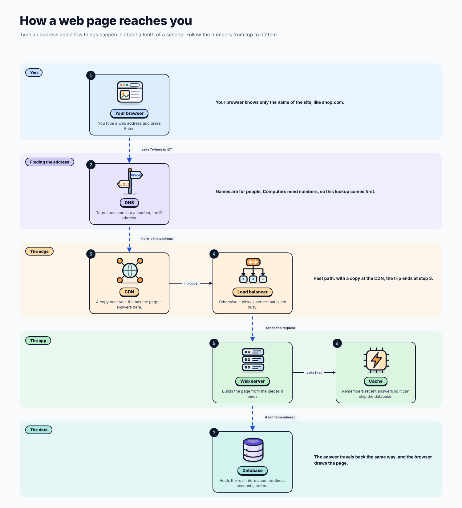
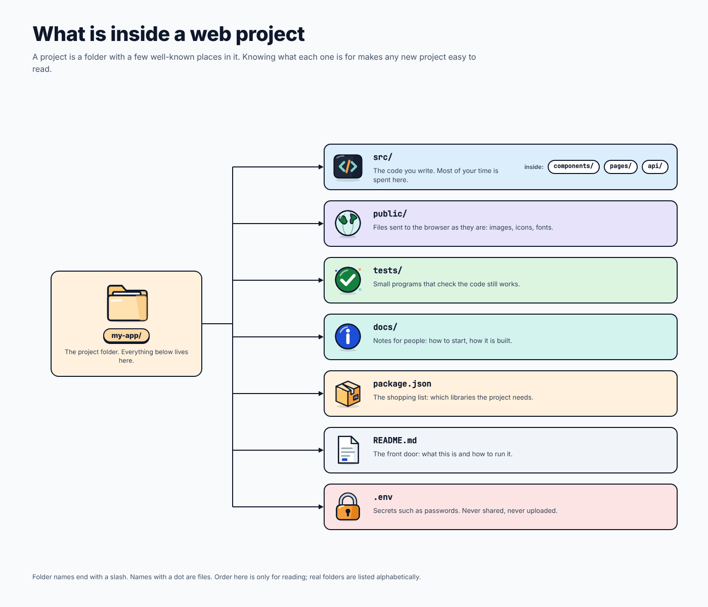
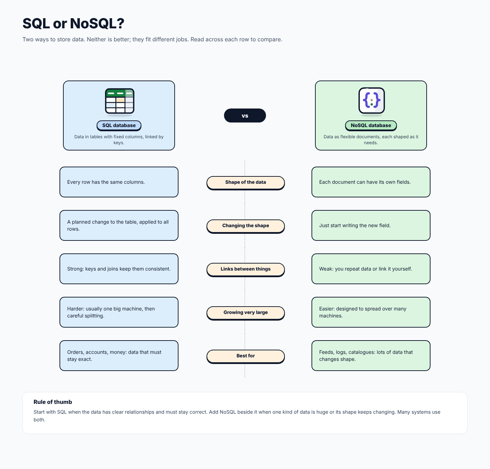
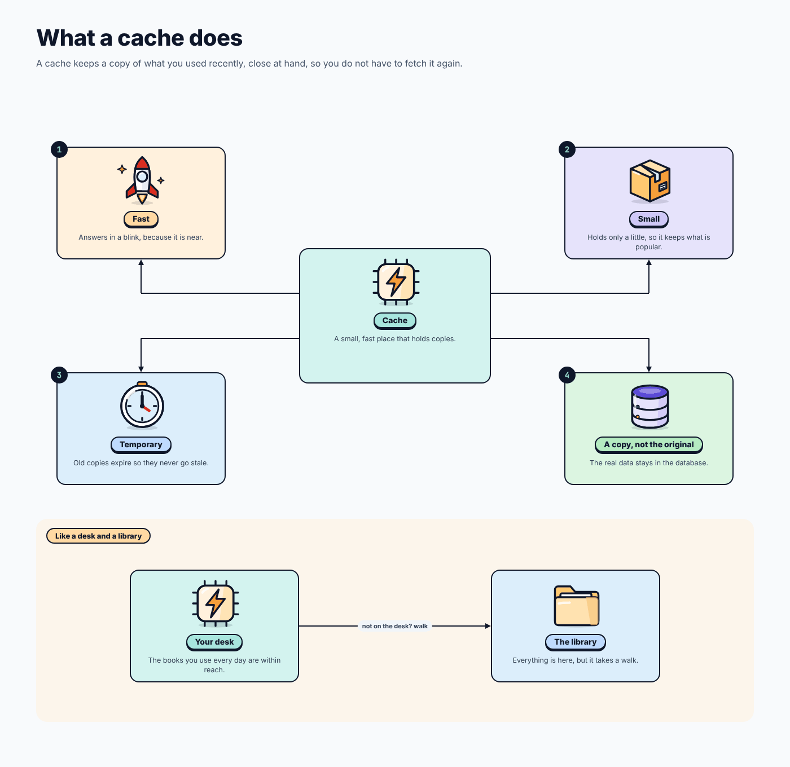
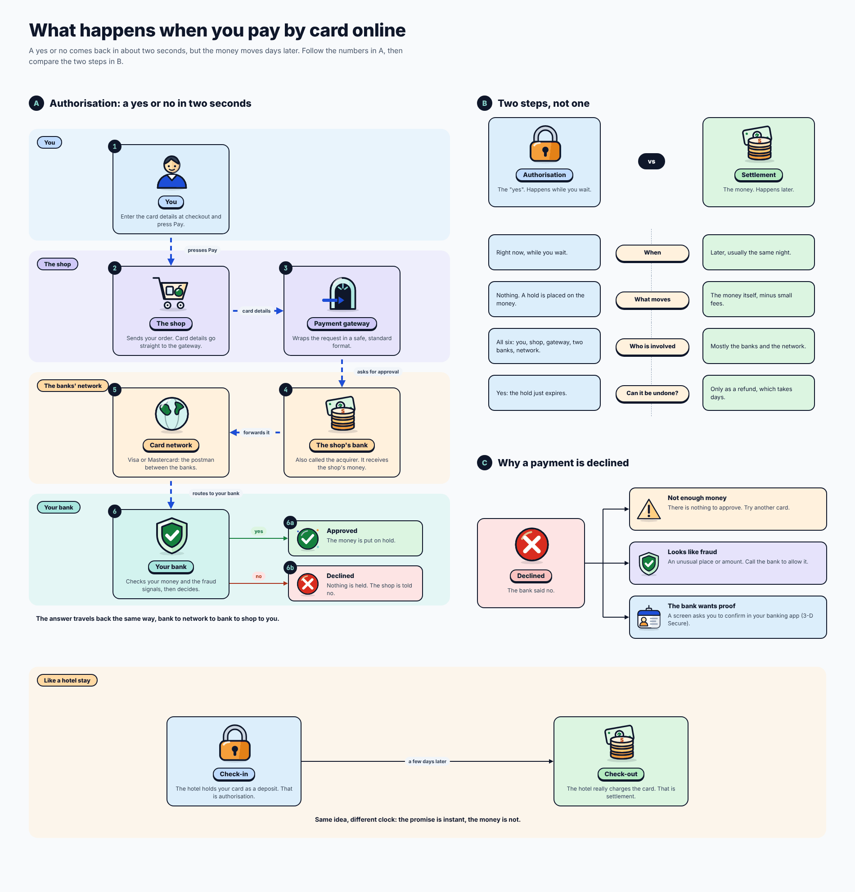
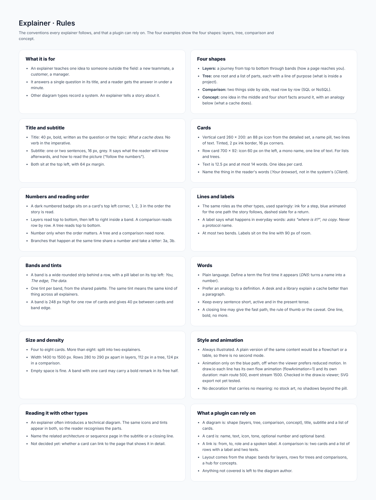

# Explainer

## At a glance

| | |
| --- | --- |
| **Question it answers** | How do I teach one idea to someone outside the field? |
| **Use it when** | A new teammate, a customer or a manager needs to understand a concept: how a web page reaches you, what a cache does, what happens when you pay by card |
| **Do not use it when** | You are recording a system for engineers: use a technical type ([architecture](06-architecture.md), [sequence](04-sequence.md)). An explainer *tells a story about* a system; the technical types *record* it |
| **Style** | Always illustrated. There is no plain mode, because a plain version of the same content would be a flowchart or a table |
| **Boards** | 6: rules, four shapes (layers, tree, comparison, concept) and one complete explainer |

## 1. What makes an explainer different

Every other type in this design is a record: it must be complete and exact enough for a team to build from. An explainer has a different job. It answers **one question**, in the title, and the reader should get the answer in **under a minute**. That changes the rules:

- **Plain words.** Define a term the first time it appears (*DNS*: turns a name into a number). Prefer an analogy to a definition: a desk and a library explain a cache better than a paragraph.
- **Few, big cards.** Four to eight cards, each one idea, each at most 14 words.
- **A path to follow.** Numbered badges give a reading order; one blue animated line marks the path the story follows.
- **A closing line.** One line, bold, may give the fast path, the rule of thumb or the caveat. No more.

## 2. The four shapes

| Shape | When | Reads |
| --- | --- | --- |
| **Layers** | A journey through places (how a page reaches you) | Top to bottom through bands, left to right inside a band |
| **Tree** | One root and its parts, each with a line of purpose (what is inside a project) | Top to bottom |
| **Comparison** | Two things side by side (SQL or NoSQL) | Row by row |
| **Concept** | One idea in the middle, four short facts around it, and an analogy below (what a cache does) | Hub first, facts clockwise, then the analogy |

### 2.1 Layers: how a web page reaches you

*Layered flow: how a web page reaches you. [Full size](images/Explainer_Layers.png)*

Five bands (You, Finding the address, The edge, The app, The data) carry seven numbered cards: Your browser (1), DNS (2), CDN (3), Load balancer (4), Web server (5), Cache (6), Database (7). The blue path runs down the cards in order, with spoken labels (*asks "where is it?"*, *here is the address*, *no copy*, *sends the request*, *asks first*, *if not remembered*). A closing note gives the fast path: with a copy at the CDN, the trip ends at step 3. Notice that labels use everyday words, never protocol names.

### 2.2 Tree: what is inside a web project

*Tree: what is inside a web project. [Full size](images/Explainer_Tree.png)*

A root card (`my-app/`) and one row card for each important file or folder (`src/`, `public/`, `tests/`, `docs/`, `package.json`, `README.md`, `.env`). Each row has an icon, a mono name and one line of purpose; for example, `package.json` is "the shopping list: which libraries the project needs" and `.env` is "secrets such as passwords: never shared, never uploaded". A tree has no numbers because order does not matter.

### 2.3 Comparison: SQL or NoSQL

*Comparison: SQL or NoSQL. [Full size](images/Explainer_Compare.png)*

Two panels, a warm one and a cool one, and five rows read across: shape of the data, changing the shape, links between things, growing very large, best for. A **rule of thumb** closes it: start with SQL when the data has clear relationships and must stay correct; add NoSQL beside it when one kind of data is huge or its shape keeps changing; many systems use both. The title says it first: *neither is better; they fit different jobs*.

### 2.4 Concept: what a cache does

*Concept: what a cache does. [Full size](images/Explainer_Concept.png)*

The **Cache** sits in the middle. Around it, four facts: Fast, Small, Temporary, A copy and not the original. Below, an analogy: *your desk* (the books you use every day are within reach) and *the library* (everything is here, but it takes a walk), joined by "not on the desk? walk".

## 3. The complete explainer: paying by card online

*Complete explainer: what happens when you pay by card online. [Full size](images/Explainer_Payment.png)*

This one combines three shapes in one page. Its title is a question, and its subtitle says what the reader will know afterwards: *a yes or no comes back in about two seconds, but the money moves days later*.

- **A. Authorisation: a yes or no in two seconds.** A layered flow across four bands (You, The shop, The banks' network, Your bank). Six numbered cards: you press Pay, the shop sends the order, the payment gateway wraps the request, the shop's bank (the *acquirer*) receives it, the card network (Visa or Mastercard) acts as postman, your bank checks your money and fraud signals and decides. Step 6 splits into **6a Approved** (the money is put on hold) and **6b Declined** (nothing is held). The answer travels back the same way.
- **B. Two steps, not one.** A comparison of **Authorisation** (the "yes", happens while you wait, places a hold, involves all six, can be undone because the hold just expires) and **Settlement** (the money, happens later, usually the same night, moves the money minus small fees, mostly the banks and the network, undone only by a refund that takes days).
- **C. Why a payment is declined, and an analogy.** A row of cards gives the common reasons: *Not enough money* (there is nothing to approve: try another card), *Looks like fraud* (an unusual place or amount: call the bank to allow it) and *The bank wants proof* (a screen asks you to confirm in your banking app, known as 3-D Secure). Below, **a hotel stay** explains the two steps with an analogy: check-in is the deposit hold (authorisation) and check-out is the real charge (settlement), "a few days later". Its closing line: *same idea, different clock: the promise is instant, the money is not.*

It is the model for how to build a complex explainer: several small shapes, one story, one numbered path.

## 4. Conventions in detail

### Title and subtitle

The title is 40 px, bold, written as the question or the topic (*What a cache does*), never in the imperative. The subtitle is one or two sentences, 16 px, grey: what the reader will know afterwards and how to read the picture (*follow the numbers*). Both sit at the top left with 64 px margin.

### Cards

| Card | Size | Anatomy | Use |
| --- | --- | --- | --- |
| **Vertical card** | 260 × 200 | 88 px detailed icon, name pill, two lines of text; tinted, 2 px ink border, 16 px corners | Layers, concept |
| **Row card** | 700 × 92 | 60 px icon on the left, a mono name, one line of text | Lists and trees |

Text is 12.5 px and at most 14 words. Name the thing in the reader's words (*Your browser*), not the system's (*Client*).

### Numbers and reading order

A dark numbered badge sits on a card's top left corner, 1, 2, 3 in the order the story is read. Number only when order matters (a tree and a comparison need none). Branches that happen at the same time share a number and take a letter (3a, 3b; 6a, 6b above).

### Bands and tints

A band is a wide rounded strip behind a row, with a pill label on its top left (*You*, *The edge*, *The data*). One tint per band, from the shared palette, meaning the same kind of thing in every explainer. A band is 248 px high for a single row of cards and leaves 40 px between cards and band edge.

### Size and density

Four to eight cards; beyond eight, split into two explainers. Width 1400 to 1500 px. Rows are 280 to 290 px apart in layers, 112 px in a tree and 124 px in a comparison. Empty space is fine; a band with one card may carry a bold remark in its free half.

### Words

Short sentences, active, in the present tense. No decoration that carries no meaning: no stock art, no shadows beyond the pill.

## 5. Connections to other types

An explainer often *introduces* a technical diagram: the same icons and tints appear in both, so the reader recognises the parts. Name the related architecture or sequence page in the subtitle or a closing line. Not decided yet: whether a card can link to the page that shows it in detail.

## 6. What a plugin can rely on

- A diagram is: shape (layers, tree, comparison, concept), title, subtitle and a list of cards.
- A card is: name, text, icon, tone, optional number and optional band.
- A link is: from, to, role and a spoken label. A comparison is: two cards and a list of rows, each with a label and two texts.
- Layout comes from the shape: bands for layers, rows for trees and comparisons, a hub for concepts.

## Reference: the rules board

*Explainer: rules board. [Full size](images/Explainer_Rules.png)*

#### What it is for

- An explainer teaches one idea to someone outside the field: a new teammate, a customer, a manager.
- It answers a single question in its title, and a reader gets the answer in under a minute.
- Other diagram types record a system. An explainer tells a story about it.

#### Four shapes

- **Layers:** a journey from top to bottom through bands (how a page reaches you).
- **Tree:** one root and a list of parts, each with a line of purpose (what is inside a project).
- **Comparison:** two things side by side, read row by row (SQL or NoSQL).
- **Concept:** one idea in the middle and four short facts around it, with an analogy below (what a cache does).

#### Title and subtitle

- Title: 40 px, bold, written as the question or the topic: *What a cache does*. No verb in the imperative.
- Subtitle: one or two sentences, 16 px, grey. It says what the reader will know afterwards, and how to read the picture ("follow the numbers").
- Both sit at the top left, with 64 px margin.

#### Cards

- Vertical card 260 × 200: an 88 px icon from the detailed set, a name pill, two lines of text. Tinted, 2 px ink border, 16 px corners.
- Row card 700 × 92: icon 60 px on the left, a mono name, one line of text. For lists and trees.
- Text is 12.5 px and at most 14 words. One idea per card.
- Name the thing in the reader's words (*Your browser*), not in the system's (*Client*).

#### Numbers and reading order

- A dark numbered badge sits on a card's top left corner, 1, 2, 3 in the order the story is read.
- Layers read top to bottom, then left to right inside a band. A comparison reads row by row. A tree reads top to bottom.
- Number only when the order matters. A tree and a comparison need none.
- Branches that happen at the same time share a number and take a letter: 3a, 3b.

#### Lines and labels

- The same roles as the other types, used sparingly: ink for a step, blue animated for the one path the story follows, dashed slate for a return.
- A label says what happens in everyday words: *asks "where is it?"*, *no copy*. Never a protocol name.
- At most two bends. Labels sit on the line with 90 px of room.

#### Bands and tints

- A band is a wide rounded strip behind a row, with a pill label on its top left: *You*, *The edge*, *The data*.
- One tint per band, from the shared palette. The same tint means the same kind of thing across all explainers.
- A band is 248 px high for one row of cards and gives 40 px between cards and band edge.

#### Words

- Plain language. Define a term the first time it appears (*DNS*: turns a name into a number).
- Prefer an analogy to a definition. A desk and a library explain a cache better than a paragraph.
- Keep every sentence short, active and in the present tense.
- A closing line may give the fast path, the rule of thumb or the caveat. One line, bold, no more.

#### Size and density

- Four to eight cards. More than eight: split into two explainers.
- Width 1400 to 1500 px. Rows 280 to 290 px apart in layers, 112 px in a tree, 124 px in a comparison.
- Empty space is fine. A band with one card may carry a bold remark in its free half.

#### Style and animation

- Always illustrated. A plain version of the same content would be a flowchart or a table, so there is no second mode.
- Animation only on the blue path, off when the viewer prefers reduced motion. In draw.io each line has its own flow animation (flowAnimation=1) and its own duration: main route 500, event stream 1500. Checked in the draw.io viewer; SVG export not yet tested.
- No decoration that carries no meaning: no stock art, no shadows beyond the pill.

#### Reading it with other types

- An explainer often introduces a technical diagram. The same icons and tints appear in both, so the reader recognises the parts.
- Name the related architecture or sequence page in the subtitle or a closing line.
- Not decided yet: whether a card can link to the page that shows it in detail.

#### What a plugin can rely on

- A diagram is: shape (layers, tree, comparison, concept), title, subtitle and a list of cards.
- A card is: name, text, icon, tone, optional number and optional band.
- A link is: from, to, role and a spoken label. A comparison is: two cards and a list of rows with a label and two texts.
- Layout comes from the shape: bands for layers, rows for trees and comparisons, a hub for concepts.
- Anything not covered is left to the diagram author.

