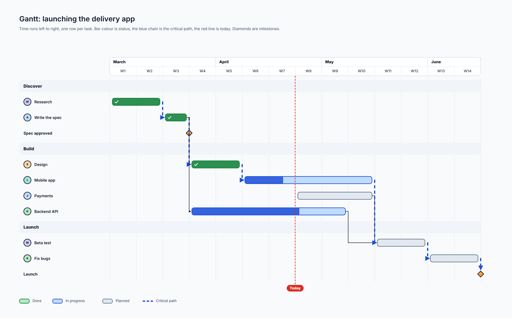
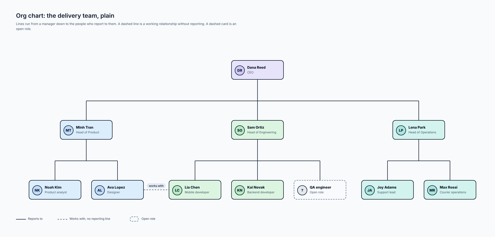
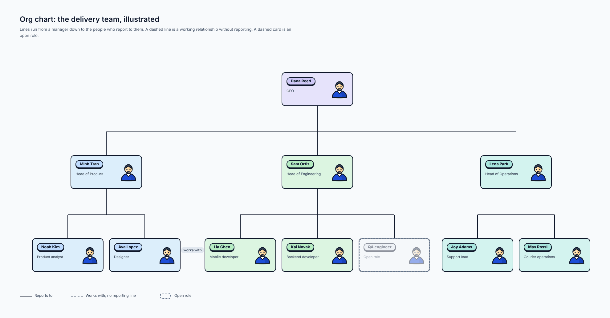
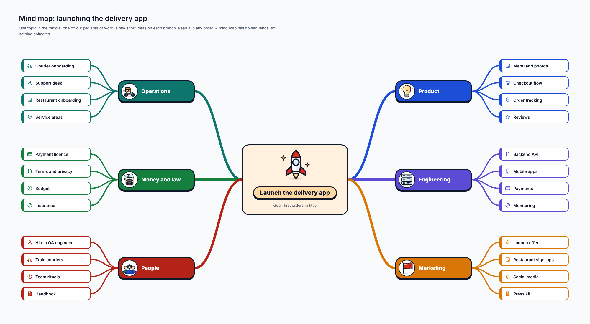
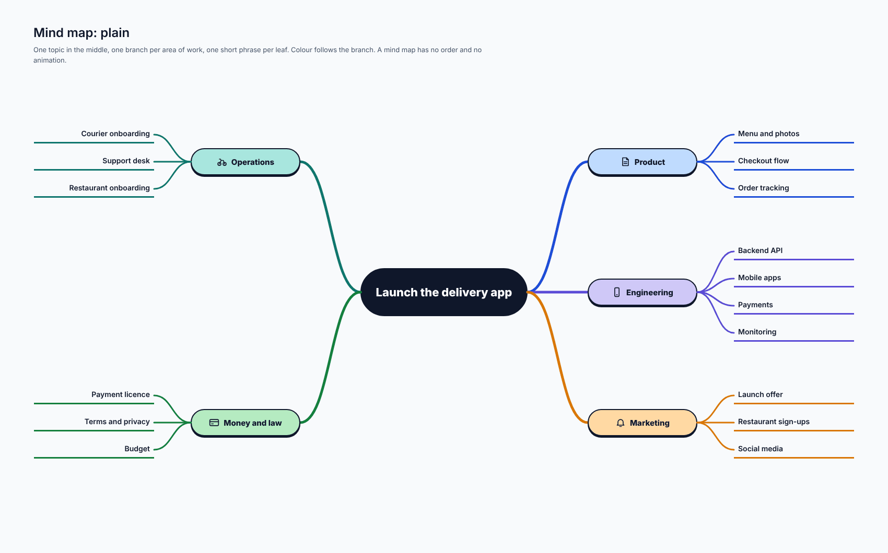
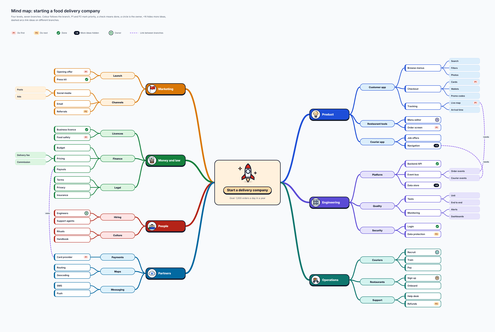
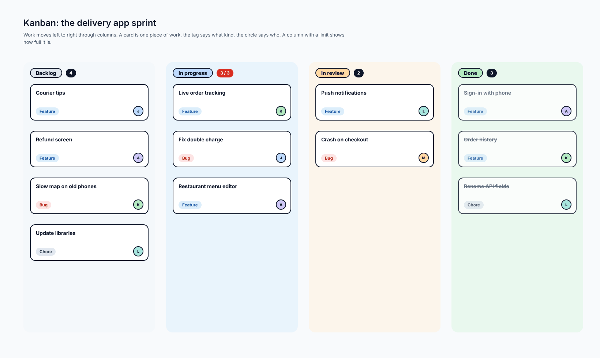
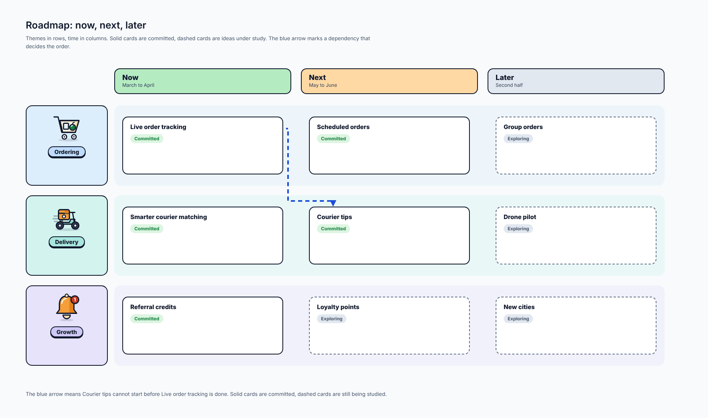
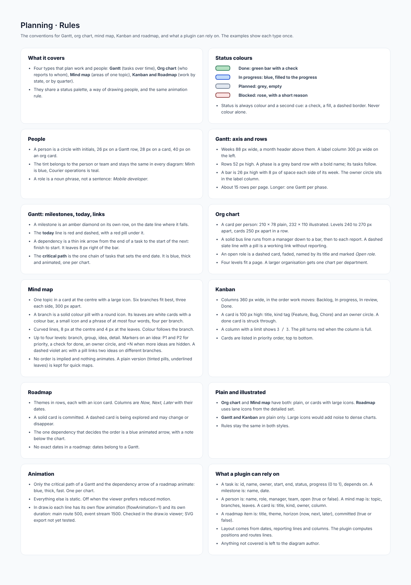

# Planning

## At a glance

| | |
| --- | --- |
| **Question it answers** | Who does what, by when, and in what order? |
| **Covers** | Five diagram kinds that plan work and people: **Gantt** (tasks over time), **Org chart** (who reports to whom), **Mind map** (areas of one topic), **Kanban** (work by state) and **Roadmap** (work by quarter) |
| **Use it when** | Planning a launch, showing a team, mapping a topic or tracking a sprint |
| **Styles** | Org chart and mind map have plain and illustrated; the roadmap uses detailed lane icons; Gantt and Kanban are plain only |
| **Boards** | 9: rules, Gantt, org chart (2), mind map (3), Kanban, roadmap |

All five share a **status palette**, a way of drawing **people**, and one animation rule, and they share a subject: *launching the delivery app*.

## 1. What the five kinds share

### 1.1 Status colours

| Status | Look | Second cue |
| --- | --- | --- |
| **Done** | Green bar | A check |
| **In progress** | Blue, filled to the progress | The fill |
| **Planned** | Grey, empty | Empty |
| **Blocked** | Rose | A short reason |

Status is always colour *and* a second cue, so it survives a black-and-white printout and a colour-blind reader.

### 1.2 People

A person is a circle with initials: 26 px on a Gantt row, 28 px on a card, 40 px on an org card. The tint belongs to the person or team and **stays the same in every diagram**: Minh is blue, Courier operations is teal. A role is a noun phrase, not a sentence (*Mobile developer*).

### 1.3 Animation

Only the **critical path** of a Gantt and the **dependency arrow** of a roadmap animate: blue, thick, fast, one per chart. Everything else is static. A mind map has no order, so nothing animates.

## 2. Gantt: tasks over time

*Gantt: launching the delivery app. [Full size](images/Planning_Gantt.png) · [HTML source](source/html/Planning_Gantt.html)*

Time runs left to right, one row per task. The example spans March to June (W1 to W14) in three phases: **Discover** (Research, Write the spec, with a milestone *Spec approved*), **Build** (Design, Mobile app, Payments, Backend API) and **Launch** (Beta test, Fix bugs, and a *Launch* milestone). Owners are circles with initials.

How to read it:

- **Bar colour is status**: done (green with a check), in progress (blue filled to its progress), planned (grey).
- **The blue chain is the critical path**: the one chain of tasks that sets the end date. It is thick and animated. One per chart.
- **The red dashed line is today**, with a red pill under it.
- **Diamonds are milestones**, amber, on their own row, on the date line where they fall.
- **A thin ink arrow is a dependency**, finish to start: it leaves 8 px to the right of the bar and enters the start of the next.

Axis and rows: weeks are 88 px wide with a month header above; a label column 300 px wide on the left; rows 52 px high; a phase is a grey band row with a bold name. Bars are 26 px high. About 15 rows per page; longer, one Gantt per phase.

## 3. Org chart: who reports to whom

*Org chart: the delivery team, plain. [Full size](images/Planning_Org.png) · [HTML source](source/html/Planning_Org.html)*

Lines run from a manager down to the people who report to them. Two kinds of exception are shown: a **dashed line** is a working relationship without reporting (*Works with, no reporting line*), and a **dashed card** is an **open role** (the QA engineer in the example). The example runs from the CEO through three heads (Product, Engineering, Operations) to their teams.

A solid bus runs from a manager down to a bar and on to each report. Cards are 210 × 78 plain and 232 × 110 illustrated; levels are 240 to 270 px apart and cards 250 px apart in a row. Four levels fit a page; a larger organisation gets one chart per department.

*Org chart: illustrated. [Full size](images/Planning_Org_Illustrated.png) · [HTML source](source/html/Planning_Org_Illustrated.html)*

In the illustrated version each person is a **card** with a name pill, the role on one line and a person icon, tinted by team (blue for Product, green for Engineering, teal for Operations). The **open role** is the same card, faded, with a dashed border and the words *Open role*; the dashed *works with* line joins the Designer and the Mobile developer. Lines, roles and rules are unchanged.

## 4. Mind map: areas of one topic

*Mind map: launching the delivery app. [Full size](images/Planning_Mind.png) · [HTML source](source/html/Planning_Mind.html)*

One topic in the middle (*Launch the delivery app*, goal: first orders in May), one colour per area of work (Product, Engineering, Marketing, Operations, Money and law, People) and a few short ideas on each branch. Read it in any order.

- A **branch** is a solid colour pill with a round icon. Its **leaves** are white cards with a colour bar, a small icon and a phrase of at most four words, four per branch.
- Lines are **curved**, 8 px at the centre and 4 px at the leaves, coloured by the branch.
- **Six branches** fit best, three on each side, 300 px apart.

### The plain version

*Mind map: plain. [Full size](images/Planning_Mind_Plain.png) · [HTML source](source/html/Planning_Mind_Plain.html)*

Tinted pills and underlined leaves, for quick maps. Same rules, no animation.

### A large mind map: four levels

*Mind map: large, four levels, starting a food delivery company. [Full size](images/Planning_Mind_Large.png) · [HTML source](source/html/Planning_Mind_Large.html)*

The simple map has two levels; real topics have more. This one has **four levels and seven branches** (Product, Engineering, Operations, Marketing and others) to show what happens when the subject is large:

- Levels are **branch, group, idea, detail** (for example Product, Customer app, Checkout, Cards).
- **P1** and **P2** mark priority (do first, do next); a **check** means done; a **circle** is the owner; **+N** says more ideas are hidden (*+4 more ideas hidden*).
- **Dashed violet arcs** link ideas on different branches, each with a pill. Use only a few: too many arcs turn the map into a tangle.
- Branches are laid out automatically so no leaf overlaps another.

## 5. Kanban: work by state

*Kanban: the delivery app sprint. [Full size](images/Planning_Kanban.png) · [HTML source](source/html/Planning_Kanban.html)*

Work moves left to right through columns: Backlog, In progress, In review, Done. A card is one piece of work: a title, a **kind tag** (Feature, Bug, Chore) and an **owner circle**. A done card is struck through.

A column with a limit shows how full it is: **3 / 3** in the example. The pill turns red when the column is full, which is the point of a limit: stop starting, finish something. Cards are listed in priority order, top to bottom. Columns are 360 px wide; a card is 100 px high.

## 6. Roadmap: work by quarter

*Roadmap: now, next, later. [Full size](images/Planning_Roadmap.png) · [HTML source](source/html/Planning_Roadmap.html)*

**Themes in rows** (Ordering, Delivery, Growth), **time in columns** (Now: March to April, Next: May to June, Later: second half). A **solid card** is committed; a **dashed card** is an idea under study (*Group orders*, *Drone pilot*, *Loyalty points*, *New cities*), which may change or disappear.

The **blue arrow** is the one dependency that decides the order: *Courier tips cannot start before Live order tracking is done*. A note below the chart says so. A roadmap has **no exact dates**: dates belong to a Gantt.

## 7. Connections to other types

- A roadmap theme often becomes a Gantt, and a Gantt phase often becomes a Kanban column set.
- The people in an org chart are the owners on a Gantt row and a Kanban card, with the same initials and tint.
- A mind map is a good first step before any of the others: it finds the areas, and the other types give them a time and an owner.

## 8. What a plugin can rely on

- A **task** is: id, name, owner, start, end, status, progress (0 to 1), depends on. A **milestone** is: name, date.
- A **person** is: name, role, manager, team, open (true or false). A **mind map** is: topic, branches, leaves. A **card** is: title, kind, owner, column.
- A **roadmap item** is: title, theme, horizon (now, next, later), committed (true or false).
- Layout comes from dates, reporting lines and columns. The plugin computes positions and routes the lines.

## Reference: the rules board

*Planning: rules board. [Full size](images/Planning_Rules.png) · [HTML source](source/html/Planning_Rules.html)*

#### What it covers

- Four types that plan work and people: **Gantt** (tasks over time), **Org chart** (who reports to whom), **Mind map** (areas of one topic), **Kanban and Roadmap** (work by state, or by quarter).
- They share a status palette, a way of drawing people, and the same animation rule.

#### Status colours

|  |
|---|
| **Done: green bar with a check** |
| **In progress: blue, filled to the progress** |
| **Planned: grey, empty** |
| **Blocked: rose, with a short reason** |

- Status is always colour and a second cue: a check, a fill, a dashed border. Never colour alone.

#### People

- A person is a circle with initials, 26 px on a Gantt row, 28 px on a card, 40 px on an org card.
- The tint belongs to the person or team and stays the same in every diagram: Minh is blue, Courier operations is teal.
- A role is a noun phrase, not a sentence: *Mobile developer*.

#### Gantt: axis and rows

- Weeks 88 px wide, a month header above them. A label column 300 px wide on the left.
- Rows 52 px high. A phase is a grey band row with a bold name; its tasks follow.
- A bar is 26 px high with 8 px of space each side of its week. The owner circle sits in the label column.
- About 15 rows per page. Longer: one Gantt per phase.

#### Gantt: milestones, today, links

- A milestone is an amber diamond on its own row, on the date line where it falls.
- The **today** line is red and dashed, with a red pill under it.
- A dependency is a thin ink arrow from the end of a task to the start of the next: finish to start. It leaves 8 px right of the bar.
- The **critical path** is the one chain of tasks that sets the end date. It is blue, thick and animated, one per chart.

#### Org chart

- A card per person: 210 × 78 plain, 232 × 110 illustrated. Levels 240 to 270 px apart, cards 250 px apart in a row.
- A solid bus line runs from a manager down to a bar, then to each report. A dashed slate line with a pill is a working link without reporting.
- An open role is a dashed card, faded, named by its title and marked *Open role*.
- Four levels fit a page. A larger organisation gets one chart per department.

#### Mind map

- One topic in a card at the centre with a large icon. Six branches fit best, three each side, 300 px apart.
- A branch is a solid colour pill with a round icon. Its leaves are white cards with a colour bar, a small icon and a phrase of at most four words, four per branch.
- Curved lines, 8 px at the centre and 4 px at the leaves. Colour follows the branch.
- Up to four levels: branch, group, idea, detail. Markers on an idea: P1 and P2 for priority, a check for done, an owner circle, and +N when more ideas are hidden. A dashed violet arc with a pill links two ideas on different branches.
- No order is implied and nothing animates. A plain version (tinted pills, underlined leaves) is kept for quick maps.

#### Kanban

- Columns 360 px wide, in the order work moves: Backlog, In progress, In review, Done.
- A card is 100 px high: title, kind tag (Feature, Bug, Chore) and an owner circle. A done card is struck through.
- A column with a limit shows `3 / 3`. The pill turns red when the column is full.
- Cards are listed in priority order, top to bottom.

#### Roadmap

- Themes in rows, each with an icon card. Columns are *Now*, *Next*, *Later* with their dates.
- A solid card is committed. A dashed card is being explored and may change or disappear.
- The one dependency that decides the order is a blue animated arrow, with a note below the chart.
- No exact dates in a roadmap: dates belong to a Gantt.

#### Plain and illustrated

- **Org chart** and **Mind map** have both: plain, or cards with large icons. **Roadmap** uses lane icons from the detailed set.
- **Gantt and Kanban** are plain only. Large icons would add noise to dense charts.
- Rules stay the same in both styles.

#### Animation

- Only the critical path of a Gantt and the dependency arrow of a roadmap animate: blue, thick, fast. One per chart.
- Everything else is static. Off when the viewer prefers reduced motion.
- In draw.io each line has its own flow animation (flowAnimation=1) and its own duration: main route 500, event stream 1500. Checked in the draw.io viewer; SVG export not yet tested.

#### What a plugin can rely on

- A task is: id, name, owner, start, end, status, progress (0 to 1), depends on. A milestone is: name, date.
- A person is: name, role, manager, team, open (true or false). A mind map is: topic, branches, leaves. A card is: title, kind, owner, column.
- A roadmap item is: title, theme, horizon (now, next, later), committed (true or false).
- Layout comes from dates, reporting lines and columns. The plugin computes positions and routes lines.
- Anything not covered is left to the diagram author.

