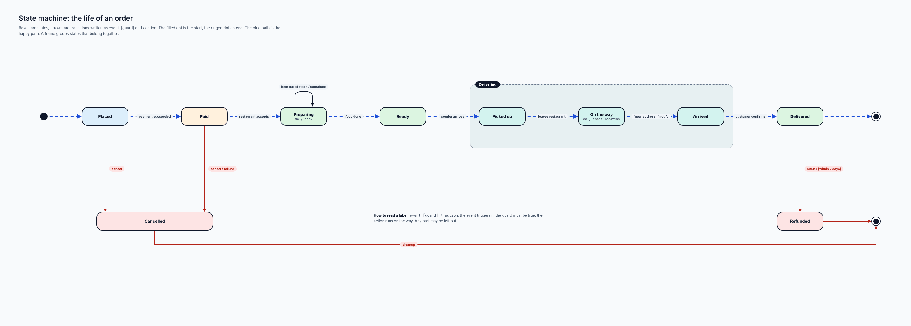
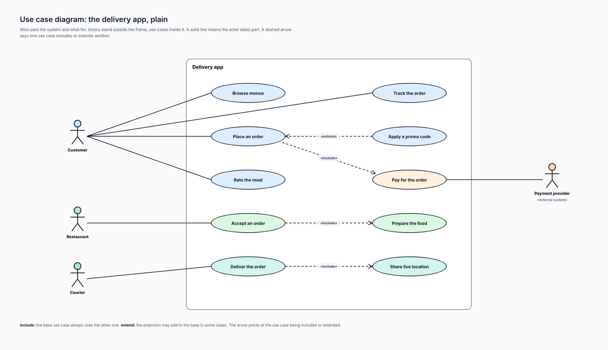
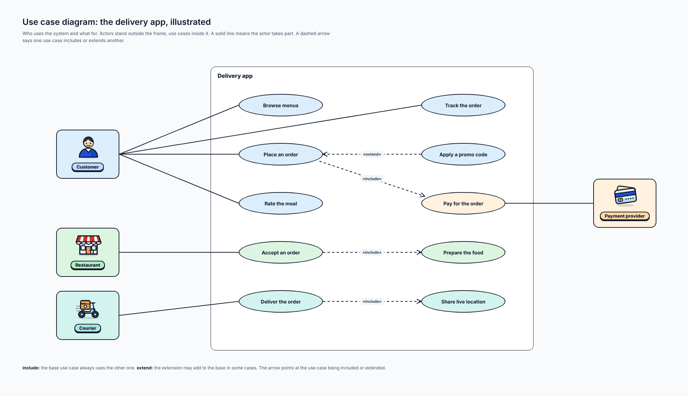
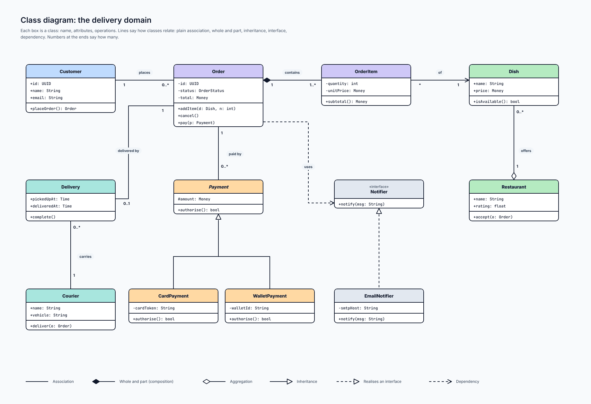
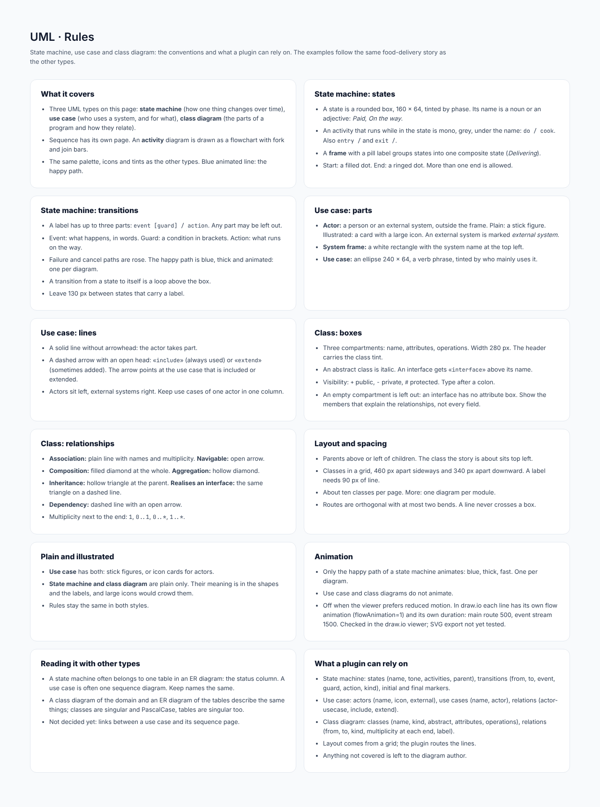

# UML

## At a glance

| | |
| --- | --- |
| **Question it answers** | What states does a thing pass through? Who uses the system, and for what? How are the classes related? |
| **Covers** | Three UML diagrams: **state machine**, **use case** and **class diagram**. (UML's *sequence* diagram has its own type: [Sequence](04-sequence.md)) |
| **Use them when** | Modelling the life of an order (state machine), listing what a system is for (use case), or describing the domain's classes (class diagram) |
| **Styles** | The use case has plain and illustrated; state machine and class diagram are plain |
| **Boards** | 6: rules, state machine, use case in two styles, class diagram |

All three use the delivery domain, so the same order that is a table in the [ER diagram](05-er.md) appears here as a class, a state machine and a use case.

## 1. State machine: the life of an order

*State machine: the life of an order. [Full size](images/UML_State.png)*

A **state machine** shows every state a thing can be in and what moves it from one to the next. Boxes are **states**, arrows are **transitions**, the filled dot is the **start** and the ringed dot an **end**.

### Reading a transition label

`event [guard] / action`, for example `leaves restaurant [near address] / notify customer`:

- the **event** triggers the transition;
- the **guard** must be true for it to fire;
- the **action** runs on the way.

Any part may be left out.

### The example

An order is **Placed**, then **Paid** (*payment succeeded*), **Preparing** (*restaurant accepts*; the state runs `do / cook`), **Ready** (*food done*), then enters the **Delivering** frame as **Picked up** (*courier arrives*), **On the way** (*leaves restaurant*; `do / share location`) and **Arrived** (`[near address] / notify customer`), and ends as **Delivered** (*customer confirms*) at the ringed end dot. A **frame** groups the three delivery states.

Three things leave the happy path, all in **rose**:

- **Cancelled** can be reached from Placed (*cancel*) and from Paid (*cancel / refund*, so the money goes back), and ends in *cleanup* at a second end dot.
- **Refunded** is reached from Delivered (*refund* `[within 7 days]`) and ends at that same second end dot.
- A **self-transition** on Preparing handles *item out of stock / substitute*: the state is left and re-entered with an action.

The **blue path** is the happy path, drawn thick and animated; it is the only animated line in the diagram.

## 2. Use case: what the system is for

*Use case diagram: the delivery app, plain. [Full size](images/UML_UseCase.png)*

A **use case diagram** says who uses the system and what for, without saying how.

- **Actors** stand *outside* the system frame: Customer, Restaurant, Courier and the Payment provider (marked *«external system»*).
- **Use cases** are ovals *inside* the frame, each a goal written as a verb phrase: Browse menus, Place an order, Pay for the order, Track the order, Rate the meal, Apply a promo code, Accept an order, Prepare the food, Deliver the order, Share live location.
- A **solid line** means the actor takes part in the use case.
- A **dashed arrow** says one use case relates to another. `«include»`: the base use case *always* uses the other one (Place an order includes Pay for the order). `«extend»`: the extension *may* add to the base in some cases (Apply a promo code extends Place an order). The arrow points at the use case being included or extended.

The Payment provider appears as an actor because it is outside the system but takes part in a use case (paying).

### The illustrated version

*Use case diagram: the delivery app, illustrated. [Full size](images/UML_UseCase_Illustrated.png)*

The actors become **cards** with a name pill and a large detailed icon (a person for the Customer, a shop front for the Restaurant, a scooter for the Courier, a card for the Payment provider), tinted by who they are. The use cases stay as ovals, tinted by the actor they belong to (blue for the customer's, green for the restaurant's, teal for the courier's, amber for payment). The notation (solid line, `«include»`, `«extend»`) is unchanged. In the plain version actors are the standard stick figure.

## 3. Class diagram: the delivery domain

*Class diagram: the delivery domain. [Full size](images/UML_Class.png)*

A **class diagram** describes the classes of a domain and how they relate. Each box has three parts: the **name**, the **attributes** and the **operations**; a compartment with nothing in it is left out. Visibility marks: `+` public, `-` private, `#` protected.

### The relationships

| Line | Meaning | Example in the diagram |
| --- | --- | --- |
| **Association** | A plain relationship, with numbers at the ends saying how many | Customer *places* Order (1 to 0..*) |
| **Whole and part (composition)** | The part dies with the whole | Order *contains* OrderItem (1 to 1..*) |
| **Aggregation** | A whole that merely holds parts that can live alone | Restaurant *offers* Dish (1 to 0..*) |
| **Inheritance** | A hollow triangle toward the parent | CardPayment and WalletPayment extend Payment |
| **Realises an interface** | Dashed line, hollow triangle | EmailNotifier realises «interface» Notifier |
| **Dependency** | Dashed open arrow: a weak, temporary use | Order *uses* Notifier |

Other details in the example: **Payment is abstract** (its name is in italics) with two concrete subclasses; Order and Delivery are linked by *delivered by* (1 to 0..1); Delivery and Courier by *carries*; Order and Payment by *paid by* (1 to 0..*); and OrderItem points at Dish with an association (*of*, many to one).

## 4. Conventions in detail

- **Animation.** Only the happy path of a state machine animates (blue, thick, fast, one per diagram). Use case and class diagrams do not animate.
- **Layout.** A state machine runs left to right with branches below; a frame groups states that belong together. A use case diagram has the actors on the outside, left and right, the frame in the middle. A class diagram puts parents above children and keeps lines short.
- **Empty compartments are omitted.** A class with no attributes shows only its name and operations. (This was added after a class box with an empty attributes compartment looked broken.)
- **Names.** Classes are singular nouns in PascalCase. Operations are written with their parameters and return type.

## 5. Connections to other types

- A class is the object-model twin of an [ER](05-er.md) table; the same names carry over.
- A state machine often documents the `status` column of an ER table: the states of the Order are the values of `Order.status`.
- A use case is a goal; the [sequence](04-sequence.md) diagram shows one way the system achieves it.

## 6. What a plugin can rely on

- A **state** is: name, optional entry/exit/do actions, optional group. A **transition** is: from, to, event, guard, action and a main flag.
- A **use case diagram** is: system name, actors (with an external flag), use cases and relationships (association, include, extend).
- A **class** is: name, stereotype, attributes, operations. A **relationship** is: from, to, kind and the multiplicity at each end.
- Anything not covered is left to the diagram author.

## Reference: the rules board

*UML: rules board. [Full size](images/UML_Rules.png)*

#### What it covers

- Three UML types on this page: **state machine** (how one thing changes over time), **use case** (who uses a system, and for what), **class diagram** (the parts of a program and how they relate).
- Sequence has its own page. An **activity** diagram is drawn as a flowchart with fork and join bars.
- The same palette, icons and tints as the other types. Blue animated line: the happy path.

#### State machine: states

- A state is a rounded box, 160 × 64, tinted by phase. Its name is a noun or an adjective: *Paid*, *On the way*.
- An activity that runs while in the state is mono, grey, under the name: `do / cook`. Also `entry /` and `exit /`.
- A **frame** with a pill label groups states into one composite state (*Delivering*).
- Start: a filled dot. End: a ringed dot. More than one end is allowed.

#### State machine: transitions

- A label has up to three parts: `event [guard] / action`. Any part may be left out.
- Event: what happens, in words. Guard: a condition in brackets. Action: what runs on the way.
- Failure and cancel paths are rose. The happy path is blue, thick and animated: one per diagram.
- A transition from a state to itself is a loop above the box.
- Leave 130 px between states that carry a label.

#### Use case: parts

- **Actor:** a person or an external system, outside the frame. Plain: a stick figure. Illustrated: a card with a large icon. An external system is marked *external system*.
- **System frame:** a white rectangle with the system name at the top left.
- **Use case:** an ellipse 240 × 64, a verb phrase, tinted by who mainly uses it.

#### Use case: lines

- A solid line without arrowhead: the actor takes part.
- A dashed arrow with an open head: `«include»` (always used) or `«extend»` (sometimes added). The arrow points at the use case that is included or extended.
- Actors sit left, external systems right. Keep use cases of one actor in one column.

#### Class: boxes

- Three compartments: name, attributes, operations. Width 280 px. The header carries the class tint.
- An abstract class is italic. An interface gets `«interface»` above its name.
- Visibility: `+` public, `-` private, `#` protected. Type after a colon.
- An empty compartment is left out: an interface has no attribute box. Show the members that explain the relationships, not every field.

#### Class: relationships

- **Association:** plain line with names and multiplicity. **Navigable:** open arrow.
- **Composition:** filled diamond at the whole. **Aggregation:** hollow diamond.
- **Inheritance:** hollow triangle at the parent. **Realises an interface:** the same triangle on a dashed line.
- **Dependency:** dashed line with an open arrow.
- Multiplicity next to the end: `1`, `0..1`, `0..*`, `1..*`.

#### Layout and spacing

- Parents above or left of children. The class the story is about sits top left.
- Classes in a grid, 460 px apart sideways and 340 px apart downward. A label needs 90 px of line.
- About ten classes per page. More: one diagram per module.
- Routes are orthogonal with at most two bends. A line never crosses a box.

#### Plain and illustrated

- **Use case** has both: stick figures, or icon cards for actors.
- **State machine and class diagram** are plain only. Their meaning is in the shapes and the labels, and large icons would crowd them.
- Rules stay the same in both styles.

#### Animation

- Only the happy path of a state machine animates: blue, thick, fast. One per diagram.
- Use case and class diagrams do not animate.
- Off when the viewer prefers reduced motion. In draw.io each line has its own flow animation (flowAnimation=1) and its own duration: main route 500, event stream 1500. Checked in the draw.io viewer; SVG export not yet tested.

#### Reading it with other types

- A state machine often belongs to one table in an ER diagram: the status column. A use case is often one sequence diagram. Keep names the same.
- A class diagram of the domain and an ER diagram of the tables describe the same things; classes are singular and PascalCase, tables are singular too.
- Not decided yet: links between a use case and its sequence page.

#### What a plugin can rely on

- State machine: states (name, tone, activities, parent), transitions (from, to, event, guard, action, kind), initial and final markers.
- Use case: actors (name, icon, external), use cases (name, actor), relations (actor-usecase, include, extend).
- Class diagram: classes (name, kind, abstract, attributes, operations), relations (from, to, kind, multiplicity at each end, label).
- Layout comes from a grid; the plugin routes the lines.
- Anything not covered is left to the diagram author.

