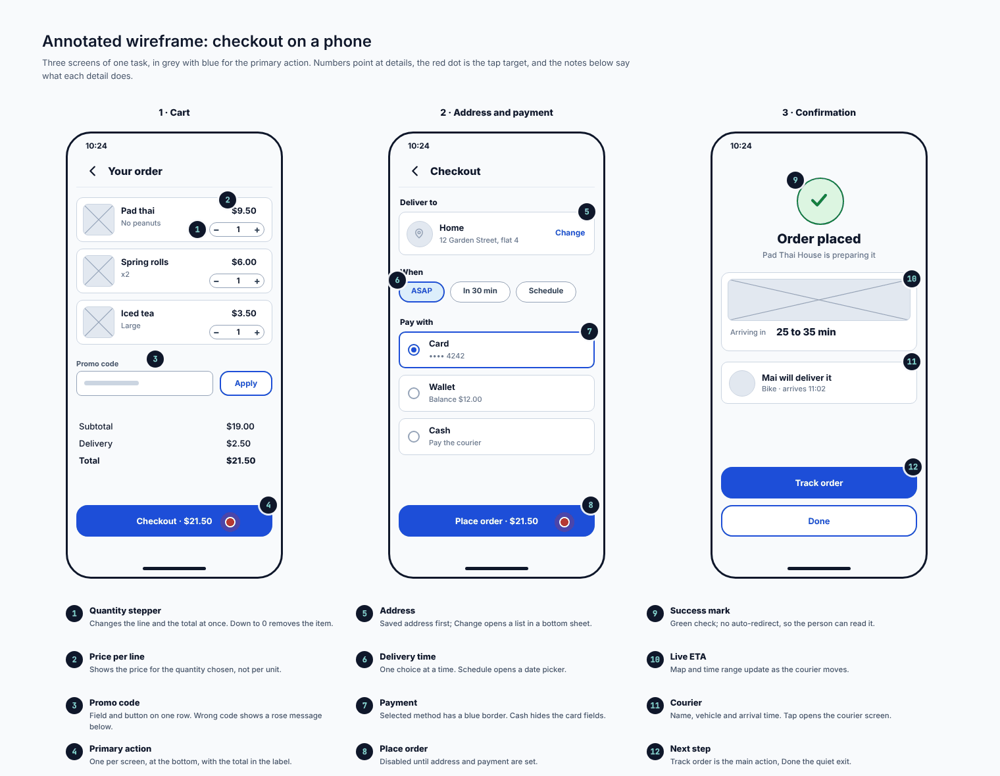
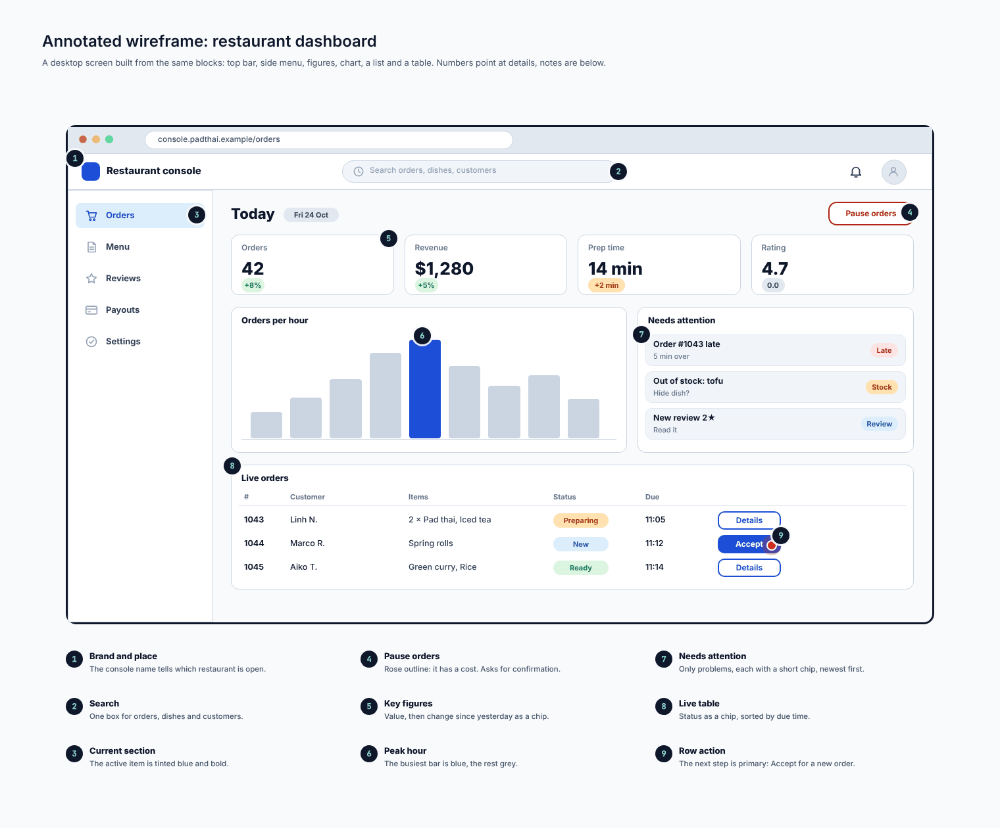
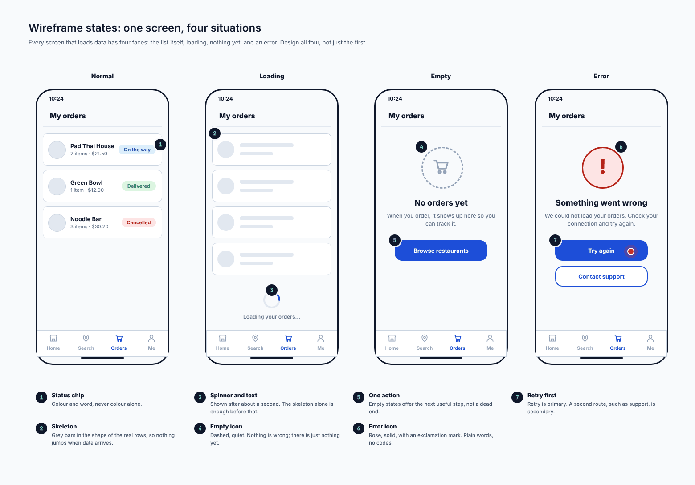
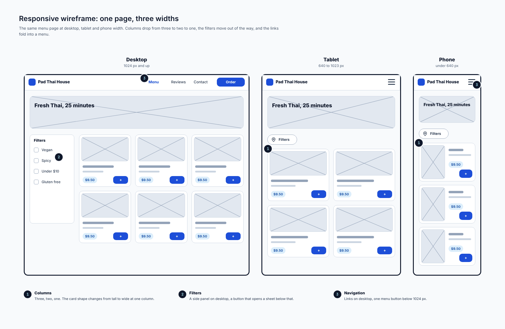
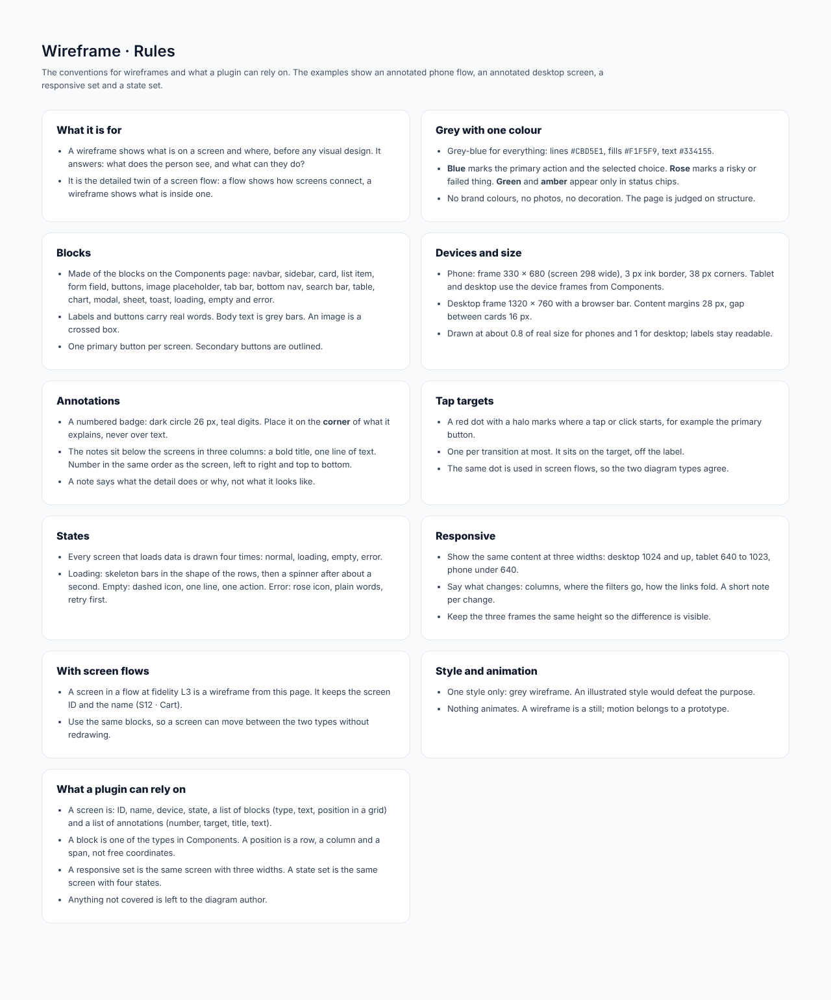

# Wireframe

## At a glance

| | |
| --- | --- |
| **Question it answers** | What is on one screen, and where? What can the person do there? |
| **Use it when** | Designing or reviewing the layout of a screen before any visual design |
| **Do not use it when** | You need how screens connect (use a [screen flow](02-screen-flow.md)) or the final look (a wireframe is deliberately not that) |
| **Style** | One only: grey with a single accent colour. An illustrated wireframe would defeat the purpose. Nothing animates |
| **Boards** | 5: rules, an annotated phone flow, an annotated desktop screen, a responsive set and a state set |

A wireframe is the **detailed twin of a screen flow**: a flow shows how screens connect; a wireframe shows what is inside one. A screen drawn at fidelity L3 in a flow *is* a wireframe from this page, with the same blocks and the same id and name (`S12 · Cart`), so a screen can move between the two types without being redrawn.

## 1. Grey with one colour

The page is judged on **structure**, not on style, so the wireframe is grey-blue throughout:

| Use | Colour |
| --- | --- |
| Lines | `#CBD5E1` |
| Fills | `#F1F5F9` |
| Text | `#334155` |
| **Blue** | The primary action and the selected choice |
| **Rose** | A risky or failed thing |
| **Green and amber** | Only in status chips |

No brand colours, no photos, no decoration. Labels and buttons carry **real words**; body text is grey bars; an image is a crossed box. There is **one primary button per screen**; secondary buttons are outlined.

## 2. Blocks

A screen is built from the blocks on the Components page: navbar, sidebar, card, list item, form field, buttons, image placeholder, tab bar, bottom nav, search bar, table, chart, modal, sheet, toast, loading, empty and error.

*The wireframe blocks, from the Components page. [Full size](images/Components_ScreenFlow.png)*

## 3. The annotated screen

A wireframe alone shows layout but not intent. So the examples are **annotated**: numbered badges on the screen, and notes below.

- A **numbered badge** (a dark circle with teal digits, 26 px) sits on the **corner** of the thing it explains, never over text.
- The **notes** sit below the screens in three columns: a bold title and one line of text. They are numbered in the same order as the screen, left to right and top to bottom.
- A note says what the detail **does or why**, not what it looks like.
- A **red dot with a halo** marks the **tap target**, where a tap or click starts. At most one per transition, on the target and off the label. The same dot is used in screen flows, so the two types agree.

### 3.1 A task on a phone: checkout

*Annotated wireframe: checkout on a phone. [Full size](images/Wireframe_Mobile.png)*

Three screens of one task (**1 · Cart**, **2 · Address and payment**, **3 · Confirmation**), in grey with blue for the primary action:

1. *Cart*: each line has a **quantity stepper** (changes the line and the total at once; down to 0 removes the item), the **price per line** (the price for the quantity chosen, not per unit), a **promo code** field and button on one row (a wrong code shows a rose message below), and the **primary action** *Checkout · $21.50*.
2. *Address and payment*: where to deliver, when (ASAP, in 30 min or schedule), how to pay (Card ending 4242, Wallet balance, Cash) and the primary action *Place order · $21.50*.
3. *Confirmation*: the order placed, who is preparing it, when it will arrive, who will deliver it, and *Track order*.

### 3.2 A desktop screen: the restaurant dashboard

*Annotated wireframe: restaurant dashboard. [Full size](images/Wireframe_Desktop.png)*

A desktop screen built from the same blocks: top bar (brand and place, search), side menu (Orders, Menu, Reviews, Payouts, Settings), four **figures** (Orders, Revenue, Prep time, Rating), an *Orders per hour* **chart**, a *Needs attention* **list** (a late order, a dish out of stock, a new review) and a **table** of live orders with a status and one action per row. Nine numbered details have notes below.

The desktop frame is 1320 × 760 with a browser bar; content margins are 28 px and the gap between cards is 16 px.

## 4. States: every screen has four faces

*States: one screen, four situations. [Full size](images/Wireframe_States.png)*

Every screen that loads data is drawn **four times**: the list itself (normal), **loading**, **empty** and **error**. Design all four, not just the first.

| State | What to draw |
| --- | --- |
| **Normal** | The data, with its status chips (*On the way*, *Delivered*, *Cancelled*) |
| **Loading** | Skeleton bars in the shape of the rows, then a spinner after about a second (*Loading your orders...*) |
| **Empty** | A dashed icon, one line of explanation and **one action** (*No orders yet. Browse restaurants*) |
| **Error** | A rose icon, plain words and **retry first** (*Something went wrong. Try again*), with a secondary option (*Contact support*) |

## 5. Responsive: three widths

*Responsive wireframe: one page, three widths. [Full size](images/Wireframe_Responsive.png)*

The same menu page at **desktop (1024 px and up), tablet (640 to 1023 px) and phone (under 640 px)**. Columns drop from three to two to one, the filters move out of the way (a side panel on desktop, a button that opens a sheet below), and the links fold into a menu. A short note per change says what happens. Keep the three frames the **same height** so the difference is visible.

## 6. Devices and size

Phone: frame 330 × 680 (screen 298 wide), a 3 px ink border and 38 px corners. Tablet and desktop use the device frames from Components. Drawn at about 0.8 of real size for phones and 1 for desktop; labels stay readable.

## 7. Connections to other types

- [Screen flow](02-screen-flow.md): the same blocks, the same ids, and the same red tap-target dot.
- A [wireframe state](#4-states-every-screen-has-four-faces) set corresponds to the "states of one screen" pattern in a screen flow (loading, data, empty, error).

## 8. What a plugin can rely on

- A **screen** is: id, name, device, state, a list of blocks (type, text, position in a grid) and a list of annotations (number, target, title, text).
- A **block** is one of the types in Components. A position is a row, a column and a span, not free coordinates.
- A **responsive set** is the same screen at three widths; a **state set** is the same screen in four states.

## Reference: the rules board

*Wireframe: rules board. [Full size](images/Wireframe_Rules.png)*

#### What it is for

- A wireframe shows what is on a screen and where, before any visual design. It answers: what does the person see, and what can they do?
- It is the detailed twin of a screen flow: a flow shows how screens connect, a wireframe shows what is inside one.

#### Grey with one colour

- Grey-blue for everything: lines `#CBD5E1`, fills `#F1F5F9`, text `#334155`.
- **Blue** marks the primary action and the selected choice. **Rose** marks a risky or failed thing. **Green** and **amber** appear only in status chips.
- No brand colours, no photos, no decoration. The page is judged on structure.

#### Blocks

- Made of the blocks on the Components page: navbar, sidebar, card, list item, form field, buttons, image placeholder, tab bar, bottom nav, search bar, table, chart, modal, sheet, toast, loading, empty and error.
- Labels and buttons carry real words. Body text is grey bars. An image is a crossed box.
- One primary button per screen. Secondary buttons are outlined.

#### Devices and size

- Phone: frame 330 × 680 (screen 298 wide), 3 px ink border, 38 px corners. Tablet and desktop use the device frames from Components.
- Desktop frame 1320 × 760 with a browser bar. Content margins 28 px, gap between cards 16 px.
- Drawn at about 0.8 of real size for phones and 1 for desktop; labels stay readable.

#### Annotations

- A numbered badge: dark circle 26 px, teal digits. Place it on the **corner** of what it explains, never over text.
- The notes sit below the screens in three columns: a bold title, one line of text. Number in the same order as the screen, left to right and top to bottom.
- A note says what the detail does or why, not what it looks like.

#### Tap targets

- A red dot with a halo marks where a tap or click starts, for example the primary button.
- One per transition at most. It sits on the target, off the label.
- The same dot is used in screen flows, so the two diagram types agree.

#### States

- Every screen that loads data is drawn four times: normal, loading, empty, error.
- Loading: skeleton bars in the shape of the rows, then a spinner after about a second. Empty: dashed icon, one line, one action. Error: rose icon, plain words, retry first.

#### Responsive

- Show the same content at three widths: desktop 1024 and up, tablet 640 to 1023, phone under 640.
- Say what changes: columns, where the filters go, how the links fold. A short note per change.
- Keep the three frames the same height so the difference is visible.

#### With screen flows

- A screen in a flow at fidelity L3 is a wireframe from this page. It keeps the screen ID and the name (S12 · Cart).
- Use the same blocks, so a screen can move between the two types without redrawing.

#### Style and animation

- One style only: grey wireframe. An illustrated style would defeat the purpose.
- Nothing animates. A wireframe is a still; motion belongs to a prototype.

#### What a plugin can rely on

- A screen is: ID, name, device, state, a list of blocks (type, text, position in a grid) and a list of annotations (number, target, title, text).
- A block is one of the types in Components. A position is a row, a column and a span, not free coordinates.
- A responsive set is the same screen with three widths. A state set is the same screen with four states.
- Anything not covered is left to the diagram author.

