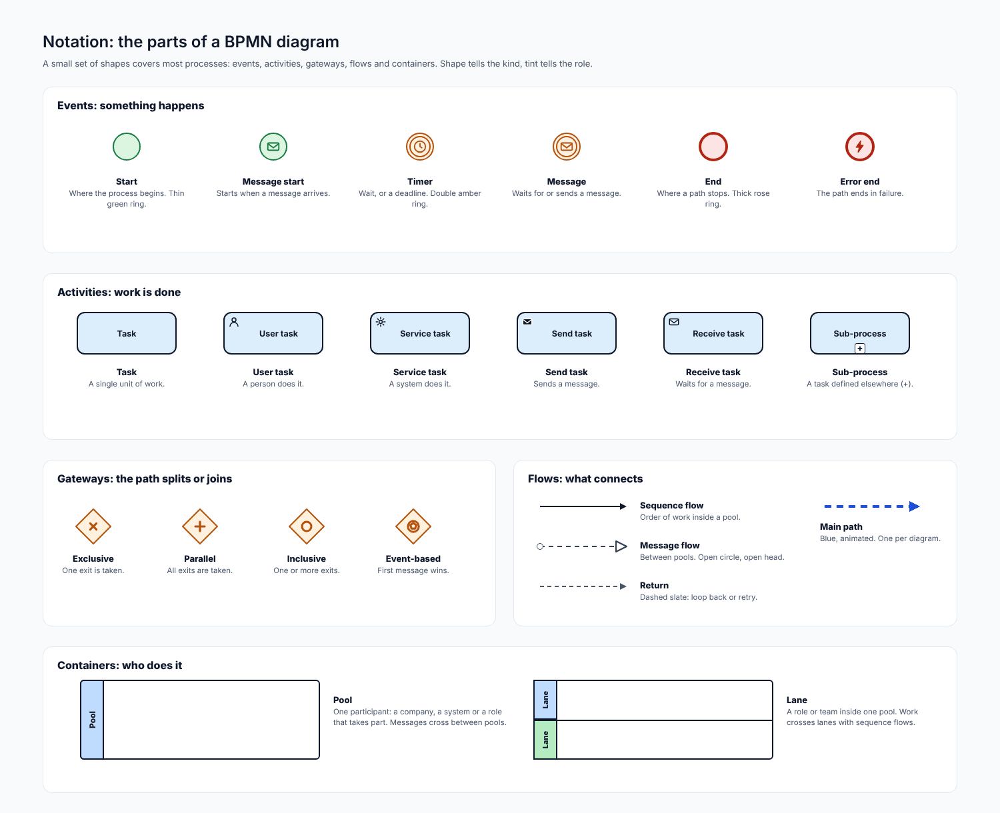
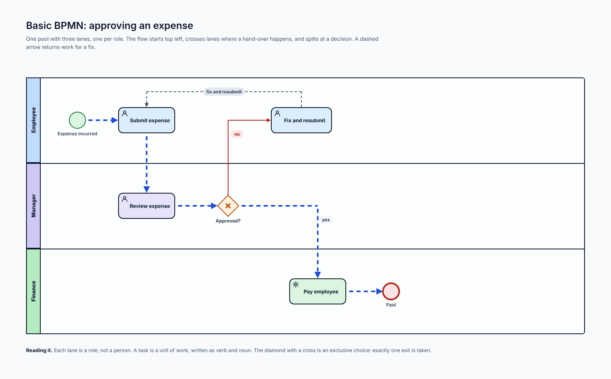
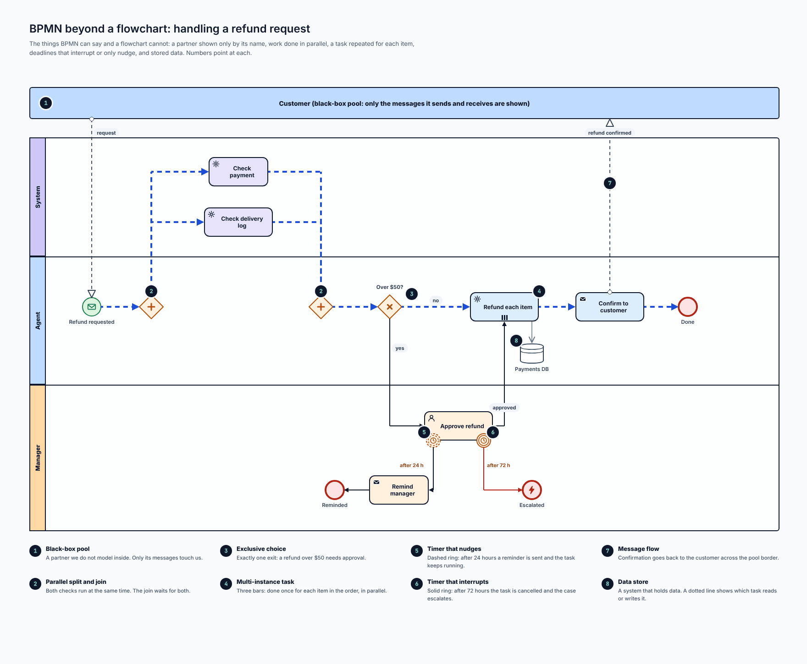
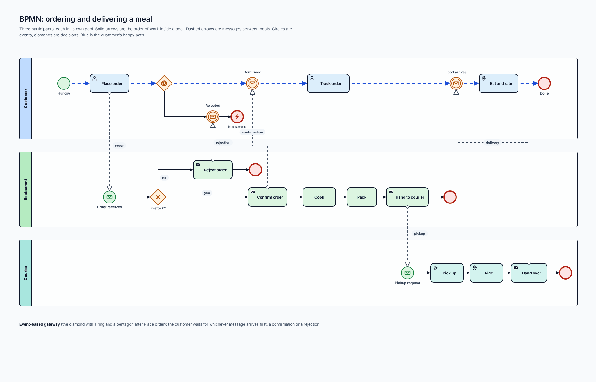
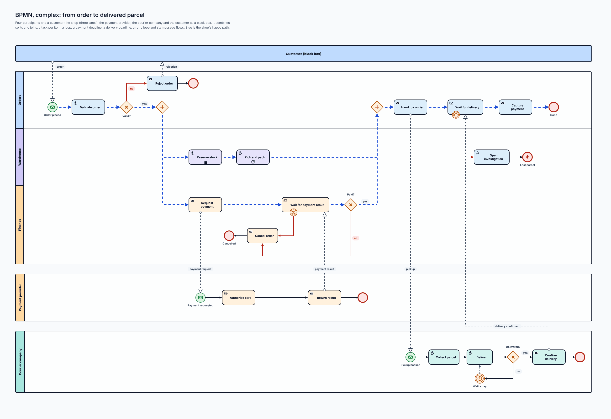
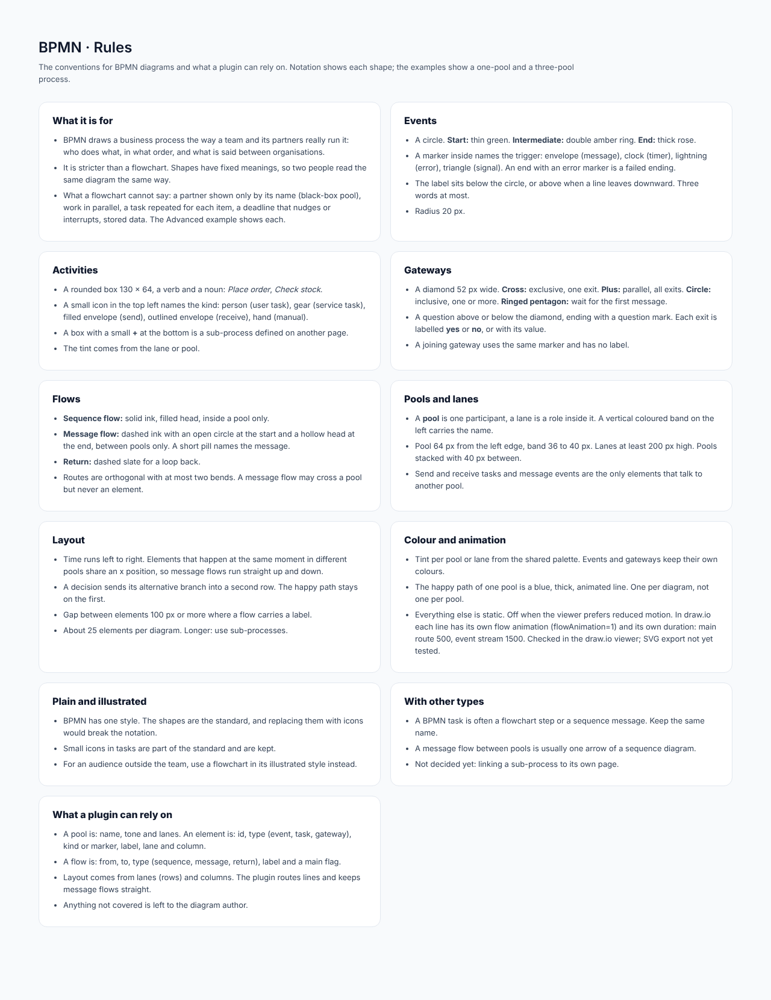

# BPMN

## At a glance

| | |
| --- | --- |
| **Question it answers** | How does a business process run across several teams and partners: who does what, in what order, and what is said between organisations? |
| **Use it when** | A process crosses roles or companies, and you need parallel work, deadlines, repeated tasks, messages or stored data |
| **Do not use it when** | One actor follows a simple process (use a [flowchart](03-flowchart.md)) or the audience is outside the team (use an illustrated flowchart) |
| **Style** | One only. The shapes are the standard, and replacing them with icons would break the notation. Small task icons are part of the standard and are kept |
| **Boards** | 6: rules, notation, basic example, advanced features, a complete collaboration, a complex case |

## 1. BPMN versus a flowchart

BPMN looks like a flowchart, but it is **stricter**: every shape has a fixed meaning, so two people read the same diagram the same way. A flowchart has a handful of loose shapes and says nothing about *who* or *when*. BPMN adds what a flowchart cannot say:

- a **partner shown only by its name**, with just the messages that touch you (a black-box pool);
- **parallel work**, with a join that waits for both;
- a **task repeated for each item** (multi-instance);
- a **deadline that nudges or interrupts** (boundary timers);
- **stored data** that a task reads or writes;
- **waiting for whichever message arrives first**.

Rule of thumb: if you find yourself writing "and meanwhile..." or "if no answer after..." in a flowchart, it is a BPMN diagram.

## 2. The notation

*The parts of a BPMN diagram. [Full size](images/BPMN_Notation.png) · [HTML source](source/html/BPMN_Notation.html)*

**Shape tells the kind; tint tells the role.**

| Family | Shapes |
| --- | --- |
| **Events** (something happens) | **Start** (thin green ring), **message start**, **timer** (double amber ring, wait or deadline), **message**, **end** (thick rose ring), **error end** (the path ends in failure). A marker inside names the trigger: envelope (message), clock (timer), lightning (error), triangle (signal) |
| **Activities** (work is done) | **Task**, **user task** (a person), **service task** (a system), **send task**, **receive task**, **sub-process** (a `+` at the bottom: defined on another page) |
| **Gateways** (the path splits or joins) | **Exclusive** (cross: one exit), **parallel** (plus: all exits), **inclusive** (circle: one or more), **event-based** (ringed pentagon: the first message wins) |
| **Flows** (what connects) | **Sequence flow** (order of work inside a pool), **message flow** (between pools; open circle at the start, hollow head at the end), **return** (dashed slate, loop back or retry), **main path** (blue, animated, one per diagram) |
| **Containers** (who does it) | **Pool** (one participant: a company, a system or a role that takes part) and **lane** (a role or team inside a pool; work crosses lanes with sequence flows) |

Sizes: an event has radius 20 px; a task is a rounded box 130 × 64; a gateway diamond is 52 px wide.

## 3. A basic example: approving an expense

*Basic BPMN: approving an expense. [Full size](images/BPMN_Basic.png) · [HTML source](source/html/BPMN_Basic.html)*

One **pool** with three **lanes**: Employee, Manager and Finance. Each lane is a role, not a person.

- The flow starts top left (*Expense incurred*), crosses lanes where a hand-over happens (the Employee *submits*, the Manager *reviews*, Finance *pays*), and ends at *Paid*.
- The diamond with a cross, *Approved?*, is an **exclusive choice**: exactly one exit is taken. *yes* goes on to Finance; *no* returns to the Employee as *Fix and resubmit*, shown as a **dashed return**.
- A task is written as a verb and a noun.

## 4. Advanced: what BPMN can say that a flowchart cannot

*BPMN beyond a flowchart: handling a refund request. [Full size](images/BPMN_Advanced.png) · [HTML source](source/html/BPMN_Advanced.html)*

One process, *handling a refund request*, uses every extra feature, each pointed at by a number:

| # | Feature | What it says |
| --- | --- | --- |
| 1 | **Black-box pool** | The Customer is a partner we do not model inside; only the messages it sends and receives touch us (*request refund*) |
| 2 | **Parallel split and join** | *Check payment* and *Check delivery log* run at the same time; the join waits for both |
| 3 | **Exclusive choice** | *Over $50?* Exactly one exit: a refund over $50 needs the Manager's approval |
| 4 | **Multi-instance task** | *Refund each item*: three bars, done once for each item in the order, in parallel |
| 5 | **Timer that nudges** | A **dashed** ring: after 24 hours *Remind manager* is sent and the task keeps running |
| 6 | **Timer that interrupts** | A **solid** ring: after 72 hours the task is cancelled and the case escalates |
| 7 | **Message flow** | *Confirm to customer* goes back across the pool border (*confirmed*) |
| 8 | **Data store** | *Payments DB* holds data; a dotted line shows which task reads or writes it |

Lanes: System, Agent and Manager (and the Customer as the black box above them). The Agent lane is tall enough that no label sits on a lane border (an overlap found in review and fixed).

## 5. A complete collaboration: ordering and delivering a meal

*BPMN: ordering and delivering a meal. [Full size](images/BPMN_Delivery.png) · [HTML source](source/html/BPMN_Delivery.html)*

**Three participants, each in its own pool**: Customer, Restaurant, Courier. Solid arrows are the order of work inside a pool; dashed arrows are messages between pools. Circles are events, diamonds are decisions. **Blue is the customer's happy path.**

- The Customer starts hungry (*Hungry*), places an order (*Place order*) and then waits at an **event-based gateway** (the diamond with a ring and a pentagon): whichever message arrives first, a *confirmation* or a *rejection*, decides what happens. *Confirmed* leads to *Track order*, then *Food arrives* and *Eat and rate*; a rejection ends in *Rejected*.
- The Restaurant receives the order (*Order received*) and decides *In stock?* *yes*: *Confirm order*, *Cook*, *Pack*, *Hand to courier*. *no*: *Reject order*, ending *Not served*.
- The Courier gets a *Pickup request*, then *Pick up*, *Ride* and *Hand over*.
- Five message flows connect them: *order*, *rejection*, *confirmation*, *pickup* and *delivery*, aligned so they run straight up and down.

## 6. A complex case: from order to delivered parcel

*BPMN, complex: from order to delivered parcel. [Full size](images/BPMN_Order.png) · [HTML source](source/html/BPMN_Order.html)*

Four participants and a customer: **the shop** (three lanes: Orders, Warehouse, Finance), **the payment provider**, **the courier company**, and **the customer as a black box**. It combines splits and joins, a task per item, a loop, a payment deadline, a delivery deadline, a retry loop and **six message flows**. Blue is the shop's happy path.

Read it in four stretches:

1. **Order (Orders lane).** The customer's *order* message starts the shop's process (*Order placed*, a message start). *Validate order* is a service task, then the exclusive gateway *Valid?* On *no*, *Reject order* sends a *rejection* back to the customer and the path ends in rose. On *yes*, a **parallel split** (the diamond with a plus) starts two branches at once.
2. **Two things at once.** In the **Warehouse** lane, *Reserve stock* (a service task whose three bars mean it is repeated for each item, in parallel) is followed by *Pick and pack* (a manual task with a loop marker, repeated until done). In the **Finance** lane, *Request payment* sends a *payment request* to the provider, and *Wait for payment result* waits for the answer under a **payment deadline** (the ring on its edge): if time runs out, or if *Paid?* is *no*, the path goes to *Cancel order* and ends at *Cancelled*.
3. **The payment provider** is a pool of its own: *Payment requested* starts it, *Authorise card* is a service task, and *Return result* sends the *payment result* back. A **parallel join** in the Orders lane waits for both the warehouse and a successful payment before the shop goes on.
4. **Delivery.** *Hand to courier* sends the *pickup* message. The **courier company** starts with *Pickup booked*, then *Collect parcel* and *Deliver*, and the gateway *Delivered?* decides: *yes* leads to *Confirm delivery*, which sends *delivery confirmed* back to the shop; *no* waits (*Wait a day*, a timer) and loops back to *Deliver*, the **retry loop**. Meanwhile the shop is in *Wait for delivery* under a **delivery deadline**: if no confirmation arrives in time, the path goes to *Open investigation* and ends as *Lost parcel* (an error end). When confirmation arrives, the shop does *Capture payment* and ends at *Done*.

The six message flows are *order*, *rejection*, *payment request*, *payment result*, *pickup* and *delivery confirmed*.

## 7. Layout and spacing

- **Time runs left to right.** Elements that happen at the same moment in different pools **share an x position**, so message flows run straight up and down.
- A decision sends its alternative branch into a **second row**; the happy path stays on the first.
- **Pool:** 64 px from the left edge, with a vertical coloured band of 36 to 40 px on the left carrying the name. Lanes are at least 200 px high. Pools are stacked with 40 px between them.
- **Gap between elements:** 100 px or more where a flow carries a label. About 25 elements per diagram; longer, use sub-processes.
- Routes are orthogonal with at most two bends. A message flow may cross a pool but **never an element**.
- **Colour:** a tint per pool or lane from the shared palette; events and gateways keep their own colours. The happy path of one pool is blue, thick and animated: **one per diagram, not one per pool**.

## 8. Connections to other types

- A BPMN task is often a [flowchart](03-flowchart.md) step or a [sequence](04-sequence.md) message: keep the same name.
- A message flow between pools is usually one arrow of a sequence diagram.
- Not decided yet: linking a sub-process to its own page. There is **no expanded sub-process** example yet.

## 9. What a plugin can rely on

- A **pool** is: name, tone and lanes. An **element** is: id, type (event, task, gateway), kind or marker, label, lane and column.
- A **flow** is: from, to, type (sequence, message, return), label and a main flag.
- Layout comes from lanes (rows) and columns. The plugin routes lines and keeps message flows straight.

## Reference: the rules board

*BPMN: rules board. [Full size](images/BPMN_Rules.png) · [HTML source](source/html/BPMN_Rules.html)*

#### What it is for

- BPMN draws a business process the way a team and its partners really run it: who does what, in what order, and what is said between organisations.
- It is stricter than a flowchart. Shapes have fixed meanings, so two people read the same diagram the same way.
- What a flowchart cannot say: a partner shown only by its name (black-box pool), work in parallel, a task repeated for each item, a deadline that nudges or interrupts, stored data. The Advanced example shows each.

#### Events

- A circle. **Start:** thin green. **Intermediate:** double amber ring. **End:** thick rose.
- A marker inside names the trigger: envelope (message), clock (timer), lightning (error), triangle (signal). An end with an error marker is a failed ending.
- The label sits below the circle, or above when a line leaves downward. Three words at most.
- Radius 20 px.

#### Activities

- A rounded box 130 × 64, a verb and a noun: *Place order*, *Check stock*.
- A small icon in the top left names the kind: person (user task), gear (service task), filled envelope (send), outlined envelope (receive), hand (manual).
- A box with a small **+** at the bottom is a sub-process defined on another page.
- The tint comes from the lane or pool.

#### Gateways

- A diamond 52 px wide. **Cross:** exclusive, one exit. **Plus:** parallel, all exits. **Circle:** inclusive, one or more. **Ringed pentagon:** wait for the first message.
- A question above or below the diamond, ending with a question mark. Each exit is labelled **yes** or **no**, or with its value.
- A joining gateway uses the same marker and has no label.

#### Flows

- **Sequence flow:** solid ink, filled head, inside a pool only.
- **Message flow:** dashed ink with an open circle at the start and a hollow head at the end, between pools only. A short pill names the message.
- **Return:** dashed slate for a loop back.
- Routes are orthogonal with at most two bends. A message flow may cross a pool but never an element.

#### Pools and lanes

- A **pool** is one participant, a lane is a role inside it. A vertical coloured band on the left carries the name.
- Pool 64 px from the left edge, band 36 to 40 px. Lanes at least 200 px high. Pools stacked with 40 px between.
- Send and receive tasks and message events are the only elements that talk to another pool.

#### Layout

- Time runs left to right. Elements that happen at the same moment in different pools share an x position, so message flows run straight up and down.
- A decision sends its alternative branch into a second row. The happy path stays on the first.
- Gap between elements 100 px or more where a flow carries a label.
- About 25 elements per diagram. Longer: use sub-processes.

#### Colour and animation

- Tint per pool or lane from the shared palette. Events and gateways keep their own colours.
- The happy path of one pool is a blue, thick, animated line. One per diagram, not one per pool.
- Everything else is static. Off when the viewer prefers reduced motion. In draw.io each line has its own flow animation (flowAnimation=1) and its own duration: main route 500, event stream 1500. Checked in the draw.io viewer; SVG export not yet tested.

#### Plain and illustrated

- BPMN has one style. The shapes are the standard, and replacing them with icons would break the notation.
- Small icons in tasks are part of the standard and are kept.
- For an audience outside the team, use a flowchart in its illustrated style instead.

#### With other types

- A BPMN task is often a flowchart step or a sequence message. Keep the same name.
- A message flow between pools is usually one arrow of a sequence diagram.
- Not decided yet: linking a sub-process to its own page.

#### What a plugin can rely on

- A pool is: name, tone and lanes. An element is: id, type (event, task, gateway), kind or marker, label, lane and column.
- A flow is: from, to, type (sequence, message, return), label and a main flag.
- Layout comes from lanes (rows) and columns. The plugin routes lines and keeps message flows straight.
- Anything not covered is left to the diagram author.

