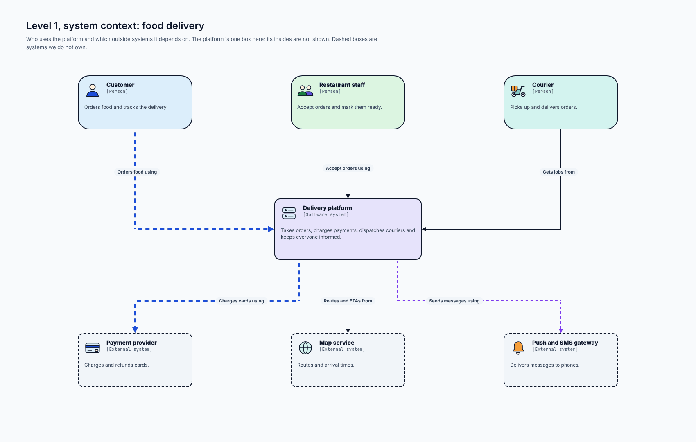
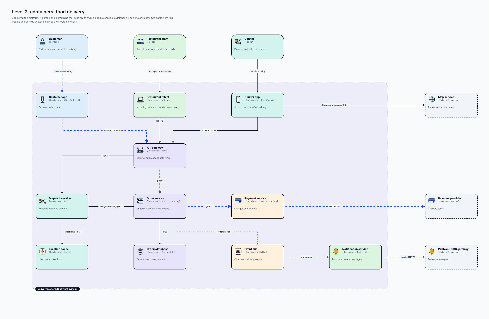
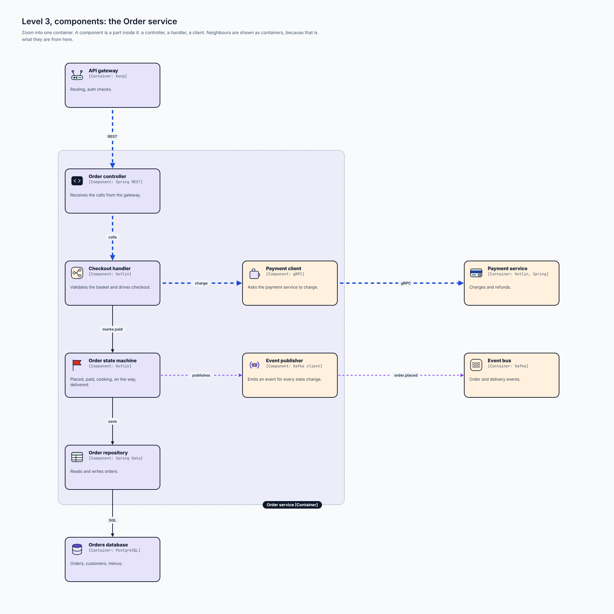
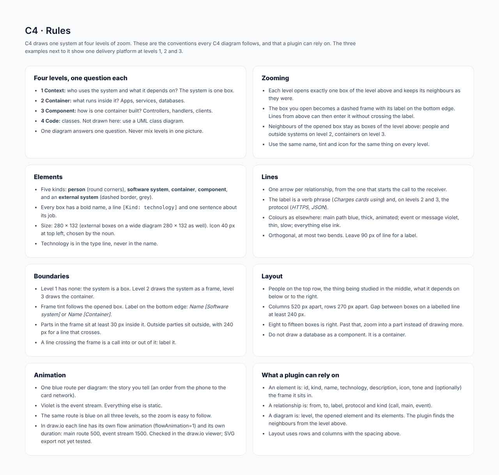

# C4 model

## At a glance

| | |
| --- | --- |
| **Question it answers** | What is this system, at four levels of zoom, for readers who need different amounts of detail? |
| **Use it when** | One system must be explained to several audiences: a manager (who uses it, what does it depend on), an architect (what runs inside it), a developer (how one part is built) |
| **Do not use it when** | You need regions, subnets and trust levels ([cloud](13-cloud.md)) or the order of messages ([sequence](04-sequence.md)) |
| **Style** | Plain only |
| **Boards** | 4: rules and one delivery platform at levels 1, 2 and 3 |

## 1. What C4 is

C4 draws **one system at four levels of zoom**, like a map you can open from a country down to a street. Each level answers one question, and each level opens exactly one box of the level above.

| Level | Name | Question | What a box is |
| --- | --- | --- | --- |
| **1** | **Context** | Who uses the system, and what does it depend on? | The system itself is one box |
| **2** | **Container** | What runs inside it? | An app, a service or a database: something that runs on its own |
| **3** | **Component** | How is one container built? | A controller, a handler, a client: a part inside one container |
| **4** | **Code** | How are the classes laid out? | Not drawn here: use a UML class diagram ([UML](09-uml.md)) |

**One diagram answers one question. Never mix levels in one picture.**

The word *container* in C4 does not mean a Docker container. It means "a thing you can run and deploy separately".

## 2. The five kinds of box

Every box has the same anatomy: an **icon**, a **bold name**, a line `[Kind: technology]` in mono, and **one sentence** about its job. Technology goes in the type line, never in the name.

| Kind | Look | Example |
| --- | --- | --- |
| **Person** | Round corners, tinted by who it is | *Customer*: orders food and tracks the delivery |
| **Software system** | Violet tint, solid border; the system in scope | *Delivery platform* |
| **External system** | Grey, **dashed** border: outside our control | *Payment provider*: charges and refunds cards |
| **Container** | Tint by domain, solid border | *Order service* `[Container: Kotlin, Spring]` |
| **Component** | The same box, tinted by domain | *Order controller* `[Component: Spring REST]` |

A database is a container: the same box, with the Database icon. It is not drawn as a special shape.

Size 280 × 132 for every box; the system box at level 1 is larger (360 × 150).

## 3. Level 1: system context

*Level 1, system context: food delivery. [Full size](images/C4_Context.png) · [HTML source](source/html/C4_Context.html)*

**Who uses the platform and what it depends on.** The platform is one box; its insides are not shown. Three **people** across the top (Customer, Restaurant staff, Courier), three **external systems** below with dashed borders (Payment provider, Map service, Push and SMS gateway).

- Each line says what the box on the *starting* side does *with* the box it points to, as a verb phrase: *Orders food using*, *Accept orders using*, *Gets jobs from*, *Charges cards using*, *Routes and ETAs from*, *Sends messages using*.
- **Blue** is the customer's order; **violet** is the messaging, a thin and slow line.
- Level 1 has **no frame**: the system is a box.

## 4. Level 2: containers

*Level 2, containers: food delivery. [Full size](images/C4_Container.png) · [HTML source](source/html/C4_Container.html)*

**Zoom into the platform.** The platform becomes a dashed violet **frame**, with its name on the **bottom edge** (so lines from people above never cross the label), and eleven containers inside:

| Group | Containers |
| --- | --- |
| Apps | Customer app, Restaurant tablet, Courier app |
| Gateway | API gateway (Kong) |
| Services | Order service, Payment service, Dispatch service, Notification service |
| Data | Orders database (PostgreSQL), Location cache (Redis), Event bus (Kafka) |

The people and the external systems are **kept exactly as on level 1**. Every line now also says *how* the two containers talk: `HTTPS, JSON`, `REST`, `gRPC`, `SQL`, `RESP`, and for events `order.placed`.

What to notice:

- **Blue** is one order: Customer app, `HTTPS, JSON` to the gateway, `REST` to the Order service, `gRPC` to the Payment service, `HTTPS API` to the provider.
- **Violet** is events: the Order service publishes `order.placed`; the Event bus feeds the Notification service, which sends push and SMS.
- The **Courier app talks directly to the Map service** with an SDK, a line that crosses the frame edge: that is where a boundary is crossed, so it is labelled.

## 5. Level 3: components

*Level 3, components: the Order service. [Full size](images/C4_Component.png) · [HTML source](source/html/C4_Component.html)*

**Zoom into one container.** The **Order service** becomes the frame, with six components inside: *Order controller* (Spring REST), *Checkout handler*, *Order state machine*, *Payment client* (gRPC), *Order repository* (Spring Data) and *Event publisher* (Kafka client). Its **neighbours are shown as containers**, because that is what they are from here: the API gateway, the Orders database, the Payment service and the Event bus.

The blue path runs straight down the left column (`REST`, `calls`, `marks paid`, `save`, `SQL`) and turns right at the Checkout handler to charge the card (`charge`, `gRPC`). The event publisher sends `order.placed` to the bus in violet.

## 6. Rules in plain words

- **Opening a box.** Each level opens exactly one box of the level above and keeps its neighbours as they were. The opened box becomes a dashed frame labelled `Name [Software system]` or `Name [Container]` on its bottom edge.
- **Same name, tint and icon at every level.** The Order service is violet with a server icon on levels 2 and 3 (and in the [architecture](06-architecture.md) diagram).
- **Lines.** One arrow per relationship, from the one that starts the call to the receiver. The label is a verb phrase and, on levels 2 and 3, the protocol. Orthogonal with at most two bends, 90 px of line for the label.
- **Layout.** People on the top row, the thing being studied in the middle, what it depends on below or to the right. Columns 520 px apart and rows 270 px apart; at least 240 px of line between boxes with a label. Eight to fifteen boxes is right; past that, zoom into a part instead of drawing more.
- **One blue route per diagram.** The same route is blue on all three levels, so the zoom is easy to follow. Violet is the event stream; everything else is static.

## 7. Connections to other types

- Level 2 is a more disciplined [architecture diagram](06-architecture.md); level 3 is the structure that a [UML class diagram](09-uml.md) (level 4) fills in.
- The blue path on level 2 is often one [sequence diagram](04-sequence.md).
- The [DFD](14-dfd.md) uses a similar idea, opening one process per level.

## 8. What a plugin can rely on

- An **element** is: id, kind, name, technology, description, icon, tone and (optionally) the frame it sits in.
- A **relationship** is: from, to, label, protocol and kind (call, main, event).
- A **diagram** is: level, the opened element and its elements. The plugin finds the neighbours from the level above.
- Layout uses rows and columns with the spacing above.

## Reference: the rules board

*C4: rules board. [Full size](images/C4_Rules.png) · [HTML source](source/html/C4_Rules.html)*

#### Four levels, one question each

- **1 Context:** who uses the system and what it depends on? The system is one box.
- **2 Container:** what runs inside it? Apps, services, databases.
- **3 Component:** how is one container built? Controllers, handlers, clients.
- **4 Code:** classes. Not drawn here: use a UML class diagram.
- One diagram answers one question. Never mix levels in one picture.

#### Zooming

- Each level opens exactly one box of the level above and keeps its neighbours as they were.
- The box you open becomes a dashed frame with its label on the bottom edge. Lines from above can then enter it without crossing the label.
- Neighbours of the opened box stay as boxes of the level above: people and outside systems on level 2, containers on level 3.
- Use the same name, tint and icon for the same thing on every level.

#### Elements

- Five kinds: **person** (round corners), **software system**, **container**, **component**, and an **external system** (dashed border, grey).
- Every box has a bold name, a line [Kind: technology] and one sentence about its job.
- Size: 280 × 132 (external boxes on a wide diagram 280 × 132 as well). Icon 40 px at top left, chosen by the noun.
- Technology is in the type line, never in the name.

#### Lines

- One arrow per relationship, from the one that starts the call to the receiver.
- The label is a verb phrase (*Charges cards using*) and, on levels 2 and 3, the protocol (*HTTPS, JSON*).
- Colours as elsewhere: main path blue, thick, animated; event or message violet, thin, slow; everything else ink.
- Orthogonal, at most two bends. Leave 90 px of line for a label.

#### Boundaries

- Level 1 has none: the system is a box. Level 2 draws the system as a frame, level 3 draws the container.
- Frame tint follows the opened box. Label on the bottom edge: *Name [Software system]* or *Name [Container]*.
- Parts in the frame sit at least 30 px inside it. Outside parties sit outside, with 240 px for a line that crosses.
- A line crossing the frame is a call into or out of it: label it.

#### Layout

- People on the top row, the thing being studied in the middle, what it depends on below or to the right.
- Columns 520 px apart, rows 270 px apart. Gap between boxes on a labelled line at least 240 px.
- Eight to fifteen boxes is right. Past that, zoom into a part instead of drawing more.
- Do not draw a database as a component. It is a container.

#### Animation

- One blue route per diagram: the story you tell (an order from the phone to the card network).
- Violet is the event stream. Everything else is static.
- The same route is blue on all three levels, so the zoom is easy to follow.
- In draw.io each line has its own flow animation (flowAnimation=1) and its own duration: main route 500, event stream 1500. Checked in the draw.io viewer; SVG export not yet tested.

#### What a plugin can rely on

- An element is: id, kind, name, technology, description, icon, tone and (optionally) the frame it sits in.
- A relationship is: from, to, label, protocol and kind (call, main, event).
- A diagram is: level, the opened element and its elements. The plugin finds the neighbours from the level above.
- Layout uses rows and columns with the spacing above.

