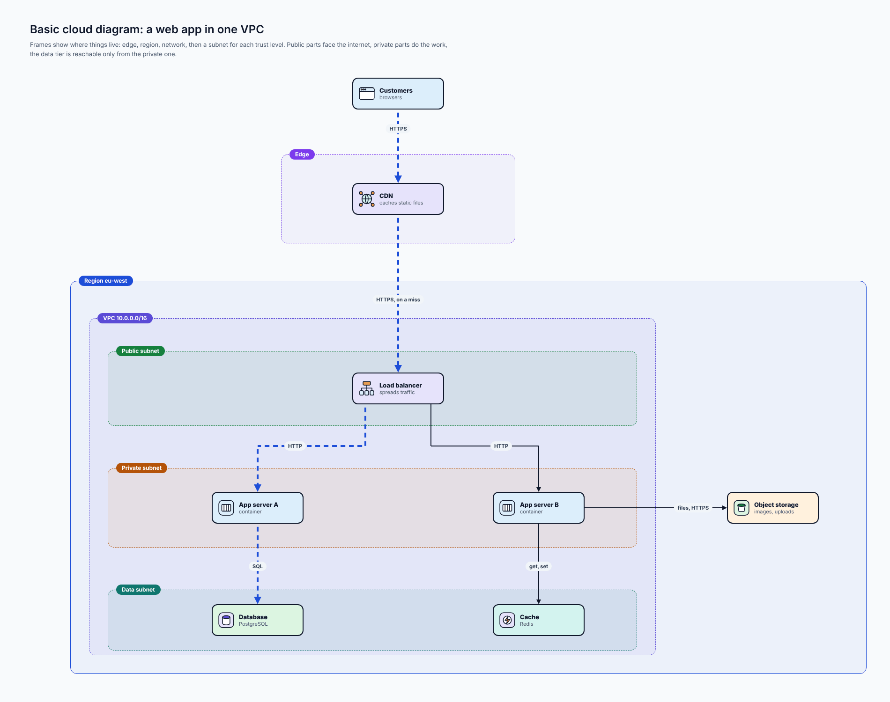
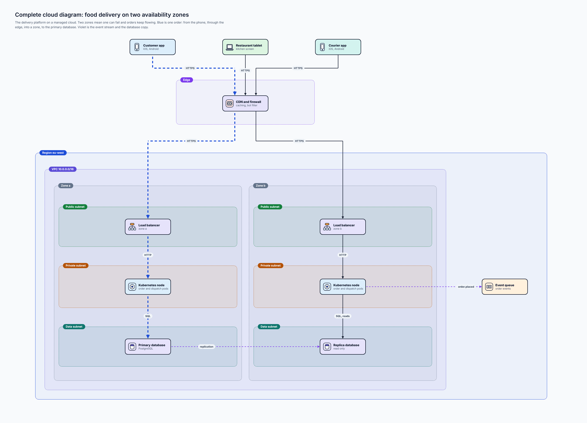
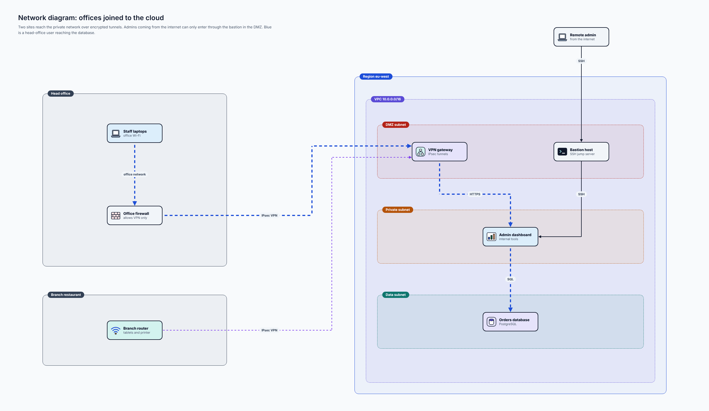
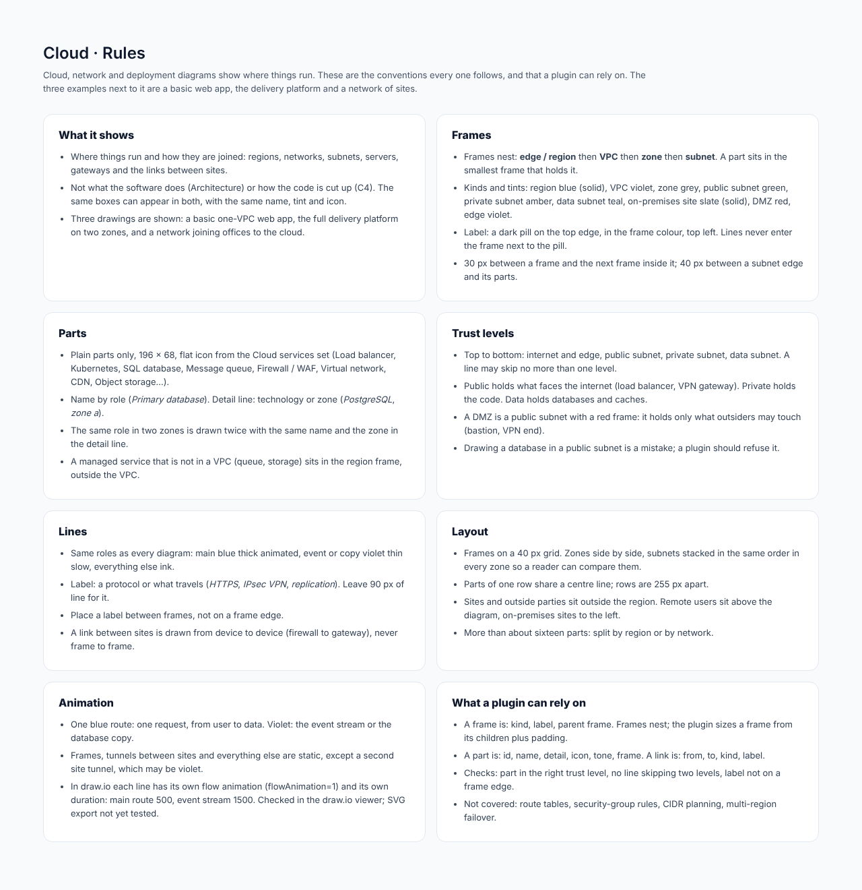

# Cloud, network and deployment

## At a glance

| | |
| --- | --- |
| **Question it answers** | Where does it run, and how is it joined together? |
| **Use it when** | Drawing infrastructure: regions, networks, subnets, zones, servers, gateways, and the links between sites |
| **Do not use it when** | You want what the software does ([architecture](06-architecture.md)) or how code is cut up ([C4](12-c4.md)). The same boxes can appear in both, with the same name, tint and icon |
| **Style** | Plain only. The cloud service icons are already detailed enough |
| **Boards** | 4: rules, a basic one-VPC web app, the delivery platform on two zones, and a network of sites |

## 1. What it shows that architecture does not

An [architecture diagram](06-architecture.md) shows *what talks to what*. A cloud or network diagram adds **where each thing lives and how far it is trusted**: which region, which network, which subnet, which zone, whether it faces the internet, whether it is behind a firewall. That information is what a security review and an outage plan both need.

## 2. Frames, the heart of the diagram

Frames **nest**: *edge or region*, then *VPC*, then *zone*, then *subnet*. A part sits in the **smallest frame that holds it**. Each frame has a coloured pill label on its top edge, in the frame's colour, at the top left; lines never enter the frame next to the pill.

| Frame | Colour and line | Holds |
| --- | --- | --- |
| **Region** | Blue, solid | A cloud region and everything in it |
| **VPC** (virtual network) | Violet, dashed | One private network; the address range goes in the label |
| **Zone** (availability zone) | Grey, dashed | One failure domain inside a VPC |
| **Public subnet** | Green, dashed | What faces the internet: load balancer, VPN gateway |
| **Private subnet** | Amber, dashed | The code that does the work |
| **Data subnet** | Teal, dashed | Databases and caches |
| **On-premises site** | Slate, solid | An office or data centre outside the cloud |
| **DMZ** | Red, dashed | The only place outsiders may touch (a bastion, a VPN end) |
| **Edge** | Violet, dashed | Edge services such as a CDN and a firewall |

Frames nest with 30 px between a frame and the next frame inside it, and 40 px between a subnet edge and its parts.

## 3. Trust levels

Reading top to bottom: **internet and edge**, then a **public subnet**, a **private subnet**, a **data subnet**. A line may skip **no more than one level** (a request goes through the layers, it does not jump from the internet to the database). Putting a database in a public subnet is a mistake; a plugin should refuse to draw it. A **DMZ** is a public subnet with a red frame that holds only what outsiders may touch.

## 4. Parts

Plain parts only, 196 × 68, with a flat icon from the **Cloud services** set (Load balancer, Kubernetes, SQL database, Message queue, Firewall / WAF, Virtual network, CDN, Object storage, and so on). Name by role (*Primary database*), with the technology or the zone in the detail line (*PostgreSQL*, *zone a*). The same role in two zones is drawn twice, with the zone in the detail line. A managed service that is not in a VPC (a queue, storage) sits in the region frame, **outside the VPC**.

## 5. A basic example: a web app in one VPC

*Basic cloud diagram: a web app in one VPC. [Full size](images/Cloud_Basic.png) · [HTML source](source/html/Cloud_Basic.html)*

Customers reach the app through an **edge** frame (a CDN that caches static files), then enter the **Region eu-west** and its **VPC 10.0.0.0/16**:

- a **public subnet** holds the *Load balancer*;
- a **private subnet** holds two app servers (A and B, containers);
- a **data subnet** holds the *Database* (PostgreSQL) and the *Cache* (Redis), reachable only from the private subnet;
- *Object storage* (images, uploads) sits in the region but **outside the VPC**.

Blue is a request: HTTPS to the CDN, HTTPS on a miss to the load balancer, HTTP to an app server, SQL to the database.

## 6. The complete example: the delivery platform on two zones

*Complete cloud diagram: food delivery on two availability zones. [Full size](images/Cloud_Delivery.png) · [HTML source](source/html/Cloud_Delivery.html)*

Two zones mean **one can fail and orders keep flowing**. The three apps (Customer app, Restaurant tablet, Courier app) reach a **CDN and firewall** in the edge; behind it, the region holds a VPC split into **Zone a** and **Zone b**, each with the same three subnets in the same order, so a reader can compare them:

- **Public subnets** hold a *Load balancer* each (zone a, zone b);
- **Private subnets** hold a *Kubernetes node* each (order and dispatch pods);
- **Data subnets** hold the *Primary database* in zone a and the *Replica database* (read only) in zone b;
- an **Event queue** sits in the region, outside the VPC.

**Blue** is one order: from the phone, through the edge, into zone a, to the primary database. **Violet** is the event stream (`order.placed` to the queue) and the database copy (`replication` from the primary to the replica across zones). The thin ink lines are the second zone, which serves traffic too.

## 7. A network: offices joined to the cloud

*Network diagram: offices joined to the cloud. [Full size](images/Cloud_Network.png) · [HTML source](source/html/Cloud_Network.html)*

Two sites reach the private network over **encrypted tunnels**:

- the **Head office** (Staff laptops, an *Office firewall* that allows VPN only) connects with an **IPsec VPN** to the *VPN gateway* in the DMZ subnet (blue);
- the **Branch restaurant** (a router for tablets and a printer) connects over its own IPsec tunnel (violet, thin);
- **admins on the road** (a *Remote admin*) can enter only through the **Bastion host** in the DMZ, over SSH, and from there to the private network;
- inside the VPC the path is the usual one: the *Admin dashboard* in the private subnet, then SQL to the *Orders database* in the data subnet.

A link between sites is drawn **from device to device** (firewall to gateway), never frame to frame. Blue is a head-office user reaching the database.

## 8. Layout and spacing

- Frames sit on a 40 px grid. Zones are side by side, and subnets are stacked in the same order in every zone.
- Parts of a row share a centre line; rows are 255 px apart.
- Sites and outside parties sit **outside the region**: remote users above the diagram, on-premises sites to the left.
- A label goes between frames, never on a frame edge. More than about sixteen parts: split by region or network.
- One blue route; violet for the event stream or the database copy. The frames and tunnels between sites are static, except a second site tunnel, which may be violet.

## 9. Connections to other types

- An [architecture](06-architecture.md) part becomes a cloud part with the same name and tint (the *Orders database* is violet in both).
- [C4](12-c4.md) level 2 says *what* the containers are; this page says *where* they run.
- Not covered: route tables, security-group rules, CIDR planning, multi-region failover.

## 10. What a plugin can rely on

- A **frame** is: kind, label, parent frame. The plugin sizes a frame from its children plus padding.
- A **part** is: id, name, detail, icon, tone, frame. A **link** is: from, to, kind and label.
- **Checks the plugin should run:** every part is in the right trust level; no line skips two levels; no label sits on a frame edge.

## Reference: the rules board

*Cloud: rules board. [Full size](images/Cloud_Rules.png) · [HTML source](source/html/Cloud_Rules.html)*

#### What it shows

- Where things run and how they are joined: regions, networks, subnets, servers, gateways and the links between sites.
- Not what the software does (Architecture) or how the code is cut up (C4). The same boxes can appear in both, with the same name, tint and icon.
- Three drawings are shown: a basic one-VPC web app, the full delivery platform on two zones, and a network joining offices to the cloud.

#### Frames

- Frames nest: **edge / region** then **VPC** then **zone** then **subnet**. A part sits in the smallest frame that holds it.
- Kinds and tints: region blue (solid), VPC violet, zone grey, public subnet green, private subnet amber, data subnet teal, on-premises site slate (solid), DMZ red, edge violet.
- Label: a dark pill on the top edge, in the frame colour, top left. Lines never enter the frame next to the pill.
- 30 px between a frame and the next frame inside it; 40 px between a subnet edge and its parts.

#### Parts

- Plain parts only, 196 × 68, flat icon from the Cloud services set (Load balancer, Kubernetes, SQL database, Message queue, Firewall / WAF, Virtual network, CDN, Object storage...).
- Name by role (*Primary database*). Detail line: technology or zone (*PostgreSQL*, *zone a*).
- The same role in two zones is drawn twice with the same name and the zone in the detail line.
- A managed service that is not in a VPC (queue, storage) sits in the region frame, outside the VPC.

#### Trust levels

- Top to bottom: internet and edge, public subnet, private subnet, data subnet. A line may skip no more than one level.
- Public holds what faces the internet (load balancer, VPN gateway). Private holds the code. Data holds databases and caches.
- A DMZ is a public subnet with a red frame: it holds only what outsiders may touch (bastion, VPN end).
- Drawing a database in a public subnet is a mistake; a plugin should refuse it.

#### Lines

- Same roles as every diagram: main blue thick animated, event or copy violet thin slow, everything else ink.
- Label: a protocol or what travels (*HTTPS*, *IPsec VPN*, *replication*). Leave 90 px of line for it.
- Place a label between frames, not on a frame edge.
- A link between sites is drawn from device to device (firewall to gateway), never frame to frame.

#### Layout

- Frames on a 40 px grid. Zones side by side, subnets stacked in the same order in every zone so a reader can compare them.
- Parts of one row share a centre line; rows are 255 px apart.
- Sites and outside parties sit outside the region. Remote users sit above the diagram, on-premises sites to the left.
- More than about sixteen parts: split by region or by network.

#### Animation

- One blue route: one request, from user to data. Violet: the event stream or the database copy.
- Frames, tunnels between sites and everything else are static, except a second site tunnel, which may be violet.
- In draw.io each line has its own flow animation (flowAnimation=1) and its own duration: main route 500, event stream 1500. Checked in the draw.io viewer; SVG export not yet tested.

#### What a plugin can rely on

- A frame is: kind, label, parent frame. Frames nest; the plugin sizes a frame from its children plus padding.
- A part is: id, name, detail, icon, tone, frame. A link is: from, to, kind, label.
- Checks: part in the right trust level, no line skipping two levels, label not on a frame edge.
- Not covered: route tables, security-group rules, CIDR planning, multi-region failover.

