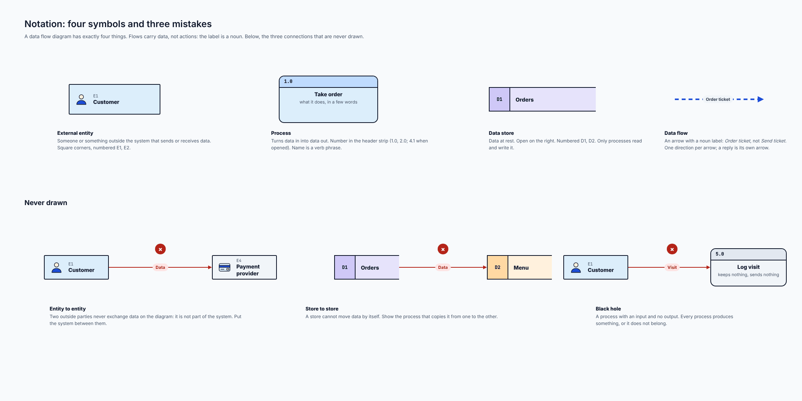
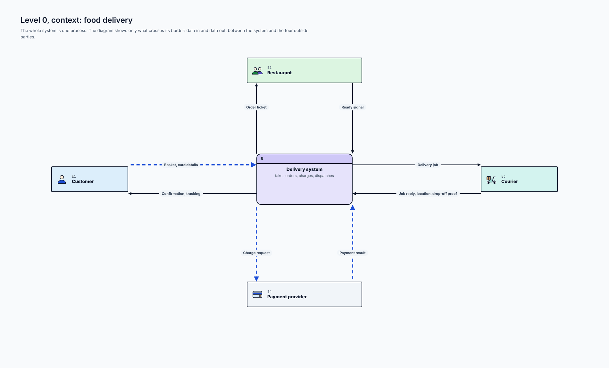
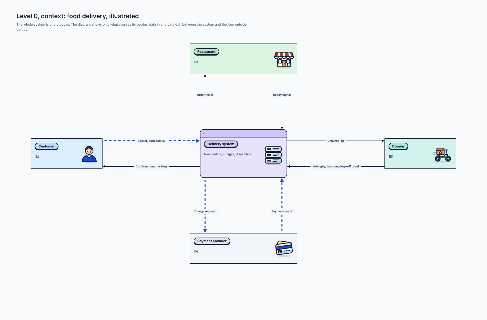
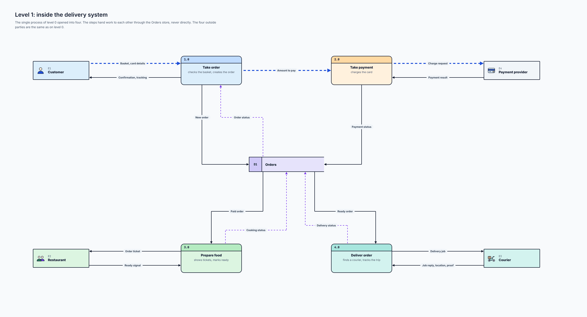
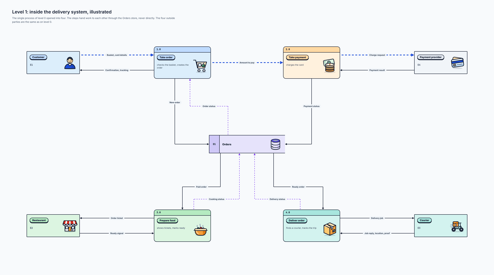
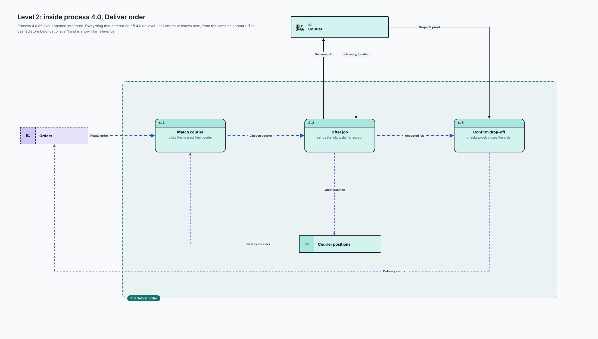
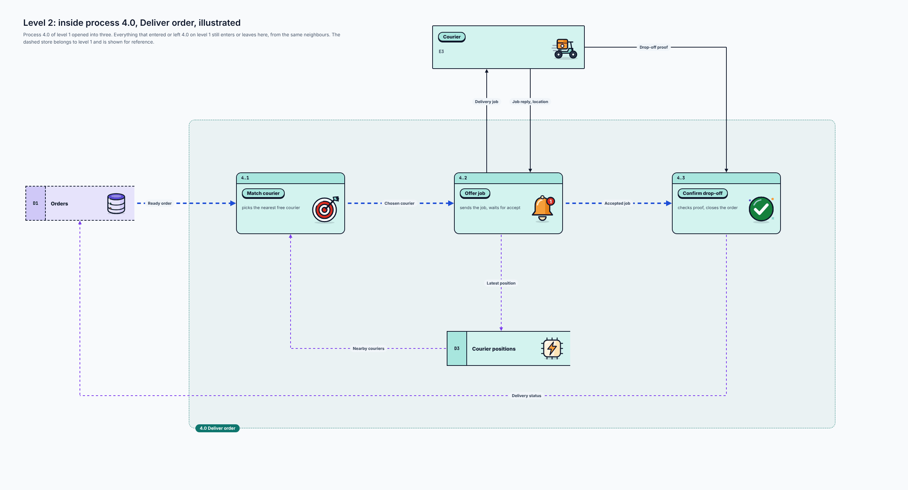
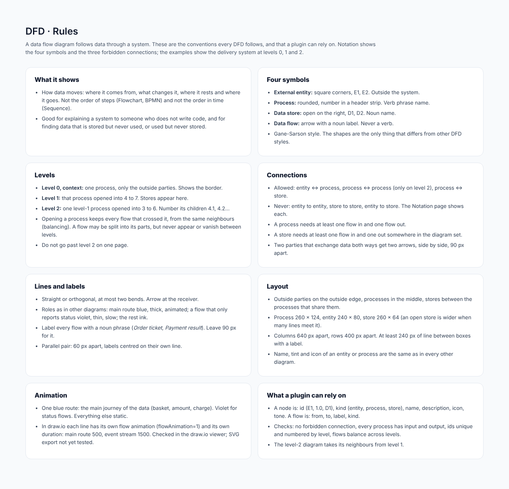

# Data flow diagram (DFD)

## At a glance

| | |
| --- | --- |
| **Question it answers** | How does data move through the system: where does it come from, what changes it, where does it rest, where does it go? |
| **Use it when** | Explaining a system to someone who does not write code, or hunting for data that is stored but never used, or used but never stored |
| **Do not use it when** | You want the order of steps or decisions ([flowchart](03-flowchart.md), [BPMN](11-bpmn.md)) or the order in time ([sequence](04-sequence.md)). A DFD shows *data*, not *control* |
| **Styles** | Plain and illustrated, at all three levels |
| **Boards** | 9: rules, notation, and levels 0, 1 and 2, each in two styles |

## 1. The four symbols

A data flow diagram has **exactly four kinds of thing**. The style used here is *Gane-Sarson*.

*Notation: four symbols and three mistakes. [Full size](images/DFD_Notation.png)*

| Symbol | Look | Meaning | Name |
| --- | --- | --- | --- |
| **External entity** | A box with **square corners**, numbered E1, E2 | Someone or something **outside** the system that sends or receives data | A noun: *Customer* |
| **Process** | A **rounded box** with its number in a header strip (1.0, 2.0; 4.1 when opened) | Turns data in into data out | A verb phrase: *Take order* |
| **Data store** | A box **open on the right**, with an id cell (D1, D2) | Data **at rest** | A noun: *Orders* |
| **Data flow** | An arrow with a **noun label** | Data on the move | A noun phrase: *Order ticket*, never *Send ticket* |

A flow goes one way. A reply is its own arrow, so two parties that exchange data both ways get **two arrows, side by side, 60 px apart**, each labelled.

## 2. What is never drawn

The Notation page shows three connections that are never allowed. A plugin should refuse them.

| Mistake | Why it is wrong | Fix |
| --- | --- | --- |
| **Entity to entity** | Two outside parties never exchange data *on the diagram*: it is not part of the system | Put the system between them |
| **Store to store** | A store cannot move data by itself | Show the process that copies it from one to the other |
| **Black hole** (a process with an input and no output) | Every process produces something, or it does not belong | Give it an output, or remove it |

Also: an entity never talks to a store directly (a process sits between them), and a process needs at least one flow in and one out.

## 3. Three levels

A DFD is drawn in levels, each opening one process of the level above.

| Level | What it shows |
| --- | --- |
| **0, context** | The whole system as **one process**, and only what crosses its border: data in and data out, between the system and the outside parties |
| **1** | That process opened into **4 to 7** processes. **Stores appear here** |
| **2** | One level-1 process opened into **3 to 6**. Its children are numbered 4.1, 4.2... |

**Balancing:** opening a process keeps **every flow that crossed it**, from the same neighbours. A flow may not appear or vanish between levels. Do not go past level 2 on one page.

### 3.1 Level 0: context

*Level 0, context: food delivery. [Full size](images/DFD_Context.png)*

The **Delivery system** is one process (`0`) in the middle. Four outside parties surround it: **Customer** (E1), **Restaurant** (E2), **Courier** (E3) and **Payment provider** (E4). Between the system and each party run **two arrows**, one each way:

| Party | Data in to the system | Data out of the system |
| --- | --- | --- |
| Customer | *Basket, card details* | *Confirmation, tracking* |
| Restaurant | *Ready signal* | *Order ticket* |
| Courier | *Job reply, location, drop-off proof* | *Delivery job* |
| Payment provider | *Payment result* | *Charge request* |

Blue marks the customer's journey and the card charge; the rest are ink. There are no stores, because a context diagram shows only the border.

*Level 0, context, illustrated. [Full size](images/DFD_Context_Illustrated.png)*

### 3.2 Level 1: inside the system

*Level 1: inside the delivery system. [Full size](images/DFD_Level1.png)*

The single process becomes **four**: **1.0 Take order**, **2.0 Take payment**, **3.0 Prepare food** and **4.0 Deliver order**. One store, **D1 Orders**, sits between them, and the four outside parties are the same as on level 0.

The central point: **the steps hand work to each other through the Orders store, never directly**.

- **1.0** receives *Basket, card details* from the Customer, sends back *Confirmation, tracking*, writes the *New order* to D1 and reads back the *Order status*. It passes the *Amount to pay* to **2.0**.
- **2.0** sends a *Charge request* to the Payment provider, receives the *Payment result* and writes the *Payment status* to D1.
- **3.0** reads the *Paid order* from D1, gives the Restaurant an *Order ticket*, receives a *Ready signal* and writes *Cooking status* back.
- **4.0** reads the *Ready order* from D1, sends the Courier a *Delivery job*, receives *Job reply, location, proof* and writes *Delivery status* back.

Blue is the main journey (basket, amount to pay, charge request); violet is the status flows that report back into the store.

*Level 1, illustrated. [Full size](images/DFD_Level1_Illustrated.png)*

### 3.3 Level 2: inside process 4.0

*Level 2: inside process 4.0, Deliver order. [Full size](images/DFD_Level2.png)*

Process **4.0 Deliver order** opens into three: **4.1 Match courier**, **4.2 Offer job** and **4.3 Confirm drop-off**. A dashed frame labelled *4.0 Deliver order* marks what was opened. The **dashed store** D1 Orders belongs to level 1 and is shown for reference.

Everything that entered or left 4.0 on level 1 still does, from the same neighbours:

- *Ready order* comes in from D1 and reaches 4.1.
- *Delivery job* goes out to the Courier from 4.2.
- The Courier's one level-1 flow, *Job reply, location, proof*, is **split into its parts**: *Job reply, location* arrives at 4.2 and *Drop-off proof* arrives at 4.3.
- *Delivery status* goes back to D1 from 4.3.

This is the rule called **balancing**: opening a process may split a flow into parts, but it may never invent a flow that was not there or drop one that was. (An earlier draft of this board drew a *Delivery receipt* to the Customer that level 1 did not have. Reading the boards side by side while writing this document found it, and it was removed; the Customer's labels on level 1 were also aligned with level 0.)

New at this level: a store **D3 Courier positions**, written by 4.2 (*Latest position*) and read by 4.1 (*Nearby couriers*). A store that exists only inside a process appears only when that process is opened.

*Level 2, illustrated. [Full size](images/DFD_Level2_Illustrated.png)*

## 4. The illustrated style

Entities, processes and stores become **cards with a name pill and a large detailed icon**; the number strip on processes and the id cell on stores are kept. Icons: Customer is a person, Restaurant a shop front, Courier a scooter, Payment provider a card; Take order a cart, Take payment money, Prepare food a pot, Deliver order a parcel, Match courier a target, Offer job a bell, Confirm drop-off a tick; Orders a database. Lines, labels and rules are the same as in the plain style. Boxes are larger, so the columns and rows are further apart.

## 5. Layout and spacing

- Outside parties on the outside edge, processes in the middle, stores between the processes that share them.
- **Process** 260 × 124, **entity** 240 × 80, **store** 260 × 64 (wider when many lines meet it); illustrated: process 300 × 170, entity 280 × 120, store 340 × 96.
- **Columns 640 px apart, rows 400 px apart.** At least 240 px of line between boxes that have a label.
- Lines are straight or orthogonal, with at most two bends, and the arrowhead is at the receiver.
- Name, tint and icon of an entity or process are the same as in every other diagram.

## 6. Colour and animation

**One blue route** per diagram: the main journey of the data (basket, amount, charge). **Violet** for flows that only report status. Everything else is static. In draw.io the two tiers use the animation recipe in [Foundations](01-foundations.md#63-animation-in-drawio).

## 7. Connections to other types

- A DFD **process** corresponds to a [flowchart](03-flowchart.md) step or a [BPMN](11-bpmn.md) task with the same name; a **store** corresponds to an [ER](05-er.md) table or a database container in [C4](12-c4.md).
- The idea of opening one box per level is shared with [C4](12-c4.md).
- Not covered: balancing checks are listed as a plugin check (below), not drawn.

## 8. What a plugin can rely on

- A **node** is: id (E1, 1.0, D1), kind (entity, process, store), name, description, icon, tone. A **flow** is: from, to, label and kind.
- **Checks the plugin should run:** no forbidden connection (entity to entity, store to store, entity to store); every process has at least one input and one output; ids unique and numbered by level; flows balance across levels.
- The level-2 diagram takes its neighbours from level 1.

## Reference: the rules board

*DFD: rules board. [Full size](images/DFD_Rules.png)*

#### What it shows

- How data moves: where it comes from, what changes it, where it rests and where it goes. Not the order of steps (Flowchart, BPMN) and not the order in time (Sequence).
- Good for explaining a system to someone who does not write code, and for finding data that is stored but never used, or used but never stored.

#### Four symbols

- **External entity:** square corners, E1, E2. Outside the system.
- **Process:** rounded, number in a header strip. Verb phrase name.
- **Data store:** open on the right, D1, D2. Noun name.
- **Data flow:** arrow with a noun label. Never a verb.
- Gane-Sarson style. The shapes are the only thing that differs from other DFD styles.

#### Levels

- **Level 0, context:** one process, only the outside parties. Shows the border.
- **Level 1:** that process opened into 4 to 7. Stores appear here.
- **Level 2:** one level-1 process opened into 3 to 6. Number its children 4.1, 4.2...
- Opening a process keeps every flow that crossed it, from the same neighbours (balancing). A flow may be split into its parts, but never appear or vanish between levels.
- Do not go past level 2 on one page.

#### Connections

- Allowed: entity ↔ process, process ↔ process (only on level 2), process ↔ store.
- Never: entity to entity, store to store, entity to store. The Notation page shows each.
- A process needs at least one flow in and one flow out.
- A store needs at least one flow in and one out somewhere in the diagram set.
- Two parties that exchange data both ways get two arrows, side by side, 90 px apart.

#### Lines and labels

- Straight or orthogonal, at most two bends. Arrow at the receiver.
- Roles as in other diagrams: main route blue, thick, animated; a flow that only reports status violet, thin, slow; the rest ink.
- Label every flow with a noun phrase (*Order ticket*, *Payment result*). Leave 90 px for it.
- Parallel pair: 60 px apart, labels centred on their own line.

#### Layout

- Outside parties on the outside edge, processes in the middle, stores between the processes that share them.
- Process 260 × 124, entity 240 × 80, store 260 × 64 (an open store is wider when many lines meet it).
- Columns 640 px apart, rows 400 px apart. At least 240 px of line between boxes with a label.
- Name, tint and icon of an entity or process are the same as in every other diagram.

#### Animation

- One blue route: the main journey of the data (basket, amount, charge). Violet for status flows. Everything else static.
- In draw.io each line has its own flow animation (flowAnimation=1) and its own duration: main route 500, event stream 1500. Checked in the draw.io viewer; SVG export not yet tested.

#### What a plugin can rely on

- A node is: id (E1, 1.0, D1), kind (entity, process, store), name, description, icon, tone. A flow is: from, to, label, kind.
- Checks: no forbidden connection, every process has input and output, ids unique and numbered by level, flows balance across levels.
- The level-2 diagram takes its neighbours from level 1.

